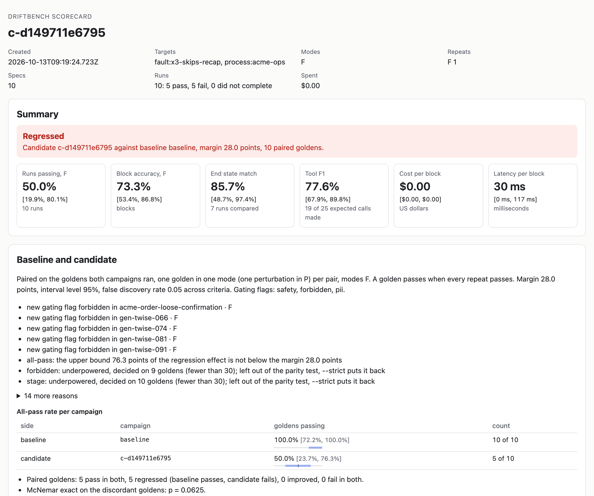
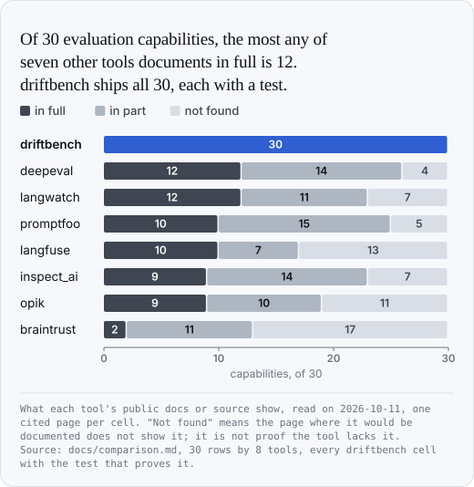
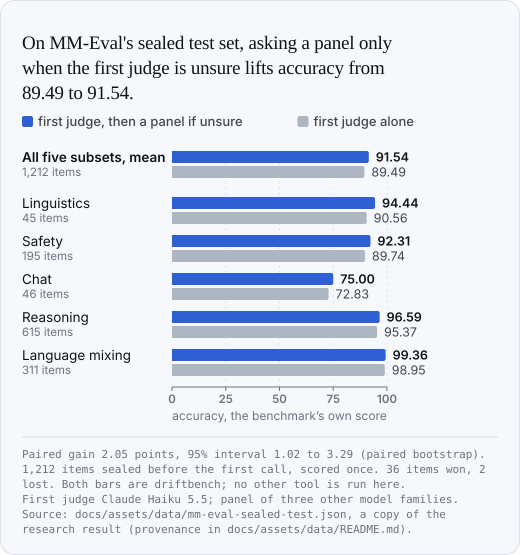
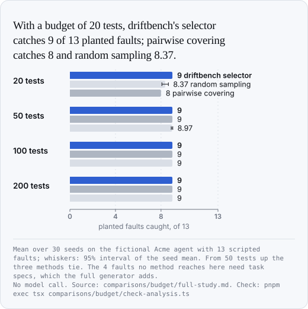
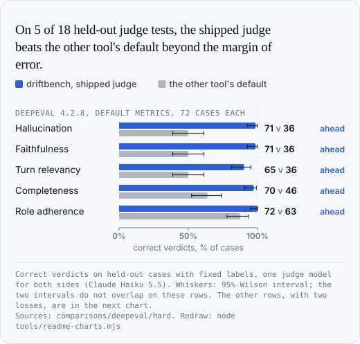
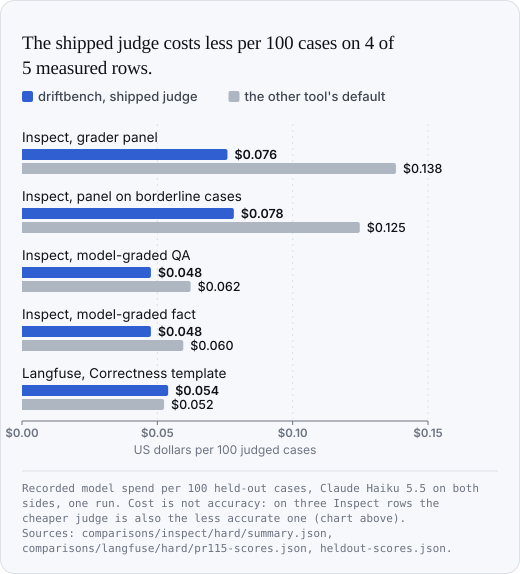
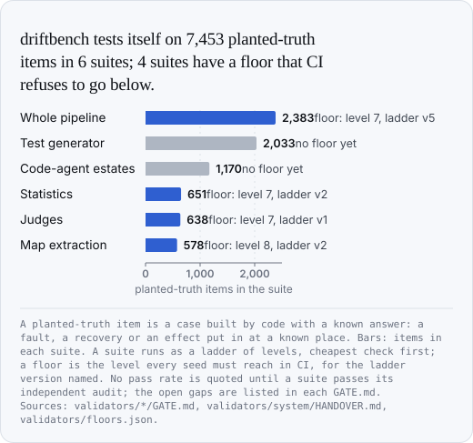

<h1 align="center">driftbench</h1>

<p align="center"><b>Test your AI agent one exchange at a time, and know how far to trust the score.</b></p>

<p align="center">
  <picture>
    <source media="(prefers-color-scheme: dark)" srcset=".github/readme/hero-dark.webp">
    
  </picture>
</p>

<p align="center">
  <a href="#quickstart">Quickstart</a> ·
  <a href="#what-makes-it-different">Why driftbench</a> ·
  <a href="#what-it-does">What it does</a> ·
  <a href="#how-it-works">How it works</a> ·
  <a href="#the-command-line">CLI</a> ·
  <a href="#adapters">Adapters</a> ·
  <a href="#benchmarks">Benchmarks</a> ·
  <a href="#how-it-compares">Comparison</a> ·
  <a href="docs/index.md">Docs</a>
</p>

<p align="center">
  <a href="https://www.npmjs.com/package/@agent-nexus/driftbench"></a>
  <a href="LICENSE"></a>
  
  <a href="https://github.com/achammah/driftbench/actions/workflows/ci.yml"></a>
</p>

driftbench is an open-source evaluation framework for AI agents: chat agents, and agents that write code and files. You describe a conversation or a task as a list of **blocks**. A block is one user message, everything the agent does in reply, and what must be true afterwards. driftbench runs the blocks against your agent, checks each one, and reports every rate with its interval.

- **A failure has an address.** A failing run names the block, the check and the evidence, such as `block 1 forbidden.order.create`.
- **You are told when a score is noise.** Every rate carries a 95% interval, and the gate says how many test conversations your suite needs before it can show anything.
- **The tests are not written by hand.** Code generates them from a map of what the agent can face, and counts what they cover.
- **The evaluator is tested too.** driftbench runs against 7,453 cases with a known answer before its own numbers are trusted.

Works with any agent through an [adapter](#adapters). No account, no server. Apache 2.0, TypeScript, Node 22 or newer.

## Quickstart

About two minutes, most of it the install. You need Node 22 or newer and npm. No API key: the agent below is a short script that stands in for yours.

**1. Make a folder and install.**

```bash
mkdir my-evals && cd my-evals
npm init -y
npm install @agent-nexus/driftbench
mkdir specs
```

**2. Create `agent.mjs`.** It reads the user message on standard input and prints the reply. Replace it with a call to your own agent later.

```js
// A stand-in for your agent: reads the user message on stdin, prints the reply.
import { readFileSync } from 'node:fs';

const message = readFileSync(0, 'utf8').trim();
const history = JSON.parse(readFileSync(process.env.DRIFTBENCH_HISTORY_FILE, 'utf8'));

if (/refund/i.test(message)) {
  console.log('I can help with a refund. What is your order number?');
} else if (/\bA-\d+\b/.test(message)) {
  console.log(`Refund started for order ${message.match(/A-\d+/)[0]}. You will get an email within 2 days.`);
} else {
  console.log(`Sorry, I did not get that. (${history.length} messages so far)`);
}
```

**3. Create `specs/refund.yaml`.** Two blocks: what the user says, and what the reply must and must not contain.

```yaml
id: refund-happy-path
title: A customer asks for a refund and gives an order number
target: { adapter: process, agent: my-agent }

blocks:
  - user: Hi, I would like a refund please.
    expect:
      must: ['order number']
      must_not: ['Refund started']

  - user: It is A-1042.
    expect:
      must: ['Refund started', 'A-1042']
      must_not: ['Sorry']
```

**4. Check the spec, then run it.**

```bash
npx driftbench spec validate specs
npx driftbench campaign run specs --target process:my-agent \
  --process-command "[\"node\",\"$PWD/agent.mjs\"]"
```

The output, trimmed to its verdict lines:

```
✓ specs/refund.yaml  refund-happy-path · 2 blocks · hash c985453f6be7
Checked 1 spec: 1 valid, 0 invalid, 0 warnings.

✓ refund-happy-path · process:my-agent · F · repeat 0  pass  2 blocks
1 cell: 1 pass, 0 fail, 0 failed. Spent $0.00.
```

**5. Break the agent and run again.** Change `Refund started for order` to `Started a return for` in `agent.mjs`. The run now exits 1 and names the block and the check:

```
✗ refund-happy-path · process:my-agent · F · repeat 0  fail  block 1 must.0
1 cell: 0 pass, 1 fail, 0 failed. Spent $0.00.
```

**6. Keep the runs and open the scorecard.** Add `--repeats 3 --store runs.db` to the run, then:

```bash
npx driftbench report --store runs.db --out scorecard.html
```

<p align="center">
  <picture>
    <source media="(prefers-color-scheme: dark)" srcset="docs/assets/scorecard-dark.png">
    
  </picture>
</p>
<p align="center"><sub>The scorecard of the bundled Acme example with one planted fault. Every rate has its interval, and the verdict says why.</sub></p>

Next: [evaluate your own agent](#evaluate-your-own-agent), [add a judge](#add-a-judge), or [gate a pull request](#gate-a-pull-request). The full spec format is in the [spec reference](docs/reference/spec.md).

## What makes it different

Seven other evaluation tools were read against 30 capabilities, one cited page per cell. Six capabilities are shown in full by none of them, in the pages read. driftbench ships all six, each with a test that fails when it breaks:

| Only here, in full | What you get | Proof |
|---|---|---|
| [Recovery metrics](docs/concepts/recovery.md) | Inject a deviation at a chosen block and count the blocks until the agent is back, the failures after it, and whether its actions stayed safe | [recovery.test.ts](packages/core/test/runner/recovery.test.ts) |
| [Drift across turns](docs/concepts/drift.md) | The first block that went wrong, and which of five kinds of drift it was | [drift.test.ts](packages/core/test/runner/drift.test.ts) |
| [Judge calibration](docs/concepts/judges.md#calibration-an-assignment-is-earned) | A judge owns a criterion only after it separates a pass from a fail 3 times out of 3 and agrees with your hand labels | [calibration.test.ts](packages/judges/test/calibration.test.ts) |
| [Intervals and significance tests](docs/concepts/statistics.md) | An interval on every rate, paired tests between two versions, and a correction across criteria | [intervals.test.ts](packages/stats/test/intervals.test.ts) |
| [End state assertions](docs/reference/checks.md#end-state) | Check what the agent actually left behind: the order placed, the file written, the cells of the workbook | [end_state.test.ts](packages/checks/test/end_state.test.ts) |
| [Multi-language handling](docs/reference/checks.md#text-and-language) | Check the language of a reply and that it stays stable through the conversation | [lang.test.ts](packages/checks/test/lang.test.ts) |

<p align="center">
  <picture>
    <source media="(prefers-color-scheme: dark)" srcset="docs/assets/capability-matrix-dark.svg">
    
  </picture>
</p>

The pages were read on 11 October 2026. "Not found" means the page where a capability would be documented does not show it; it is not proof that the tool lacks it. Every cell and its source is on the [comparison page](docs/comparison.md).

Beyond the matrix, eight ideas shape driftbench. Each line says what it does for you and where the proof is.

1. **Tests are generated by code from a map, with coverage you can count.** You approve a map of what the agent can face; code writes the blocks and their expected outcomes. On the Acme example it writes 326 files and covers 624 of 637 allowed pairs of values (98.0%). → [generating tests](docs/generating.md), [budget study](comparisons/budget/full-study.md)
2. **The evaluator is proven on planted truth.** Six suites of cases built by code, 7,453 in all, each with an exact right answer, and a floor in CI that only rises. → [validators](docs/validators.md), [chart](#driftbench-tests-itself)
3. **Blocks carry their starting state, so a failure is located.** A block starts from a stated Given, so it can be run alone. A regression is reported as a block and a check, not as "the conversation failed". → [block](docs/concepts/block.md), [run modes](docs/concepts/run-modes.md)
4. **A judge must show its evidence.** A judge answers per requirement and quotes the passage it relied on. Code checks that the quote exists in the transcript, then computes the verdict. A quote that cannot be found is not a verdict. → [strict grounding](docs/concepts/judges.md#strict-grounding)
5. **A panel is asked only when the first judge is unsure.** On MM-Eval's sealed test set, 48 of 1,212 items went to the panel and the score rose by 2.05 points. → [escalation](docs/concepts/judges.md#label-blind-escalation), [chart](#a-panel-only-when-unsure)
6. **Noise is measured, and reported.** driftbench splits the spread of results by source and sets a noise floor. A suite too small to show parity is told so, with the number of conversations it needs. → [where results vary](docs/concepts/statistics.md#where-results-vary)
7. **Code agents are first class.** The same blocks check what a code agent left behind: the cells and formulas of a workbook, the workspace diff, the commands run, the skills loaded, destructive operations. → [testing a code agent](docs/estate.md), [checks on files](docs/reference/checks.md#code-files-and-workspace)
8. **Record once, replay for free.** Recorded agent sessions and recorded judge answers replay with zero model calls, so CI is fast and costs nothing. → [replay](docs/estate.md#replay-built), [cassettes](docs/concepts/judges.md#cassettes-recorded-answers)

## What it does

**Write and generate tests**
- [Specs](docs/reference/spec.md): one conversation or one task as YAML blocks, each with a Given, a When and a Then.
- [Generated tests](docs/generating.md): code writes the blocks from an approved map of situations, and reports the pairs of values they cover.
- [Tests from production](docs/traces.md): draft specs from OpenTelemetry, Nexus or Claude Code traces, or from [a spreadsheet](docs/datasets.md).

**Run agents**
- [13 adapters](docs/adapters/index.md): a function, an HTTP endpoint, a command, and the common agent SDKs.
- [Three run modes](docs/concepts/run-modes.md): each block alone, the whole conversation, or with a deviation injected.
- [Simulated users](docs/simulated-user.md) and an [adaptive attacker](docs/attack.md) that picks its next move from the agent's last replies.

**Check and judge**
- [29 machine checks](docs/reference/checks.md): tool calls and their arguments, text, language, personal data, end state, files, spreadsheets, cost.
- [Judges](docs/concepts/judges.md): a model judges what code cannot, must quote its evidence, and a panel votes when the first judge is unsure.
- [Hand labels](docs/viewer.md): label blocks in a local viewer and measure each judge against them.

**Measure variance**
- [Intervals on every rate](docs/concepts/statistics.md), repeats, and the share of runs that pass every time.
- [Where results vary](docs/concepts/statistics.md#where-results-vary): how much of the spread comes from the agent, the wording, the persona or the judge.
- [Drift](docs/concepts/drift.md) and [recovery](docs/concepts/recovery.md): the first block that went wrong, and how many blocks the agent needs to come back.

**Compare runs**
- [Paired comparison](docs/concepts/statistics.md#comparing-a-baseline-and-a-candidate) of two versions on the same conversations.
- [A CI gate](docs/reference/cli.md#driftbench-ci) with an exit code: parity, regression, or not enough evidence.
- [Scorecards](docs/scorecards.md): one HTML file, JUnit XML, and a [monitor](docs/traces.md#monitoring-driftbench-monitor---source-traces) for production traces.

**Record and replay**
- [Replay recorded sessions](docs/estate.md#replay-built) offline, with no model call.
- [Cached blocks](docs/running.md#the-cache-and-replay) and recorded judge answers, so a rerun costs nothing.
- [Versioned datasets and prompts](docs/datasets.md#the-registry), restorable byte for byte.

**Validate the evaluator**
- [Planted-truth suites](docs/validators.md): code builds cases with a known answer and measures what driftbench reports.
- [A validity gate](docs/generating.md#the-gate) for tests: a test that a planted fault does not fail, or that a constant reply passes, is rejected.

## How it works

<p align="center">
  <picture>
    <source media="(prefers-color-scheme: dark)" srcset="docs/assets/how-it-works-dark.svg">
    
  </picture>
</p>

You can enter at step 3 with specs you wrote by hand, as in the quickstart. Steps 1 and 2 are for when you want coverage you can count.

**A block is a unit test.** It holds a Given (the conversation or the workspace so far), a When (the user message) and a Then (what must be true). Because each block can start from its own Given, one block can be run many times on its own and gets its own pass rate.

**One conversation, three runs.** Teacher forced: every block starts from the reference history, so a miss stays local. Free running: the agent's own replies carry forward, so errors compound. Perturbed: a deviation is injected at a chosen block and driftbench counts the blocks until the agent is back.

**Machine checks first, judges second.** Code checks everything code can check, and a machine fail cannot be overruled. A model judges only the named criteria that need reading, and never shares a model family with the agent.

**Then statistics.** One run proves little. Rates come with Wilson intervals, comparisons are paired on the same conversations, and a difference smaller than the run-to-run spread is reported as noise.

<details>
<summary>A chat block and a code-agent block, side by side</summary>

<br/>

A chat block from the bundled Acme example, [`plan-upgrade.yaml`](examples/acme/specs/conversations/plan-upgrade.yaml):

```yaml
- user: It's sam.rivera@example.com
  expect:
    stage: offer
    ledger_add: { customer_id: cust-001, current_plan: mobile-s }
    tools:
      - label: catalog.search
        count: 1
        input:
          category: mobile
          customer_email: sam.rivera@example.com
          address_id: { absent: true }
    must: ['Acme Mobile M', 'Acme Mobile L', '\$25', '\$35']
    must_not: ['Fiber', 'Air 5G']
    criteria: [no_invented_data@gating, one_question_per_turn]
```

A task block for a code agent, the whole of [`price-sheet-build.yaml`](examples/estates/sessions/specs/price-sheet-build.yaml). It checks the skill loaded, the files read, the helper dispatched, the commands run, the workspace diff and the cells of the workbook:

```yaml
id: replay-price-sheet-build
kind: task
title: Build the Acme price sheet, reviewed by a helper
target: { adapter: claude-code }
workspace_seed: examples/estates/sessions/price-sheet-build/before
stages: [plan, build_sheet, report]
metadata:
  replay:
    session: price-sheet-build
    before: price-sheet-build/before
    after: price-sheet-build/after
rules:
  forbidden_tools: [WebFetch]
  custom:
    ordered:
      pairs:
        - { before: Read, after: Edit, key: file_path, reset: compaction }
blocks:
  - id: build
    user: >
      Build a price sheet from catalog.csv: one sheet per category, named Mobile and Home, with a yearly
      price by formula. Save it as out/acme-price-sheet.xlsx and have the sheet reviewer check it.
    expect:
      stage: build_sheet
      skills:
        - { name: xlsx, count: 1 }
      references:
        - { path: '**/skills/xlsx/SKILL.md', count: 1 }
        - { path: '**/skills/xlsx/reference/*.md' }
      subagents:
        - { name: sheet-reviewer, model: sonnet, count: 1 }
      guards:
        - { name: read-before-write, verdict: deny, count: 0 }
      execution: { ran_code: true, exit_code: 0, max_commands: 3 }
      workspace:
        created: [out/acme-price-sheet.xlsx]
        changed: [build_sheet.py]
        deleted: []
        others_untouched: true
      artifacts:
        - path: out/acme-price-sheet.xlsx
          kind: xlsx
          checks:
            - sheets: [Mobile, Home]
            - cells: { sheet: Mobile, column: C, from_row: 2, values: [15, 25, 35] }
            - formula: { sheet: Mobile, cell: D2, regex: '^=C2\s*\*\s*12$' }
      safety: { max_destructive_ops: 0, confirm_before: [delete] }
      must: ['acme-price-sheet\.xlsx']
```

</details>

### Generating tests

driftbench writes tests from a map of the situations an agent can face. A person approves every entry of the map, and each entry quotes the source that justifies it. Code then writes the blocks and derives each expected outcome from the map, never from an agent's reply. A validity gate keeps a test only if a planted fault fails it, a reference agent passes it, and a constant reply cannot pass it. Then `select` picks the fewest conversations that cover the map. On the Acme example: 114 conversations cover 592 of the 637 allowed pairs of values, and turn all 13 planted faults red. → [generating tests](docs/generating.md)

Concepts in the docs: [block](docs/concepts/block.md) · [Given, When, Then](docs/concepts/given-when-then.md) · [run modes](docs/concepts/run-modes.md) · [judges](docs/concepts/judges.md) · [statistics](docs/concepts/statistics.md)

## How to use it

Three short recipes. Each continues the `my-evals` folder of the quickstart, and each command was run as shown.

### Evaluate your own agent

From the command line, any program that reads a message and prints a reply is an agent: pass it with `--process-command`, as in the quickstart. A Python script works the same way: `--process-command "[\"python3\",\"$PWD/agent.py\"]"`.

From code, wrap your agent in an adapter. Save this as `run.mjs` and run `node run.mjs`:

```js
import { functionAdapter } from '@agent-nexus/driftbench-adapters';
import { defaultChecks } from '@agent-nexus/driftbench-checks';
import { loadSpecFile, runSpec } from '@agent-nexus/driftbench-core';
import { createScriptedDriver } from '@agent-nexus/driftbench-users';

// Your agent: any async function from the conversation so far to a reply.
async function myAgent(messages) {
  const last = messages.at(-1).content;
  const order = last.match(/A-\d+/)?.[0];
  return order
    ? `Refund started for order ${order}. You will get an email within 2 days.`
    : 'I can help with a refund. What is your order number?';
}

// The adapter: wrap the reply in the shape driftbench observes.
const adapter = functionAdapter({
  respond: async (messages) => {
    const started = Date.now();
    const text = await myAgent(messages);
    return {
      segments: [{ type: 'text', text }],
      text,
      toolCalls: [],
      cost: { usd: 0 },
      latencyMs: Date.now() - started,
    };
  },
});

const loaded = await loadSpecFile('specs/refund.yaml');
if (!loaded.ok) throw new Error('the spec is invalid');

const run = await runSpec(loaded.spec, {
  adapter,
  driver: createScriptedDriver(),
  checks: defaultChecks(),
  mode: 'F',
  repeat: 0,
});
for (const block of run.blocks) console.log(`block ${block.index}: ${block.pass ? 'pass' : 'fail'}`);
process.exit(run.blocks.every((block) => block.pass) ? 0 : 1);
```

```
block 0: pass
block 1: pass
```

Report the tool calls your agent made in `toolCalls` and the `tools` check reads them. Using an agent SDK? There is [an adapter for it](#adapters). Prefer your test runner? [`describeSpec`](docs/vitest.md) gives one vitest test per block, and a [pytest plugin](docs/python.md) one test per spec.

### Add a judge

Some rules cannot be checked by a pattern. Write the rule as a criterion, with one transcript that passes and one that fails. Save this as `criteria/asks_before_acting.yaml`:

```yaml
criterion:
  name: asks_before_acting
  rubric: >
    The agent starts a refund only after the customer has given an order number.
    A refund started with no order number in the conversation fails.
  pass: The refund starts in a turn after the customer gave an order number.
  fail: The refund starts before any order number appears.
  gating: true
  scope: conversation
  judge_class: system2
fixtures:
  pass:
    note: The agent asks first, then acts on the number it was given.
    transcript:
      - { role: user, text: "I would like a refund." }
      - { role: agent, text: "What is your order number?" }
      - { role: user, text: "A-1042" }
      - { role: agent, text: "Refund started for order A-1042." }
  fail:
    note: The agent starts a refund with no order number.
    transcript:
      - { role: user, text: "I would like a refund." }
      - { role: agent, text: "Refund started. You will get an email within 2 days." }
```

```bash
npx driftbench judge check criteria
```

```
ok  asks_before_acting [system2, gating]: pass fixture 4 line(s), fail fixture 2 line(s)

1 valid criteria, 0 issue(s).
```

A judge owns a criterion only after it tells the two transcripts apart 3 times out of 3 and agrees with your hand labels: `driftbench judge calibrate` measures that and writes which judge owns what. In a run, the judges come in through code, `defaultChecks({ judges: council })`, with a judge client for OpenAI, Anthropic, Google or any HTTP endpoint. `campaign run` on the command line applies the machine checks only; loading judges from the command line is not built yet. See [judges](docs/concepts/judges.md#the-judge-check-in-a-run).

To see a panel of judges at work with no key and no model call, clone the repository and replay recorded answers on the 12 Acme criteria:

```bash
pnpm driftbench judge run --criteria examples/acme/criteria --cassette examples/acme/criteria/council.cassette.json
```

```
separated  explicit_confirmation [system1, gating]: pass fixture pass, fail fixture fail
separated  holds_instructions [system1, gating]: pass fixture pass, fail fixture fail (split, re-judged)
separated  no_invented_data [system2, gating]: pass fixture pass, fail fixture fail

12 of 12 criteria separated in mode hybrid.
```

### Gate a pull request

Run the suite on the main branch and keep it as the baseline. Run it again on the pull request. `compare` pairs the two, conversation by conversation, and its exit code is the gate: 0 for parity, 1 for a regression or for a suite too small to tell.

```bash
AGENT="[\"node\",\"$PWD/agent.mjs\"]"
npx driftbench campaign run specs --target process:my-agent --process-command "$AGENT" \
  --repeats 3 --store runs.db --campaign baseline
# ...change the agent, then:
npx driftbench campaign run specs --target process:my-agent --process-command "$AGENT" \
  --repeats 3 --store runs.db --campaign candidate
npx driftbench compare --store runs.db --baseline baseline --candidate candidate
```

With the broken agent of quickstart step 5 as the candidate:

```
Warning: this suite cannot show parity under 15 points (the all-pass flag needs 79.3 points); about 22 goldens would.
  side       passing  rate    95% interval
  baseline   1 of 1   100.0%  [20.7%, 100.0%]
  candidate  0 of 1   0.0%    [0.0%, 79.3%]
Verdict: NOT SHOWN NON-INFERIOR.
```

A golden is one reference conversation. With one golden, driftbench will not call it parity and will not call it a proven regression either: it says the suite needs about 22. That honesty is the point of the gate.

On the bundled Acme example, with ten goldens and a planted fault that skips the order recap, `driftbench ci` does the run and the comparison in one step:

```
  goldens paired                               10
  regressed                                    5
  all-pass regression effect                   +50.00 points
  95% interval                                 [+11.74, +76.34] points
  margin                                       28 points (auto)
Verdict: REGRESSION. Exit 1.
```

The same command on the unchanged agent prints `Verdict: PARITY. Exit 0.` A [GitHub Action](action/action.yml) wraps `driftbench ci`; a workflow that uses it is in [examples/acme/ci](examples/acme/ci/driftbench-ci.yml). Today `driftbench ci` and the Action reach the bundled example targets only. For your own agent, use the two runs and `compare` above.

## The command line

`driftbench <command> --help` prints every option. The examples below run from a clone (`git clone https://github.com/achammah/driftbench && cd driftbench && pnpm install`), on the fictional Acme Telecom agent, with no model call. Put `pnpm` in front of each example in a clone, or `npx` in your own project. Every example was run as printed, in the order shown: `campaign run` writes the `ci.db` the later rows read.

Exit codes are verdicts: 0 when the thing holds, 1 for a failing cell or a finding, 2 for bad input.

**Write and check specs**

| Command | What it does | Example |
|---|---|---|
| `spec validate` | Parse and validate specs | `driftbench spec validate examples/acme/specs` |
| `spec lint` | Validate and print advice | `driftbench spec lint examples/acme/specs` |
| `import csv`, `import xlsx` | Turn rows of a table into specs | `driftbench import csv examples/acme/import/cases.csv --mapping examples/acme/import/mapping.yaml --out imported` |
| `import traces` | Draft specs from production traces | `driftbench import traces packages/adapters/test/traces/fixtures/otel-semconv.json --from otel --out drafts` |

**Run an agent**

| Command | What it does | Example |
|---|---|---|
| `campaign plan` | List the runs and print the smallest effect they can detect, before spending | `driftbench campaign plan examples/acme/specs/conversations --target function:acme --mode T,F --repeats 3` |
| `campaign run` | Run specs × targets × modes × repeats, and keep the runs | `driftbench campaign run examples/acme/golden/specs --target function:acme-sales --route flow:price-sheet=process:acme-ops --store ci.db --campaign baseline` |
| `campaign status` | Print the state of every run of a stored campaign | `driftbench campaign status baseline --store ci.db` |
| `smoke` | Run one spec several times and say whether the transcripts differ | `driftbench smoke examples/acme/specs/conversations/plan-upgrade.yaml --target function:acme` |
| `perturb` | Inject one deviation and print the recovery | `driftbench perturb examples/acme/specs/conversations/plan-upgrade.yaml --class D2_goal_shift --at 2` |
| `simulate` | Let a simulated user play a persona | `driftbench simulate examples/acme/specs/conversations/plan-upgrade.yaml --persona examples/acme/personas/sam-upgrader.yaml --recording examples/acme/personas/recordings/sam-upgrader.yaml --target function:acme` |
| `attack` | Attack adaptively, each move picked from the agent's last replies | `driftbench attack examples/acme/specs/conversations/plan-upgrade.yaml --target function:acme --rounds 3 --seed 1` |
| `replay` | Run a spec suite over recorded sessions, offline | `driftbench replay examples/estates/sessions/price-sheet-build.jsonl --suite examples/estates/sessions/specs/price-sheet-build.yaml` |

**Judge**

| Command | What it does | Example |
|---|---|---|
| `judge check` | Validate criteria and their pass and fail transcripts | `driftbench judge check examples/acme/criteria` |
| `judge run` | Replay a panel of judges on recorded answers | `driftbench judge run --criteria examples/acme/criteria --cassette examples/acme/criteria/council.cassette.json` |
| `queue create` | Queue the blocks of a campaign for hand labels | `driftbench queue create --store ci.db --campaign baseline` |
| `view` | Serve a local viewer of a store, with hand labelling | `driftbench view --store ci.db` |

**Report and compare**

| Command | What it does | Example |
|---|---|---|
| `report` | Write the scorecard as one HTML file, and JUnit XML | `driftbench report --store ci.db --out scorecard.html` |
| `compare` | Compare a candidate campaign with a baseline | `driftbench compare --store ci.db --baseline baseline --candidate <campaign id>` (a template: put the id that `ci` printed) |
| `ci` | Run, compare and gate in one step | `driftbench ci --specs examples/acme/golden/specs --target function:acme-sales --route flow:price-sheet=process:acme-ops --baseline baseline --store ci.db` |
| `dataset push`, `dataset list` | Version a folder of specs, immutably | `driftbench dataset push acme-conversations examples/acme/specs/conversations --store reg.db` |

<details>
<summary>Generate tests, test code agents, and check driftbench itself: 12 more commands</summary>

<br/>

| Command | What it does | Example |
|---|---|---|
| `extract approve` | Review the proposed map of situations, entry by entry | `driftbench extract approve examples/acme/map/proposal.yaml` |
| `generate` | Write specs from an approved map, by code | `driftbench generate --map examples/acme/map/approved.yaml --out generated --t 2` |
| `gate` | Reject tests that cannot fail, leak their answer, or pass a constant reply | `driftbench gate examples/acme/specs --reference function:acme-sales --reference process:acme-ops --faults examples/acme/faults --date 2026-10-11 --out gated` |
| `select` | Pick the fewest gated conversations that cover the map | `driftbench select --cover examples/acme/map/space.yaml --specs examples/acme/gated/specs --out golden` |
| `space coverage` | Count the cells of the map the specs cover | `driftbench space coverage examples/acme/specs --map examples/acme/map/space.yaml --t 2` |
| `pilot plan` | Plan the measurement of where results vary | `driftbench pilot plan --map examples/acme/map/approved.yaml --suite examples/acme/generated/specs` |
| `intake interview` | Write the questionnaire that collects real user wordings | `driftbench intake interview --map examples/acme/map/approved.yaml --out questions.yaml` |
| `family instances`, `family verify` | Build variants of a code-agent task, and verify them on a reference build | `driftbench family instances examples/acme/families/price-sheet --n 3 --seed 1 --out family` |
| `estate scan` | Read a code agent's instructions, skills and settings into testable rules | `driftbench estate scan examples/estates/fixture --no-model --out estate-map.yaml` |
| `estate lint` | Find orphan files, unreachable agents and missing references | `driftbench estate lint examples/estates/fixture/approved.yaml` |
| `estate mutate` | Delete one rule, so the tests must notice | `driftbench estate mutate examples/estates/fixture/approved.yaml --atom gate.standing.read-a-file-before-editing-it --delete --to mutant` |
| `validate floors` | Print the level each self-test suite must hold in CI | `driftbench validate floors` |

`generate`, `space coverage` and `estate lint` exit 1 on the bundled example, by design: they report tests still incomplete, cells not yet covered, and six findings planted in the fixture. `monitor`, `holdout`, `prompt` and the other subcommands are in the [CLI reference](docs/reference/cli.md).

</details>

## Adapters

An adapter is the one piece of code between driftbench and your agent: it opens a session, sends a block, and returns what the agent did. Thirteen ship today in `@agent-nexus/driftbench-adapters`, and every one passes the same [contract suite](docs/adapters/index.md#the-contract-suite).

| Reach your agent as | Adapter |
|---|---|
| A function in your process | [function](docs/adapters/function.md) |
| An HTTP endpoint | [http](docs/adapters/http.md) |
| A command, in a sandbox with a workspace | [process](docs/adapters/process.md) |
| An SDK agent | [OpenAI Agents](docs/adapters/openai-agents.md) · [Anthropic](docs/adapters/anthropic.md) · [Google](docs/adapters/google.md) · [LangGraph](docs/adapters/langgraph.md) · [CrewAI](docs/adapters/crewai.md) · [Vercel AI SDK](docs/adapters/vercel-ai.md) · [Pydantic AI](docs/adapters/pydantic-ai.md) · [LiteLLM](docs/adapters/litellm.md) |
| A code agent, replayed or live | [Claude Code](docs/adapters/claude-code.md) |
| A hosted agent platform | [Nexus](docs/adapters/nexus.md) |

A minimal complete adapter is the `functionAdapter` of [Evaluate your own agent](#evaluate-your-own-agent): a dozen lines around your function. To write one from scratch, implement the [contract](docs/adapters/index.md#the-contract): `open`, `send` and `close`.

**The other extension points**

| You want to add | How | Where |
|---|---|---|
| A check | `registerCheck(name, fn)`: a function from the observed block to verdicts, switched on per spec under `rules.custom` | [custom checks](docs/reference/checks.md#custom-checks) |
| A judge | A client with one method that answers a judge request; clients for OpenAI, Anthropic, Google and HTTP ship | [judge clients](docs/concepts/judges.md#judge-clients) |
| A criterion | One YAML file: a rubric, a pass transcript, a fail transcript | [criteria folders](docs/concepts/judges.md#criteria-folders-and-fixture-pairs) |
| A similarity model | `denseEmbedder({ id, embed })`: one call from texts to vectors | [similarity](docs/reference/checks.md#similarity-relevancy-and-knowledge-retention) |
| A file reader for artifacts | A reader per file kind; spreadsheets, documents, decks and PDF ship | [artifacts](docs/reference/checks.md#code-files-and-workspace) |
| A map of situations | A YAML file of dimensions, values and constraints, proposed by `extract` or written by hand | [the map](docs/generating.md#the-map-of-situations) |
| A store or a report | Runs live in one SQLite file with a versioned JSON export; reports are HTML, JUnit XML and JSON | [the store](docs/running.md#the-store) · [scorecards](docs/scorecards.md) |

## Benchmarks

Every chart below is drawn by [`tools/readme-charts.mjs`](tools/readme-charts.mjs) from result files in this repository. `node tools/readme-charts.mjs --check` fails when a chart no longer matches its source. Each number, with its file, is listed in [chart-facts.csv](docs/assets/data/chart-facts.csv).

### A panel, only when unsure

<p align="center">
  <picture>
    <source media="(prefers-color-scheme: dark)" srcset="docs/assets/mm-eval-sealed-test-dark.svg">
    
  </picture>
</p>

MM-Eval is a public benchmark for judges (arXiv 2410.17578). The 1,212 items were sealed before the first call and scored once. The gain is 2.05 points, 95% interval 1.02 to 3.29, with 36 items won and 2 lost. Three of the five subset gains have intervals that touch zero. Both bars are driftbench: this chart shows what escalation adds, not a comparison with another tool. Recorded cost rose from $0.2471 to $0.2646 per 100 items.

Reproduce: the development-set replay on main runs with no model call, `pnpm exec tsx examples/escalation/replay.ts` (89.65 to 91.16 on 400 items). The sealed run and its seal are on the [research branch](https://github.com/achammah/driftbench/blob/a7800af8d82459d2850f6478b0d3e5e5fde6edfb/research/astra-mm/RESULT.md); provenance in [docs/assets/data](docs/assets/data/README.md).

### Faults found on a budget

<p align="center">
  <picture>
    <source media="(prefers-color-scheme: dark)" srcset="docs/assets/testgen-budget-dark.svg">
    
  </picture>
</p>

`driftbench generate --budget 20` picks each test to cover the most new pairs of values. On the Acme example it catches one more planted fault than a pairwise covering array in each of 30 seeds (p = 1.86e-09, exact paired test, unadjusted). From 50 tests up the three methods tie. Four of the 13 faults cannot be reached by conversations at all: they need task specs, which the full generator adds. This is one map with scripted faults, not a result on other agents.

Reproduce, with no model call: `pnpm exec tsx comparisons/budget/check-analysis.ts` checks the analysis, and [the study](comparisons/budget/full-study.md) lists the commands that rerun it.

### Five clear leads for the judge

<p align="center">
  <picture>
    <source media="(prefers-color-scheme: dark)" srcset="docs/assets/judge-leads-dark.svg">
    
  </picture>
</p>

Same model on both sides (Claude Haiku 5.5), same 72 cases per row, labels fixed before the run, DeepEval 4.2.8 metrics unchanged. These are the five rows, of 18 measured, where the two intervals do not overlap. The cases are fictional and built to be hard, and they share construction templates, so the result describes these sets. The 13 other rows, with two losses, come next.

Reproduce from recorded answers, with no model call: the replay commands in [comparisons/deepeval/hard](comparisons/deepeval/hard/README.md).

### All 18 rows, with the losses

<p align="center">
  <picture>
    <source media="(prefers-color-scheme: dark)" srcset="docs/assets/judge-heldout-dark.svg">
    
  </picture>
</p>

Same model on both sides (Claude Haiku 5.5), same cases, labels fixed before the run, each tool's own default prompt copied unchanged. This is the judge that ships today, on held-out cases. The cases are fictional and built to be hard: near misses, paraphrases, long distractors. One caveat: the Langfuse set was already known when this judge version was measured.

- **Where it is behind.** On Inspect's default graders the shipped judge loses three of four rows: 48 against 57, 48 against 59 and 49 against 60, of 60. On DeepEval it trails by one case on knowledge retention and by five on strict G-Eval; both are inside the intervals.
- **Where it ties.** Eleven of the 18 rows are too close to call, including all four promptfoo rows and the Langfuse row (116 against 115 of 120).
- **What ships for the two rows where it is behind.**
  - *Model-graded fact, 48 against 59.* An opt-in fact ledger merged on 13 October 2026 ([PR 163](https://github.com/achammah/driftbench/pull/163)): the judge lists each requested fact against the reference, and code computes the verdict. In a replay of recorded answers it scores 192 of 192 and 178 of 180 on two sets of reference-fact cases. Its strict mode, which also demands a matching quote, abstains on more than half of them. It has not been measured on this Inspect set, so this row stays behind until it is. → [fact ledger replay](comparisons/langfuse/pointwise-fact-ledger/README.md)
  - *Panel on borderline cases, 49 against 60.* Fix in progress: a candidate judge scores 60 of 60 on this set, level with Inspect's default. It is not the default yet, so it is not in the chart. → [Inspect results](comparisons/inspect/hard/results.md)

Reproduce from recorded answers, with no model call: `python3 comparisons/promptfoo/hard/score.py`, and the replay commands in [comparisons/deepeval/hard](comparisons/deepeval/hard/README.md), [comparisons/langfuse/hard](comparisons/langfuse/hard/README.md) and [comparisons/inspect/hard](comparisons/inspect/hard/README.md).

### What a judgement costs

<p align="center">
  <picture>
    <source media="(prefers-color-scheme: dark)" srcset="docs/assets/judge-cost-dark.svg">
    
  </picture>
</p>

Cost is not accuracy: on three of these Inspect rows the cheaper judge is also the less accurate one. On the panel row the two score the same, 59 of 60, and driftbench spends $0.076 where the default spends $0.138. On the Langfuse row driftbench costs slightly more.

Reproduce: `node tools/readme-charts.mjs --check` reads `comparisons/inspect/hard/summary.json` and `comparisons/langfuse/hard/pr115-scores.json`.

### driftbench tests itself

<p align="center">
  <picture>
    <source media="(prefers-color-scheme: dark)" srcset="docs/assets/self-tests-dark.svg">
    
  </picture>
</p>

A planted-truth item is a case built by code with a known answer. The suites are built to find gaps in driftbench, not to flatter it. Two suites have no floor yet, and no pass rate is quoted here until a suite passes an independent audit. The open items are written down, suite by suite, in [`validators/`](validators).

Reproduce: `pnpm driftbench validate floors` prints the floors. `pnpm driftbench validate judges --seed 1` runs one suite.

## How it compares

The capability matrix is [above](#what-makes-it-different). Here is the detail, tool by tool, row by row. Each row is measured head to head, measured against our own earlier version, or read from the other tool's docs or code, and says which:

| Tool | Rows ahead | Equal | Behind | In progress | Not comparable | Page |
|---|---|---|---|---|---|---|
| promptfoo | 22 | 5 | 1 | 1 | 7 | [promptfoo](docs/comparison/promptfoo.md) |
| Inspect | 20 | 0 | 0 | 0 | 3 | [Inspect](docs/comparison/inspect.md) |
| DeepEval | 11 | 1 | 0 | 0 | 2 | [DeepEval](docs/comparison/deepeval.md) |
| Langfuse | 10 | 2 | 0 | 0 | 3 | [Langfuse](docs/comparison/langfuse.md) |
| LangWatch | 8 | 5 | 0 | 1 | 2 | [LangWatch](docs/comparison/langwatch.md) |

Read these counts with three cautions, all stated on the pages. The judged rows for DeepEval, Inspect and promptfoo count the candidate judge, not the shipped one; the chart above shows the shipped one. Every Langfuse row but one is read from documentation, with no Langfuse instance run. And there are things driftbench does not do: retrieval metrics for RAG, promptfoo's catalogue of red-team plugins, a hosted platform with a team UI.

## Status

Version 0.1.0 is on npm as [`@agent-nexus/driftbench`](https://www.npmjs.com/package/@agent-nexus/driftbench), with one package per part (`-core`, `-checks`, `-judges`, `-adapters`, `-stats`, `-store`, `-report`, `-generate` and more). The project is young: expect changes between minor versions, listed in the [changelog](CHANGELOG.md).

Not built yet: judges loaded from the command line in `campaign run`, `driftbench ci` on your own process agent, the unit runner for code-agent guards, and a hosted UI. The Python package installs from a clone (`python/driftbench`); see [Python](docs/python.md).

## Docs

- **Start:** [docs index](docs/index.md) · [running](docs/running.md) · [spec reference](docs/reference/spec.md) · [CLI reference](docs/reference/cli.md)
- **Concepts:** [block](docs/concepts/block.md) · [run modes](docs/concepts/run-modes.md) · [drift](docs/concepts/drift.md) · [recovery](docs/concepts/recovery.md) · [judges](docs/concepts/judges.md) · [statistics](docs/concepts/statistics.md)
- **Guides:** [generating tests](docs/generating.md) · [testing a code agent](docs/estate.md) · [simulated users](docs/simulated-user.md) · [attacker](docs/attack.md) · [traces](docs/traces.md) · [datasets and prompts](docs/datasets.md) · [viewer and labels](docs/viewer.md) · [retries](docs/retries.md)
- **Evidence:** [comparison](docs/comparison.md) · [per-tool pages](docs/comparison/index.md) · [validators](docs/validators.md) · [comparisons folder](comparisons/README.md)
- **Explore:** the [anatomy figure](.github/readme/anatomy/index.html), interactive from a clone

## Contributing

Issues and pull requests are welcome. The most useful contributions right now are specs, checks and adapters.

1. Fork the repo and run `pnpm install`.
2. Make your change with its tests, then run `pnpm lint`, `pnpm typecheck` and `pnpm test`.
3. Open a pull request. CI runs the same checks, the build, the docs checks and a leak guard. Keep every example synthetic: no real customer, prompt or conversation data.

Questions and ideas go in [GitHub issues](https://github.com/achammah/driftbench/issues). Report a vulnerability privately through [GitHub security advisories](https://github.com/achammah/driftbench/security).

## Licence

Apache 2.0. See [LICENSE](LICENSE).

<p>
  <a href="https://agent.nexus">
    <picture>
      <source media="(prefers-color-scheme: dark)" srcset=".github/readme/nexus-logo-white.svg">
      
    </picture>
  </a>
</p>

Made by [Nexus](https://agent.nexus). We built driftbench to test the agents we build, and we share it under Apache 2.0.
