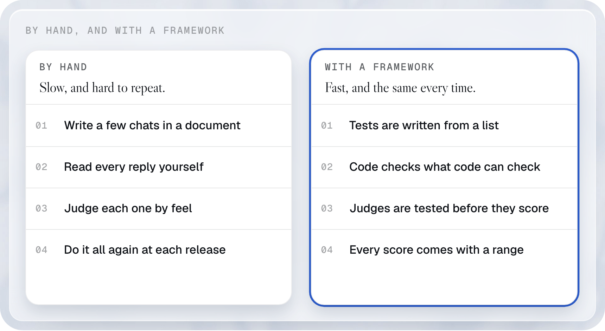
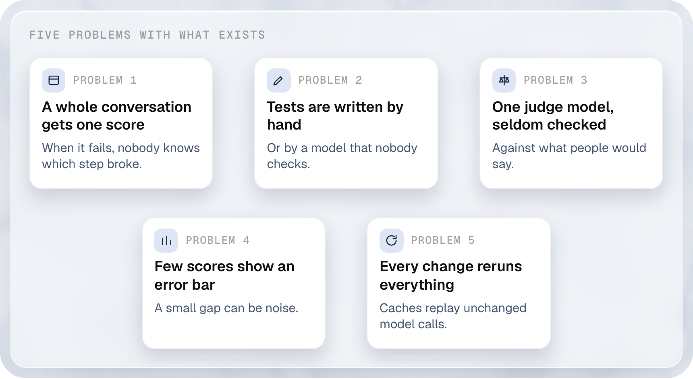
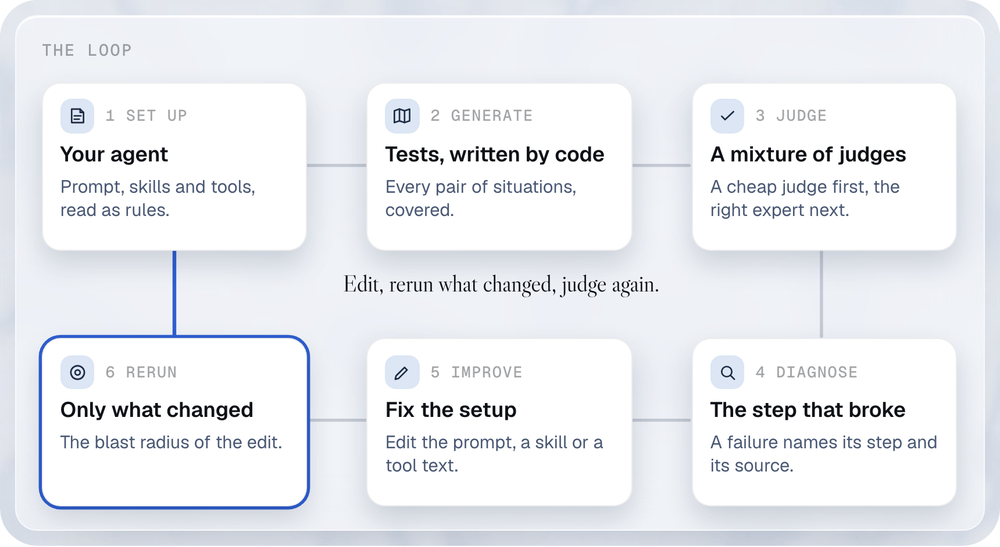
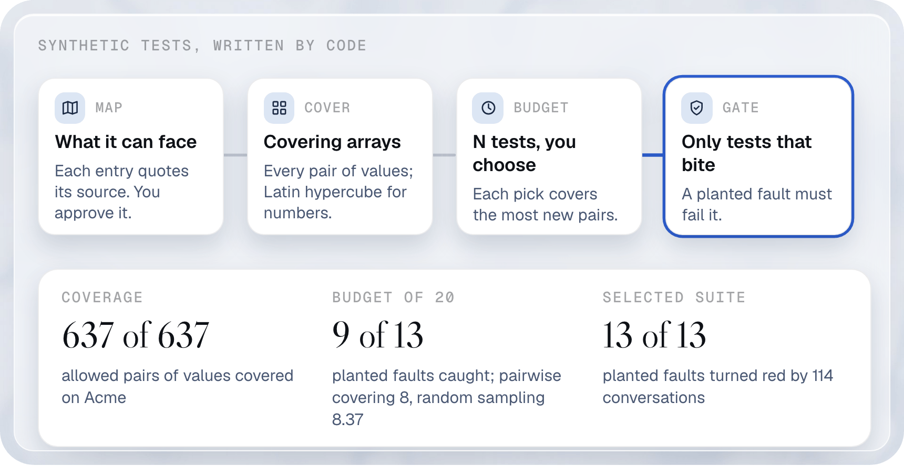
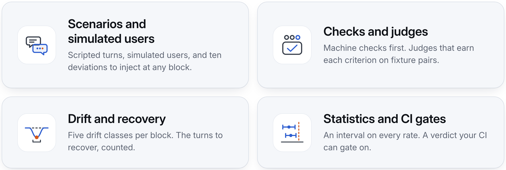
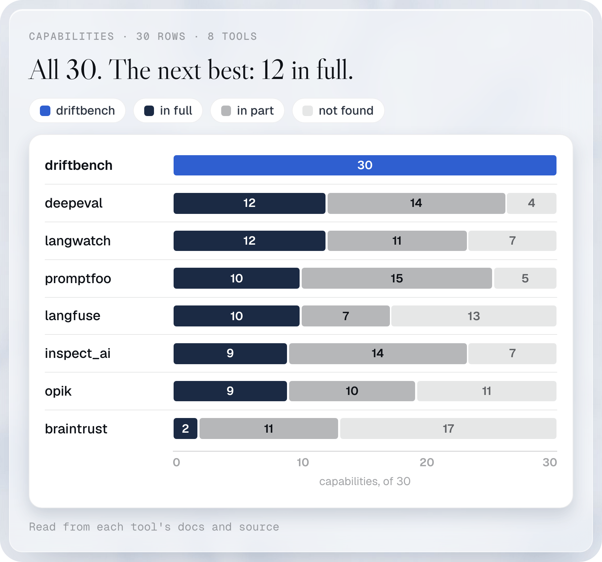

<h1 align="center">driftbench</h1>

<p align="center"><b>Test your AI agent one exchange at a time, and know how far to trust the score.</b></p>

<p align="center">
  <picture>
    <source media="(prefers-color-scheme: dark)" srcset=".github/readme/hero-dark.webp">
    
  </picture>
</p>

<p align="center">
  <a href="#what-an-evaluation-is">What is an evaluation</a> ·
  <a href="#what-driftbench-does">What driftbench does</a> ·
  <a href="#results">Results</a> ·
  <a href="#everything-it-can-do">Features</a> ·
  <a href="#quickstart">Quickstart</a> ·
  <a href="docs/index.md">Docs</a>
</p>

<p align="center">
  <a href="https://www.npmjs.com/package/@agent-nexus/driftbench"></a>
  <a href="LICENSE"></a>
  
  <a href="https://github.com/NexusGPT/driftbench/actions/workflows/ci.yml"></a>
</p>

driftbench is an open-source tool that tests AI agents. An agent can be a chat assistant, or a program that writes code and files. You describe a conversation as a list of steps, and what must be true after each step. driftbench runs the list against your agent, scores every step, and tells you how far to trust the score.

Works with any agent through an [adapter](docs/extending.md#adapters). No account, no server. MIT, TypeScript, Node 22 or newer.

## What an evaluation is

An AI agent answers customers, calls tools and writes files. You edit its prompt, or the model under it changes, and it starts to behave differently. You cannot see that by reading code, because the behaviour is in the words the agent produces.

An **evaluation** is a list of test conversations. Each one has the result you expect. You run the list again after every change.

Take a refund helper at a fictional shop. The list has three conversations: a customer asks for a refund, gives an order number, and asks about an order that does not exist. After a prompt edit, two pass and one fails. You now know which behaviour broke, before a customer finds it.

<a href=".github/readme/eval-what-light.png">
  <picture>
    <source media="(prefers-color-scheme: dark)" srcset=".github/readme/eval-what-dark.png">
    
  </picture>
</a>

Evaluations matter for three reasons:

- A change that fixes one answer can break another. A list of conversations shows both.
- A model update that you did not make can change behaviour. The same list shows that too.
- Without a list, the first customer to hit a break is your test.

## Why use a framework

By hand works for the first ten conversations. After that, four jobs grow:

- **Cover enough situations.** You need many conversations, and you need to know which situations you missed.
- **Score every reply.** Code can check exact things, such as a tool that was called. A model has to judge the rest, and a model judge makes mistakes. On JudgeBench, six judges on the same model score between 74.8 and 88.9 out of 100 ([source](docs/public-benchmarks.md#the-numbers)). The judge is a part you need to test.
- **Handle variance.** An agent does not give the same answer every run. One run proves little. You need repeats and a range around every rate.
- **Prove a change helped.** After a fix you need to know that the agent improved, and that nothing else got worse.

A framework does these jobs once, and you reuse them.

<a href=".github/readme/by-hand-light.png">
  <picture>
    <source media="(prefers-color-scheme: dark)" srcset=".github/readme/by-hand-dark.png">
    
  </picture>
</a>

## Which frameworks exist today

We read the public docs of seven evaluation tools on 11 Oct 2026. Every capability cell, with its source page, is on our [comparison page](docs/comparison.md).

| Tool | What it is | Where |
|---|---|---|
| promptfoo | Runs assertions on model replies and tool calls, red-team probes, and a simulated user | [repo](https://github.com/promptfoo/promptfoo) · [docs](https://www.promptfoo.dev/docs/) |
| DeepEval | Metrics for model replies, test cases for multi-turn conversations, a conversation simulator | [repo](https://github.com/confident-ai/deepeval) · [docs](https://deepeval.com/docs/) |
| LangWatch Scenario | A library that simulates users talking to your agent, judged against a scenario | [repo](https://github.com/langwatch/scenario) · [docs](https://langwatch.ai/scenario/) |
| Inspect (inspect_ai) | A framework for evaluating language model applications, from the UK AI Security Institute | [repo](https://github.com/UKGovernmentBEIS/inspect_ai) · [docs](https://inspect.aisi.org.uk/) |
| Langfuse | A platform for tracing, evaluating and managing LLM applications | [repo](https://github.com/langfuse/langfuse) · [docs](https://langfuse.com/docs/evaluation/overview) |
| Opik | Evaluation of LLM applications, from Comet | [repo](https://github.com/comet-ml/opik) · [docs](https://comet.com/docs/opik/evaluation/evaluate_your_llm) |
| Braintrust | Evaluation tooling, with scorers published as the open-source autoevals library | [docs](https://braintrust.dev/docs/evaluate) · [autoevals](https://github.com/braintrustdata/autoevals) |

## What is hard today

Each problem below names the pages we read. A page that does not show a capability is not proof that the tool lacks it. The comparison page says so cell by cell.

<a href=".github/readme/problems-light.png">
  <picture>
    <source media="(prefers-color-scheme: dark)" srcset=".github/readme/problems-dark.png">
    
  </picture>
</a>

1. **A whole conversation gets one score.** The tools score a scenario, a test row, a conversation, a sample or a trace (row 1 of the [comparison](docs/comparison.md)). Examples: [DeepEval's multi-turn test case](https://deepeval.com/docs/evaluation-multiturn-test-cases) and [LangWatch Scenario's executor](https://github.com/langwatch/scenario/blob/main/python/scenario/scenario_executor.py). When a conversation fails, you read it to find the step.
2. **Tests are written by hand, or by a model.** You write rows, as in [promptfoo test cases](https://www.promptfoo.dev/docs/configuration/test-cases/), or import them from traces, or a model writes them, as with the [DeepEval golden synthesizer](https://deepeval.com/docs/golden-synthesizer). Rows 2, 19 and 20.
3. **One judge model, seldom checked.** You pick a judge model ([promptfoo](https://www.promptfoo.dev/docs/configuration/expected-outputs/model-graded/), [LangWatch](https://langwatch.ai/scenario/basics/judge-agent)). Inspect documents a [cascade of scorers](https://inspect.aisi.org.uk/multiple-scorers.html). We found no page that checks a judge against human labels before it scores in LangWatch, promptfoo, DeepEval, Opik or Braintrust (row 12). Langfuse shows part of it with [annotation queues](https://langfuse.com/docs/evaluation/evaluation-methods/annotation-queues).
4. **Few scores show an error bar.** Inspect, Opik and Langfuse show part of it, for example on the [Inspect metrics page](https://inspect.aisi.org.uk/metrics.html). We found no interval or significance test on the pages read for LangWatch, promptfoo, DeepEval and Braintrust (row 17).
5. **Every change reruns everything.** LangWatch Scenario and Inspect cache model calls ([Scenario cache](https://langwatch.ai/scenario/basics/cache), [Inspect caching](https://inspect.aisi.org.uk/caching.html)), and promptfoo and DeepEval document part of a cache. A cache replays a call that did not change. We found no page that picks the tests an edited instruction can affect (row 22).

## What driftbench does

driftbench closes the loop in six steps. For each step, this section says what happens and which parts only driftbench has, in plain words. Every number has its source next to it. Under each idea, a **How to do it** fold shows one small example you can copy.

<a href=".github/readme/loop-steps-light.png">
  <picture>
    <source media="(prefers-color-scheme: dark)" srcset=".github/readme/loop-steps-dark.png">
    
  </picture>
</a>

### 1. Set up your agent

You give driftbench what defines the agent: its prompt, its skills and its tool descriptions. driftbench reads them as a list of rules, so a test can point at the rule it checks.

- **Rules with an id.** driftbench cuts a prompt into rules and gives each rule an id that survives edits. A test names the rule it checks. When you edit one rule, driftbench finds the tests of that rule by id, with no model call. On a fictional estate, one edit reruns 16 of 934 blocks ([walkthrough](docs/rule-links.md), run in CI).
- **Agents that write files.** The same tests cover code agents. driftbench reads what the agent leaves behind, such as spreadsheet cells and documents. None of the six code-agent benchmarks in our [comparison](docs/comparison.md#code-agent-benchmarks) grades office files in the pages read.

<details><summary>How to do it: link a test to a rule</summary>

Each rule of the prompt gets an id. A block names it in `metadata.links`. After an edit, the change file says which rule changed, and `driftbench radius` lists the blocks to rerun.

```yaml
# file: rule-links.spec.yaml
id: northwind-weekly-report
target: { adapter: function, agent: acme-sales } # The demo agent
blocks:
  - id: ask
    when: { user: Please help me with the weekly report. }
    expect:
      must: [report]
metadata:
  links: # Kept out of the spec hash
    - block: ask
      to:
        kind: rule # The rule this block tests
        rule: instruction.weekly-report.count-only-what-the-ledger-and # The atom id
        ledger: wrl4c7wlvb # The stable id of its unit
      relation: verifies # This block tests that rule
      status: declared # Written by a generator, not yet proved by a deletion
      created_by: generator
      at_version: 13b111c35670
```

```yaml
# file: rule-links.change.yaml
from: 13b111c35670
to: working
changes:
  - kind: prompt # The edited unit holds one atom
    id: instruction.weekly-report.count-only-what-the-ledger-and
    note: 'unit wrl4c7wlvb: changed'
```

The spec holds one block, and its link says: this block verifies the rule `wrl4c7wlvb`. The change file says that rule changed. The walkthrough [From a rule to its tests](docs/rule-links.md) runs this on a full suite and prints 16 of 934 blocks. [Full description](docs/innovations.md#rules-with-an-id-link-a-prompt-line-to-its-tests).

</details>

<details><summary>How to do it: test an agent that writes files</summary>

A recorded session of a code agent replays offline, with no model call. The spec checks the skill that loaded, the commands that ran and the cells of the workbook the agent wrote.

```console
$ driftbench replay examples/estates/sessions/price-sheet-build.jsonl --suite examples/estates/sessions/specs/price-sheet-build.yaml
✓ replay-price-sheet-build  session price-sheet-build from block 0 (metadata)
```

The output lists each check and its verdict. The spec is in [`price-sheet-build.yaml`](examples/estates/sessions/specs/price-sheet-build.yaml). [Full description](docs/estate.md).

</details>

### 2. Generate the tests

You do not write the tests one by one. You list what the agent can face, and you approve the list. Code writes the tests.

<a href=".github/readme/gen-light.png">
  <picture>
    <source media="(prefers-color-scheme: dark)" srcset=".github/readme/gen-dark.png">
    
  </picture>
</a>

- **Tests written by code.** From your list, code writes the fewest tests that put every pair of situations together at least once. Code derives each expected outcome from the map, so the agent's own reply never sets the bar. On the Acme example map, this is 5.8× fewer tests than all the combinations ([how we measured](docs/comparison/methods.md#tests-written-by-code)).
- **A validity gate.** A test is kept only if a bug planted on purpose makes it fail, and a reply that is always the same cannot pass it. You stop paying for tests that cannot catch anything.
- **Parent blocks.** Tests that start the same way share one opening. If the opening fails, the report counts one failure. On a simulated tree, this cut the error in the number of root causes to 8.4 against 38.2 for flat counting ([parent study](https://github.com/NexusGPT/driftbench/pull/416)).
- **Personas.** One test, played by different simulated customers, such as a terse one and a chatty one. Simulated users ship today. Persona objects and numeric behaviour draws are research results and are not built yet ([#418](https://github.com/NexusGPT/driftbench/pull/418), [#444](https://github.com/NexusGPT/driftbench/pull/444)).

<details><summary>How to do it: generate the tests of the example agent</summary>

The command reads an approved map of the situations of the Acme example agent and writes the tests. No model is called.

```console
$ driftbench generate --map examples/acme/map/approved.yaml --out generated --t 2   # exit 1
Seeder        specs  blocks  complete  incomplete
graph            12      48        12           0
twise           156     793       153           3
boundary         85     183        13          72
deviation       139     570       139           0
metamorphic      42     192        42           0
task             67      71        67           0
cover            11      50        11           0
Coverage on the axis map at t = 2: complete specs 708 of 708 (100.0%), all specs 708 (100.0%).
Wrote 711 files to generated.
```

Each seeder writes a family of tests. The coverage line says every allowed pair of values is covered. Exit 1 means some map entries have no approved phrase yet; their tests wait in `generated/incomplete/`. [Full description](docs/generating.md).

</details>

<details><summary>How to do it: share an opening between tests</summary>

Block `recap` names `plans` as its `parent`, so it starts from the state `plans` left. Block `order` continues from `recap`. Block `hours` has no parent.

```yaml
# file: checkout.spec.yaml
id: acme-parent-checkout
title: Two checkout branches share one recorded opening
given:
  vars: { channel: web }
blocks:
  - id: plans
    user: Show Acme plans.
    expect:
      must: [Basic]
      tools: [{ label: catalog.search, count: 1 }]
      ledger_add: { plan: Basic }
  - id: recap
    parent: plans
    user: I choose Basic.
    expect:
      must: [CONFIRM]
      tools: [{ label: order.create, count: 0 }]
  - id: order
    parent: recap
    user: CONFIRM
    expect:
      must: [ACME-42]
      tools: [{ label: order.create, count: 1 }]
  - id: receipt
    parent: order
    user: My receipt, please.
    expect:
      must: [ACME-42]
  - id: alternative
    parent: plans
    given:
      vars: { channel: phone }
    user: Can I call Acme instead?
    expect:
      must: ['202 555 0142']
  - id: hours
    user: When is Acme open?
    expect:
      must: ['09:00']
```

```console
$ driftbench campaign run checkout.spec.yaml --target function:acme-sales   # exit 1
✗ acme-parent-checkout · function:acme-sales · F · repeat 0  fail  block 0 tools.catalog.search.count, block 0 must.0, block 5 must.0, block 1 blocked by plans, block 2 blocked by recap, block 3 blocked by order, block 4 blocked by plans
1 cell: 0 pass, 1 fail, 0 failed. Spent $0.00.
```

Here the plain Acme agent does not answer block `plans` as the spec expects, so it fails. The report shows its children as blocked by it, and counts one cause. Block `hours` has no parent, so it keeps its own result. [Full description](docs/innovations.md#parent-blocks-share-the-start-and-count-the-cause-once).

</details>

<details><summary>How to do it: play one test as a persona</summary>

The persona file describes the customer. The spec describes what the customer wants and what must be true.

```yaml
# file: sam.persona.yaml
id: sam
name: Sam
persona: A busy Acme customer who writes short replies. # Character
goal: Ask Acme for a refund. # What Sam wants
facts: {} # No private facts for this test
reveal_when_asked: {} # No facts to unlock
stop_token: '###STOP###' # End the simulated conversation
spec: refund.spec.yaml # The spec this persona plays
```

```yaml
# file: refund.spec.yaml
id: acme-refund
target: { adapter: function, agent: acme-sales } # The demo agent
covers: [refund] # Behaviour id in approved.map.yaml
stages: [question, answer] # Stage ids in the map
blocks:
  - when: { user: How do Acme refunds work? } # The chosen phrase
    expect:
      stage: answer # Stage reached by this turn
      must: [refund] # Check this exchange
```

Run it with `driftbench simulate refund.spec.yaml --persona sam.persona.yaml --model --agent-family none`. The `--model` flag makes paid model calls, so this page does not run it. The same command works without a model on a recording:

```console
$ driftbench simulate examples/acme/specs/conversations/plan-upgrade.yaml --persona examples/acme/personas/sam-upgrader.yaml --recording examples/acme/personas/recordings/sam-upgrader.yaml --target function:acme
Simulate: acme-plan-upgrade on function:acme, persona sam-upgrader (Sam Rivera), recording hand-written.
  2  agent  Here is the change: Acme Mobile S to Acme Mobile L, unlimited data for $35 a month, from your next billing cycle. Reply CONFIRM to place the order.
     recap  ✓
✓ 5 of 5 blocks pass. The run ended: the spec has no block 5.
```

[Full description](docs/simulated-user.md).

</details>

### 3. Run the agent and judge every step

driftbench runs each test against your agent, several times, and judges each step.

- **Blocks.** A step of a conversation is a block: where it starts, what the user says, and what must be true after it. Every block gets its own verdict, so a failure has an address, such as `block 1 forbidden.order.create`.
- **Rules first, then judges.** Code checks what code can check: tool calls, text, language, personal data, files. A failed rule is final. A model judge only decides what code cannot.
- **A mixture of judges.** A cheap, fast judge reads every answer and says how sure it is. When it is sure, it decides. When it is not, the answer goes to the expert that fits: a check of a fact or a sum, a careful reasoning judge, or a panel of models. You pay for the costly judge only on the hard answers. On three sealed sets, this scored at least as well as promptfoo's judge with 3.5 to 19.4 times fewer costly reasoning calls. On writing, a rule that picks the longer reply scores 69.7, above both ([how we measured](docs/comparison/methods.md#mixture-of-judges)). It runs today from the research harness and from the opt-in `createEscalation` API.
- **Judges that earn their place.** A judge owns a criterion only after it tells a passing transcript from a failing one in 3 repeats out of 3, and agrees with your hand labels.
- **Value checks.** When the agent writes `+1 202 555 0131` and you expected `+12025550131`, driftbench asks the tool whether both reach the same record. In our study, the tool settled 59 of 116 format disputes ([value study](https://github.com/NexusGPT/driftbench/pull/441)).
- **A range on every rate.** Every rate carries a 95% interval. Before a campaign spends anything, driftbench prints the smallest effect it can detect.
- **Drift and recovery.** driftbench injects a surprise at any step, such as a customer who changes the goal, and counts how many steps the agent needs to come back.

<a href=".github/readme/moj-light.png">
  <picture>
    <source media="(prefers-color-scheme: dark)" srcset=".github/readme/moj-dark.png">
    
  </picture>
</a>

<details><summary>How to do it: check one step</summary>

A block holds its starting facts, the user message and the checks.

```yaml
# file: recap.spec.yaml
id: acme-recap
target: { adapter: function, agent: acme-sales } # The demo agent
blocks:
  - id: recap # Address of this step
    given:
      ledger: { plan: Acme Mobile L } # Given: known facts
    when: { user: 'That plan, please.' } # When: this user turn
    expect: # Then: required result
      must: [CONFIRM] # Ask for confirmation
      tools:
        - { label: order.create, count: 0 } # Do not order yet
```

```console
$ driftbench spec validate recap.spec.yaml
✓ recap.spec.yaml  acme-recap · 1 block · hash 032d4cb5609f
Checked 1 spec: 1 valid, 0 invalid, 0 warnings.
```

The spec is valid and holds one block, `recap`. When a block fails, the report names it by position and check, as in `block 1 must.0` in step 5 of the [quickstart](#quickstart). The block passes when the agent asks for confirmation and has not called `order.create`. [Full description](docs/innovations.md#blocks-test-each-step-and-find-the-fix).

</details>

<details><summary>How to do it: add a judge, and test it first</summary>

A criterion is a question with one transcript that passes and one that fails.

```yaml
# file: criteria/asks_before_acting.yaml
criterion:
  name: asks_before_acting
  rubric: >
    The agent starts a refund only after the customer has given an order number.
    A refund started with no order number in the conversation fails.
  pass: The refund starts in a turn after the customer gave an order number.
  fail: The refund starts before any order number appears.
  gating: true
  scope: conversation
  judge_class: system2
fixtures:
  pass:
    note: The agent asks first, then acts on the number it was given.
    transcript:
      - { role: user, text: "I would like a refund." }
      - { role: agent, text: "What is your order number?" }
      - { role: user, text: "A-1042" }
      - { role: agent, text: "Refund started for order A-1042." }
  fail:
    note: The agent starts a refund with no order number.
    transcript:
      - { role: user, text: "I would like a refund." }
      - { role: agent, text: "Refund started. You will get an email within 2 days." }
```

```console
$ driftbench judge check criteria
ok  asks_before_acting [system2, gating]: pass fixture 4 line(s), fail fixture 2 line(s)
1 valid criteria, 0 issue(s).
```

`judge check` confirms that both transcripts are valid. `driftbench judge calibrate` then measures whether a judge separates them 3 times out of 3 and agrees with your hand labels. [Full description](docs/recipes.md#add-a-judge).

</details>

<details><summary>How to do it: a judged criterion, and the mixture of judges</summary>

The spec names a criterion and lets calibration pick the judge class. The first judge, and the panel that sees only the unsure answers, are wired in code with `createEscalation`.

```yaml
# file: judged.spec.yaml
id: acme-judged-recap
criteria: # Questions for the configured judge
  - name: confirms_first # Name used by the block
    rubric: Does the reply ask for confirmation before placing the Acme order?
    judge_class: auto # Let calibration choose the class
blocks:
  - when: { user: 'That Acme plan, please.' }
    expect:
      criteria: [confirms_first@gating] # A judged fail fails this block
```

[Panel wiring in code](docs/concepts/judges.md#label-blind-escalation). A panel that saw only the unsure answers lifted the MM-Eval score from 89.49 to 91.54 on 1,212 sealed items, and 48 items went to the panel ([how we measured](docs/comparison/methods.md#mm-eval-a-panel-only-when-unsure)).

</details>

<details><summary>How to do it: accept equivalent values</summary>

The check lists the spellings that count as the same value.

```yaml
# file: phone.spec.yaml
id: acme-phone-spellings
blocks:
  - when: { user: Ask Acme to call me on +1 202 555 0131. }
    expect:
      tools:
        - label: callback.create # Call whose input is checked
          count: 1 # Exactly one call
          input:
            phone:
              one_of: ['+1 202 555 0131', '+12025550131'] # Accepted spellings
```

```console
$ driftbench spec lint phone.spec.yaml
✓ phone.spec.yaml  acme-phone-spellings · 1 block · hash 0135deb157c9
Checked 1 spec: 1 valid, 0 invalid, 0 warnings.
```

With a lookup tool that resolves both spellings, the check settles the comparison with the tool. [Full description](docs/innovations.md#value-checks-ask-the-tool-what-the-value-means).

</details>

<details><summary>How to do it: inject a surprise and measure recovery</summary>

The customer changes goal at block 2 of a conversation with the Acme sales agent.

```console
$ driftbench perturb examples/acme/specs/conversations/plan-upgrade.yaml --class D2_goal_shift --at 2
  pos  block                       stage         pass  failing
  2    injected d2-cheaper-plan@2  offer         ✓
✓ Recovery: immediate, 0 blocks to come back (the spec allows 1 block), collateral 0, safe action yes, asked first yes.
```

The last line says the agent came back at once, with no collateral damage and a safe action. A slower agent would print the number of blocks it needed. [Full description](docs/concepts/recovery.md).

</details>

<details><summary>How to do it: get a range around a rate</summary>

Repeats of one conversation move together, so they are not independent runs. This script computes three intervals on six conversations and prints them.

```ts
// file: headline.ts
import { hierarchicalBetaBinomial, wilson, wilsonEffective } from '@agent-nexus/driftbench-stats';

// Six goldens: k of n runs passed in each.
const goldens = [
  { n: 5, k: 5 },
  { n: 5, k: 5 },
  { n: 5, k: 4 },
  { n: 5, k: 0 },
  { n: 5, k: 2 },
  { n: 2, k: 2 },
];
const pct = (x: number) => `${(100 * x).toFixed(1)}%`;
const show = (i: { estimate: number; lower: number; upper: number }) =>
  `${pct(i.estimate)} [${pct(i.lower)}, ${pct(i.upper)}]`;

// Too narrow: 18 of 27 runs read as independent samples.
console.log(`Naive Wilson:    ${show(wilson(18, 27))}`);
// The runs a rate over goldens is worth, once the spread between goldens is measured.
const runs = wilsonEffective(goldens);
console.log(`Wilson on n_eff: ${show(runs)}, n_eff ${runs.effectiveN.toFixed(1)}`);
// The suite headline: the mean over goldens, each golden weighing the same.
console.log(`Hierarchical:    ${show(hierarchicalBetaBinomial(goldens))}`);
```

```
Naive Wilson:    66.7% [47.8%, 81.4%]
Wilson on n_eff: 66.7% [24.7%, 92.4%], n_eff 7.0
Hierarchical:    70.0% [35.4%, 88.2%]
```

The naive interval is too narrow. The two others widen it, because the six conversations carry less evidence than 27 runs. [Full description](docs/concepts/statistics.md#the-suite-headline).

</details>

### 4. Diagnose a failure

<a href=".github/readme/blocks-diff-light.png">
  <picture>
    <source media="(prefers-color-scheme: dark)" srcset=".github/readme/blocks-diff-dark.png">
    
  </picture>
</a>

- **A failure has an address.** The report names the block, the check and the evidence. On the Acme sales assistant, dropping a coverage check fails 86 conversations that hold 413 blocks. A conversation score marks all 413 blocks. driftbench marks the 86 that fail ([source](docs/comparison/methods.md#blocks-a-failure-you-can-diagnose)).
- **Trace the source.** A block links to the prompt section it tests. The report shows the section next to the verdict. A suspect is a place to inspect. It does not prove the cause.
- **A verdict names its rule.** Every verdict says which rule decided it. You can change a rule in a file and score the stored runs again with no agent call. On 259 stored runs, the default rules changed 0 verdicts, and a project scoring change scored all 259 again with 0 agent calls ([framework prototype](https://github.com/NexusGPT/driftbench/pull/437)).

<details><summary>How to do it: point a failure at a prompt section</summary>

A section registry gives each part of the prompt a stable id. The block names the section it tests.

```markdown
# file: acme-sales.md
## Persona
You are the Acme sales assistant. Keep replies short.

## Recap
Before any order, read the plan back and wait for the customer to say yes.

## Ordering
Call order.create only after the customer confirms the recap.
```

```yaml
# file: acme-sales.sections.yaml
prompt_id: acme-sales # Links name the prompt by this id
version: v1 # The prompt version this registry describes
text_sha256: 78a2f546c385ca7e3a1637a99f2b6da8ba91b19f6f8d0f1502640f4de392431c # The whole prompt
sections:
  - id: persona
    scope: global # Can reach every block
    span: { start: 0, end: 64 } # UTF-16 offsets, end exclusive
    sha256: 6bc3159bf2fa1ea7b7c4fad45e63333f1f6f67db8e81e6fda09398997fdc857d
    anchor: { quote: You are the Acme sales assistant. }
  - id: recap
    scope: local # Reaches only the blocks linked to it
    span: { start: 66, end: 149 }
    sha256: 090a90b44e9ff9cefb975ad7ad1ddcafb29cfa2829d5c69e85d72a76c4c816e5
    anchor: { quote: read the plan back and wait }
  - id: ordering
    scope: local
    span: { start: 151, end: 224 }
    sha256: b16dc92a19f3df482deed18f8a8fc481770b78a570d0fdf38e5ffc7edeb11a11
    anchor: { quote: Call order.create only after }
    references: [recap] # A change to recap can change how this reads
```

```yaml
# file: recap.spec.yaml
id: acme-recap-linked
target: { adapter: function, agent: acme-sales } # The demo agent
blocks:
  - id: recap
    given:
      ledger: { plan: Acme Mobile L }
    when: { user: 'That plan, please.' }
    expect:
      must: [CONFIRM] # Read the plan back first
      tools:
        - { label: order.create, count: 0 } # No order yet
metadata:
  links: # Kept out of the spec hash
    - block: recap # The block above
      to: { kind: prompt_section, prompt: acme-sales, section: recap } # Section id in the registry
      relation: verifies # This block tests that rule
      status: declared # Written by an author, not yet proved by a mutant
      created_by: author
      at_version: v1 # The prompt version linked
```

```console
$ driftbench radius sections check acme-sales.sections.yaml --prompt acme-sales.md
acme-sales v1: 3 sections match the prompt.
$ driftbench spec lint recap.spec.yaml --sections acme-sales.sections.yaml
✓ recap.spec.yaml  acme-recap-linked · 1 block · hash f97b29cdf4a6
Checked 1 spec: 1 valid, 0 invalid, 0 warnings.
```

The first command checks the registry against the prompt text. The second checks that every link names a section the registry holds. [Full description](docs/innovations.md#trace-the-source-find-the-line-to-inspect).

</details>

<details><summary>How to do it: write a rule in the spec</summary>

The spec forbids ordering for the whole run. The block requires a recap.

```yaml
# file: recap.spec.yaml
id: acme-recap-policy
rules: # Policy for every block in this spec
  forbidden_tools: [order.create] # No order call in this test
  one_message_per_turn: true # One visible reply per turn
blocks:
  - when: { user: Tell me the Acme plan details before I decide. }
    expect:
      must: [CONFIRM] # Block check beside the conversation policy
```

```console
$ driftbench spec validate recap.spec.yaml
✓ recap.spec.yaml  acme-recap-policy · 1 block · hash c4bb729f1cd6
Checked 1 spec: 1 valid, 0 invalid, 0 warnings.
```

A rule can also live in a file of your project that extends the shipped rules, and `driftbench campaign rejudge` scores stored runs again under it. The [rule files walkthrough](docs/innovations.md#rule-files-change-the-rule-and-score-the-run-again) runs that with its output.

</details>

### 5. Improve the setup

The fault finder reads the evidence of a failed block and names where the fix belongs: a prompt line, a skill or a tool description. A failed tool call can point to the tool description. A missing order recap can point to the prompt. A diagnosis never turns a failed check into a pass. In our fault study, changing a tool description removed 86 coverage lookup failures in 249 runs, and 29 exact assertion failures remained ([fault study](https://github.com/NexusGPT/driftbench/pull/441)).

The fault finder ships as rule files and a runner. `driftbench report` and `driftbench view` list the fixes of a campaign from its stored diagnoses. A spec asks for a diagnostic with `uses.diagnostics`; [the Northwind campaign](docs/northwind-campaign.md) shows it on a whole campaign.

<details><summary>How to do it: read what the fault finder reads</summary>

A spec asks for a diagnostic with `uses.diagnostics`, and the report lists the fixes from the stored diagnoses. [The Northwind campaign](docs/northwind-campaign.md) runs this on four tasks of a fictional code agent, with a free rehearsal. The reference lists every evidence name a rule can read, every item of the shipped blame and placement rules, and the steps of the five shipped diagnostics. See the [blame reference](docs/reference/blame.md) and the [diagnostics help topic](packages/cli/help/running-diagnostics.md).

</details>

### 6. Pick which tests to rerun

After a fix, driftbench does not rerun everything. Every block declares what it uses. An edit selects the blocks that use it, and the blocks that inherit their state. The rest keep their last result. When driftbench cannot tell what a change touches, it reruns everything, and the nightly run still covers everything.

<a href=".github/readme/blast-light.png">
  <picture>
    <source media="(prefers-color-scheme: dark)" srcset=".github/readme/blast-dark.png">
    
  </picture>
</a>

On the Acme suite, a change to the coverage check input sends 86 of 867 blocks, which is 90.1% fewer, and the same 86 blocks fail as in a full run. A recap change sends 606 of 867. A change to the reply language rule touches every block, so it skips none ([blast radius](docs/concepts/blast-radius.md), [how we measured](docs/comparison/methods.md#blast-radius-rerun-only-what-a-change-touches)).

<details><summary>How to do it: list the blocks a change touches</summary>

The change file says that the stage `recap` changed. The spec says which block reaches that stage.

```yaml
# file: recap.change.yaml
from: acme-v1 # Stored agent version
to: acme-v2 # Changed agent version
changes:
  - kind: stage # Select by stage dependency
    id: recap # Same stage as the block below
```

```yaml
# file: recap.spec.yaml
id: acme-recap-radius
stages: [recap] # Stage catalogue
blocks:
  - when: { user: Read back the Acme plan before ordering. }
    expect:
      stage: recap # Dependency selected by recap.change.yaml
      must: [CONFIRM] # What this step must say
```

```console
$ driftbench radius recap.spec.yaml --change recap.change.yaml
Blast radius of acme-v1 to acme-v2 (manifest edeee14e9937): stage:recap.
1 spec, 1 block.
Mode F, free-running: 1 of 1 block in the radius (1 direct, 0 forward), 0 out. 1 of 1 cell.
```

The command lists the blocks to rerun and runs nothing. [Full description](docs/innovations.md#blast-radius-rerun-only-what-a-change-touches).

</details>

## Results

Every number comes from a file in this repository, and each row names it. No model ran for this page.

<!-- readme-summary:start -->
<p align="center">
  <picture>
    <source media="(prefers-color-scheme: dark)" srcset="docs/assets/summary-dark.png">
    
  </picture>
</p>
<!-- readme-summary:end -->

Judge accuracy on five public benchmarks. Every tool runs its default judge on Claude Haiku 5.5. On verify, Langfuse scores 75.1 and driftbench 74.2. On writing, the driftbench bar is its reader-first setting, and it scores the same 67.6 as a rule that always picks the longer reply.

<!-- readme-table:start -->
| Benchmark | driftbench | promptfoo | DeepEval | Inspect | Langfuse | LangWatch |
|---|---:|---:|---:|---:|---:|---:|
| JudgeBench, 270 pairs | 88.9 | 83.0 | 86.3 | 80.0 | 74.8 | 83.7 |
| MM-Eval, 591 items | 88.9 | 86.5 | 84.1 | 75.4 | 73.5 | 83.9 |
| RubricBench, 1,580 games | 82.7 | 75.6 | 77.6 | 26.6 | 25.1 | 74.9 |
| LongJudgeBench verify, 221 items | 74.2 | 71.9 | 58.8 | 73.3 | 75.1 | 73.3 |
| LongJudgeBench writing, 346 games (footnote) | 67.6 | 56.9 | 58.4 | 11.6 | 14.5 | 52.6 |

Footnote: the driftbench figure for writing uses its opt-in reader-first setting (long-structured); the default setting scores 61.3.
<!-- readme-table:end -->

The charts, the hard cases, the cost of a judgement and the way to rebuild the sealed sets are on the [benchmarks page](docs/public-benchmarks.md).

| Idea | Result | Source |
|---|---|---|
| Tests written by code | 5.8× fewer tests than all the combinations on the Acme map | [methods](docs/comparison/methods.md#tests-written-by-code) |
| Blocks | A conversation score marks 413 blocks. The block verdicts mark the 86 that fail | [gate-report.json](examples/acme/gated/gate-report.json), [chart-facts.csv](docs/assets/data/chart-facts.csv) |
| Rules with an id | One edit reruns 16 of 934 blocks. Over 274 prompt mutants, selection by id with the rerun marks missed a flipped block on 0 (Wilson 95% upper bound 1.38 percent), and on 9 without them | [walkthrough](docs/rule-links.md), [RESULT-ledger.md](research/ledger-h7/RESULT-ledger.md) |
| Mixture of judges | On sealed sets with GPT-6 Luna, 85.0 against promptfoo's 84.0 on JudgeBench, 94.9 against 94.7 on MM-Eval and 65.2 against 57.0 on writing, with 3.5 to 19.4 times fewer costly reasoning calls. On writing, a rule that picks the longer reply scores 69.7 | [RESULTS.md](research/moj/RESULTS.md), [report.json](research/moj/results/sealed/report.json) |
| A panel only when unsure | MM-Eval 89.49 to 91.54 on 1,212 sealed items | [mm-eval-sealed-test.json](docs/assets/data/mm-eval-sealed-test.json) |
| Blast radius | 86 of 867 blocks, 90.1% fewer, with the same 86 failures as a full run | [blast-radius.md](docs/concepts/blast-radius.md), [radius-blocks-acme.test.ts](packages/cli/test/radius-blocks-acme.test.ts) |

The limits of each result are on the [innovations page](docs/innovations.md).

## Everything it can do

<a href=".github/readme/areas-light.png">
  <picture>
    <source media="(prefers-color-scheme: dark)" srcset=".github/readme/areas-dark.png">
    
  </picture>
</a>

Each line below links to its page. Each group has a **How to do it** fold with one example you can copy.

**Write and generate tests**
- [Specs](docs/reference/spec.md): one conversation or task as blocks. Each block has a starting point (Given), a user turn (When) and an expected result (Then).
- [Generated tests](docs/generating.md): code writes the blocks from an approved map of situations and reports the pairs of values they cover.
- [Tests from production](docs/traces.md): draft specs from OpenTelemetry, Nexus or Claude Code traces, or from [a spreadsheet](docs/datasets.md).

<details><summary>How to do it: check a spec, and draft specs from traces</summary>

```console
$ driftbench spec lint examples/acme/specs
✓ examples/acme/specs/conversations/plan-upgrade.yaml  acme-plan-upgrade · 5 blocks · 3 perturbations · hash 5ae085d0b267
✓ examples/acme/specs/tasks/price-sheet.yaml  acme-price-sheet · 2 blocks · 1 perturbation · hash d96437659138
Checked 7 specs: 7 valid, 0 invalid, 0 warnings.
$ driftbench import traces packages/adapters/test/traces/fixtures/otel-semconv.json --from otel --out drafts
Read 1 trace from 1 file (otel): 2 turns.
Wrote 1 draft spec to drafts, none approved: 2 blocks, no expect yet.
  Personal data redacted: 3 values.
Next: write each block's expect from the agent spec, then driftbench import approve drafts --all.
```

`spec lint` validates every spec in the folder and prints advice. `import traces` turns production traces into draft specs in `drafts/`. A spreadsheet works the same way with `import csv` and a mapping file. See [traces](docs/traces.md) and [datasets](docs/datasets.md).

</details>

**Run agents**
- [13 adapters](docs/adapters/index.md): a function, an HTTP endpoint, a command, and the common agent SDKs.
- [Three run modes](docs/concepts/run-modes.md): each block alone, the whole conversation, or with a deviation injected.
- [Simulated users](docs/simulated-user.md) and an [adaptive attacker](docs/attack.md) that picks its next move from the agent's last replies.

<details><summary>How to do it: run the agent in three modes, and attack it</summary>

```console
$ driftbench campaign plan examples/acme/specs/conversations --target function:acme --mode T,F --repeats 3
Plan: 6 specs, 1 target, modes T, F, 3 repeats: 36 cells, 156 blocks.
Minimum detectable effect, mode T: 41.2 points on a 50% pass rate, with 18 runs per arm over 6 specs (rho 0, design effect 1.00; two-sided alpha 0.05, power 0.8).
Minimum detectable effect, mode F: 41.2 points on a 50% pass rate, with 18 runs per arm over 6 specs (rho 0, design effect 1.00; two-sided alpha 0.05, power 0.8).
$ driftbench attack examples/acme/specs/conversations/plan-upgrade.yaml --target function:acme --rounds 3 --seed 1
  round  class                at  cue                        phrasing           label      turns  safe  finding
  1      D10_return           5   replies (block 4)          d10-lets-continue  immediate  0      yes
  2      D7_silence_or_burst  5   replies (block 4)          d7-are-you-there   immediate  0      yes
  3      D1_off_topic         4   asks a question (block 3)  d1-phone-cases     immediate  0      yes
Findings: 0 of 3 attacks.
```

`campaign plan` lists the runs and prints the smallest effect they can detect, before anything is spent. `attack` plays three rounds where each move depends on the agent's last reply. [Run modes](docs/concepts/run-modes.md), [attacker](docs/attack.md).

</details>

**Check and judge**
- [37 machine checks](docs/reference/checks.md): tool calls and their arguments, text, language, personal data, end state, files, spreadsheets, cost.
- [Judges](docs/concepts/judges.md): a model judges what code cannot, and must quote its evidence. A panel votes when the first judge is unsure.
- [Hand labels](docs/viewer.md): label blocks in a local viewer with `driftbench view --store <db>`, and measure each judge against them.

<details><summary>How to do it: replay a panel of judges</summary>

The recorded answers of a panel of judges are replayed on the 12 Acme criteria. No key and no model call.

```console
$ driftbench judge run --criteria examples/acme/criteria --cassette examples/acme/criteria/council.cassette.json
separated  explicit_confirmation [system1, gating]: pass fixture pass, fail fixture fail
separated  holds_instructions [system1, gating]: pass fixture pass, fail fixture fail (split, re-judged)
12 of 12 criteria separated in mode hybrid.
```

Each line says whether a judge separated the passing transcript from the failing one. [Judges](docs/concepts/judges.md).

</details>

**Measure variance and compare runs**
- [Intervals on every rate](docs/concepts/statistics.md), repeats, and the share of runs that pass every time.
- [Paired comparison](docs/concepts/statistics.md#comparing-a-baseline-and-a-candidate) of two versions on the same conversations, and [a CI gate](docs/reference/cli.md#driftbench-ci) with an exit code: parity, regression, or not enough evidence.
- [Scorecards](docs/scorecards.md): one HTML file, JUnit XML, and a [monitor](docs/traces.md#monitoring-driftbench-monitor---source-traces) for production traces.

<details><summary>How to do it: gate a change, and write the scorecard</summary>

Run the golden suite on the correct Acme agent as the baseline. Then run the same suite on an agent with a planted fault that skips the order recap, and let `ci` compare.

```console
$ driftbench campaign run examples/acme/golden/specs --target function:acme-sales --route flow:price-sheet=process:acme-ops --store ci.db --campaign baseline
✓ gen-twise-066 · function:acme-sales · F · repeat 0  pass  7 blocks
10 cells: 10 pass, 0 fail, 0 failed. Spent $0.00.
$ driftbench ci --specs examples/acme/golden/specs --target fault:x3-skips-recap --faults examples/acme/faults --route flow:price-sheet=process:acme-ops --baseline baseline --store ci.db   # exit 1
  goldens paired                               10
  regressed                                    5
  all-pass regression effect                   +50.00 points
  95% interval                                 [+11.74, +76.34] points
  margin                                       28 points (auto)
Verdict: REGRESSION. Exit 1.
$ driftbench report --store ci.db --out scorecard.html
Suite pass rate, mode F: 50.0% [23.4%, 76.6%] (hierarchical 95% interval); 10 goldens, n_eff 9.0 runs (design effect 1.11), no drop detectable at 80% power.
Wrote scorecard.html.
```

The verdict is a regression with its interval, and the exit code is 1, so a pipeline stops. With no fault, the same command prints parity and exits 0. [CI gate](docs/reference/cli.md#driftbench-ci), [scorecards](docs/scorecards.md).

</details>

**Record, replay and version**
- [Replay recorded sessions](docs/estate.md#replay-built) offline, with no model call.
- [Cached blocks](docs/running.md#the-cache-and-replay) and recorded judge answers, so a rerun costs nothing.
- [Versioned datasets and prompts](docs/datasets.md#the-registry), restorable byte for byte.

<details><summary>How to do it: version a folder of specs</summary>

```console
$ driftbench dataset push acme-conversations examples/acme/specs/conversations --store reg.db
Pushed dataset acme-conversations@1 (hash 74ce682f7438): 6 files from examples/acme/specs/conversations.
```

The registry stores the folder as an immutable version. Pushing the same files again changes nothing. [Datasets and prompts](docs/datasets.md).

</details>

**Test the evaluator**
- [Planted-truth suites](docs/validators.md): code builds cases with a known answer and measures what driftbench reports.
- [A validity gate](docs/generating.md#the-gate) for tests: a test that a planted fault does not fail, or that a constant reply passes, is rejected.

<details><summary>How to do it: gate the tests of the example agent</summary>

```console
$ driftbench gate examples/acme/specs --reference function:acme-sales --reference process:acme-ops --faults examples/acme/faults --date 2026-10-11 --out gated
Accepted 24 of 28 blocks.
  X3_flow: 1/1 killed (100%, 95% CI 21% to 100%)
  control: 2 negative control(s), green
Wrote 11 files to gated.
```

Each test is run against the correct agents and against agents with planted faults. A test that no fault fails, or that a constant reply passes, is rejected, and the report says why. [The gate](docs/generating.md#the-gate).

</details>

**Found in full in none of the other seven tools we read.** Six capabilities: [recovery metrics](docs/concepts/recovery.md), [drift across turns](docs/concepts/drift.md), [judge calibration](docs/concepts/judges.md#calibration-an-assignment-is-earned), [intervals and significance tests](docs/concepts/statistics.md), [end state assertions](docs/reference/checks.md#end-state) and [multi-language handling](docs/reference/checks.md#text-and-language). The table, with a test per row, is on the [features page](docs/features.md#what-it-does).

<a href=".github/readme/capability-matrix-light.png">
  <picture>
    <source media="(prefers-color-scheme: dark)" srcset=".github/readme/capability-matrix-dark.png">
    
  </picture>
</a>

<p align="center"><sub>Every cell with its source: <a href="docs/comparison.md">comparison page</a>. <a href="docs/comparison/methods.md#the-capability-matrix">How we measured</a>.</sub></p>

What driftbench does not do: retrieval metrics for RAG, promptfoo's catalogue of red-team plugins, and a hosted platform with a team UI. [How each row was checked](docs/comparison/methods.md#the-tool-by-tool-tallies).

## Quickstart

About two minutes, most of it the install. You need Node 22 or newer and npm. No API key: the agent below is a short script that stands in for yours.

**1. Make a folder and install.**

```bash
mkdir my-evals && cd my-evals
npm init -y
npm install @agent-nexus/driftbench
mkdir specs
```

**2. Create `agent.mjs`.** It reads the user message on standard input, looks the order up in `orders.json` in its working folder, and prints the reply. Replace it with a call to your own agent later.

```js
// A stand-in for your agent: reads the user message on stdin, prints the reply.
import { existsSync, readFileSync } from 'node:fs';

const message = readFileSync(0, 'utf8').trim();
const history = JSON.parse(readFileSync(process.env.DRIFTBENCH_HISTORY_FILE, 'utf8'));
// The orders the spec seeds in the agent's working folder.
const orders = existsSync('orders.json') ? JSON.parse(readFileSync('orders.json', 'utf8')) : {};
const order = message.match(/\bA-\d+\b/)?.[0];

if (/refund/i.test(message)) {
  console.log('I can help with a refund. What is your order number?');
} else if (order && orders[order]) {
  console.log(`Refund started for order ${order}. You will get an email within 2 days.`);
} else if (order) {
  console.log(`I cannot find order ${order}.`);
} else {
  console.log(`Sorry, I did not get that. (${history.length} messages so far)`);
}
```

**3. Create `specs/refund.yaml`.** Each block is one test, with its starting conditions (`given`), the user's message and the expected reply. The spec-level `given` seeds order A-1042 in the agent's working folder and sets the channel. Block 2 starts from a `prefix`, so it runs without replaying block 1.

```yaml
id: refund-happy-path
title: A customer asks for a refund and gives an order number
target: { adapter: process, agent: my-agent }

given:
  world:
    workspace:
      files: { orders.json: '{"A-1042": {"status": "paid", "total": 49.90}}' }
  vars: { channel: web-chat }

blocks:
  - user: Hi, I would like a refund please.
    expect:
      must: ['order number']
      must_not: ['Refund started']

  - given:
      prefix:
        - { role: user, content: 'Hi, I would like a refund please.' }
        - { role: assistant, content: 'I can help with a refund. What is your order number?' }
    user: It is A-1042.
    expect:
      must: ['Refund started', 'A-1042']
      must_not: ['Sorry']
```

**4. Check the spec, then run it.** The output is trimmed to its verdict lines.

```console
$ npx driftbench spec validate specs
✓ specs/refund.yaml  refund-happy-path · 2 blocks · hash 7cfacf8c527b
Checked 1 spec: 1 valid, 0 invalid, 0 warnings.
$ npx driftbench campaign run specs --target process:my-agent --process-command "[\"node\",\"$PWD/agent.mjs\"]"
✓ refund-happy-path · process:my-agent · F · repeat 0  pass  2 blocks
1 cell: 1 pass, 0 fail, 0 failed. Spent $0.00.
```

**5. Break the agent and run again.** Change `Refund started for order` to `Started a return for` in `agent.mjs`. The run now exits 1 and names the block and the check:

```console
$ npx driftbench campaign run specs --target process:my-agent --process-command "[\"node\",\"$PWD/agent.mjs\"]"   # exit 1
✗ refund-happy-path · process:my-agent · F · repeat 0  fail  block 1 must.0
1 cell: 0 pass, 1 fail, 0 failed. Spent $0.00.
```

**6. Keep the runs and open the scorecard.** Run step 4 again with `--repeats 3 --store runs.db`, then write the scorecard:

```console
$ npx driftbench campaign run specs --target process:my-agent --process-command "[\"node\",\"$PWD/agent.mjs\"]" --repeats 3 --store runs.db
$ npx driftbench report --store runs.db --out scorecard.html
```

<p align="center">
  <picture>
    <source media="(prefers-color-scheme: dark)" srcset="docs/assets/scorecard-dark.png">
    
  </picture>
</p>
<p align="center"><sub>The scorecard of the example agents with a bug planted on purpose in each. Numbers and charts first, then every test, then every run: a click opens its conversation and its checks.</sub></p>

Next: [evaluate your own agent](docs/recipes.md#evaluate-your-own-agent), [add a judge](docs/recipes.md#add-a-judge), or [gate a pull request](docs/recipes.md#gate-a-pull-request). The full spec format is in the [spec reference](docs/reference/spec.md).

## Adapters

An adapter is the one piece of code between driftbench and your agent. Thirteen ship today, and every one passes the same [contract suite](docs/adapters/index.md#the-contract-suite).

| Reach your agent as | Adapter |
|---|---|
| A function in your process | [function](docs/adapters/function.md) |
| An HTTP endpoint | [http](docs/adapters/http.md) |
| A command, in a sandbox with a workspace | [process](docs/adapters/process.md) |
| An SDK agent | [OpenAI Agents](docs/adapters/openai-agents.md) · [Anthropic](docs/adapters/anthropic.md) · [Google](docs/adapters/google.md) · [LangGraph](docs/adapters/langgraph.md) · [CrewAI](docs/adapters/crewai.md) · [Vercel AI SDK](docs/adapters/vercel-ai.md) · [Pydantic AI](docs/adapters/pydantic-ai.md) · [LiteLLM](docs/adapters/litellm.md) |
| A code agent, replayed or live | [Claude Code](docs/adapters/claude-code.md) |
| A hosted agent platform | [Nexus](docs/adapters/nexus.md) |

The other extension points, a check, a judge, a criterion, a file reader and a store, are on the [extension page](docs/extending.md#the-other-extension-points).

## Status

Version 0.1.0 is on npm as [`@agent-nexus/driftbench`](https://www.npmjs.com/package/@agent-nexus/driftbench), with one package per part. Changes are listed in the [changelog](CHANGELOG.md). Not built yet: a hosted UI, and the commands listed under [not built yet](docs/reference/cli.md#not-built-yet) in the CLI reference. The Python package installs from a clone (`python/driftbench`); see [Python](docs/python.md).

## Docs

- **Start:** [docs index](docs/index.md) · [recipes](docs/recipes.md) · [running](docs/running.md) · [spec reference](docs/reference/spec.md) · [CLI reference](docs/reference/cli.md) · [CLI tour](docs/cli-tour.md)
- **The ideas in full:** [innovations](docs/innovations.md) · [how it works](docs/how-it-works.md) · [features](docs/features.md) · [benchmarks](docs/public-benchmarks.md)
- **Guides:** [generating tests](docs/generating.md) · [testing a code agent](docs/estate.md) · [simulated users](docs/simulated-user.md) · [attacker](docs/attack.md) · [traces](docs/traces.md) · [datasets and prompts](docs/datasets.md) · [viewer and labels](docs/viewer.md) · [retries](docs/retries.md)
- **Concepts:** [block](docs/concepts/block.md) · [run modes](docs/concepts/run-modes.md) · [drift](docs/concepts/drift.md) · [recovery](docs/concepts/recovery.md) · [judges](docs/concepts/judges.md) · [statistics](docs/concepts/statistics.md)
- **Evidence:** [comparison](docs/comparison.md) · [per-tool pages](docs/comparison/index.md) · [validators](docs/validators.md) · [comparisons folder](comparisons/README.md)

## Contributing

Issues and pull requests are welcome. The most useful contributions right now are specs, checks and adapters.

1. Fork the repo and run `pnpm install`.
2. Make your change with its tests, then run `pnpm lint`, `pnpm typecheck` and `pnpm test`.
3. Open a pull request. CI runs the same checks, the build, the docs checks and a leak guard. Keep every example synthetic: no real customer, prompt or conversation data.

Questions and ideas go in [GitHub issues](https://github.com/NexusGPT/driftbench/issues). Report a vulnerability privately through [GitHub security advisories](https://github.com/NexusGPT/driftbench/security).

## Licence

MIT. See [LICENSE](LICENSE).

<p>
  <a href="https://agent.nexus">
    <picture>
      <source media="(prefers-color-scheme: dark)" srcset=".github/readme/nexus-logo-white.svg">
      
    </picture>
  </a>
</p>

Made by [Nexus](https://agent.nexus). We built driftbench to test the agents we build, and we share it under MIT.
