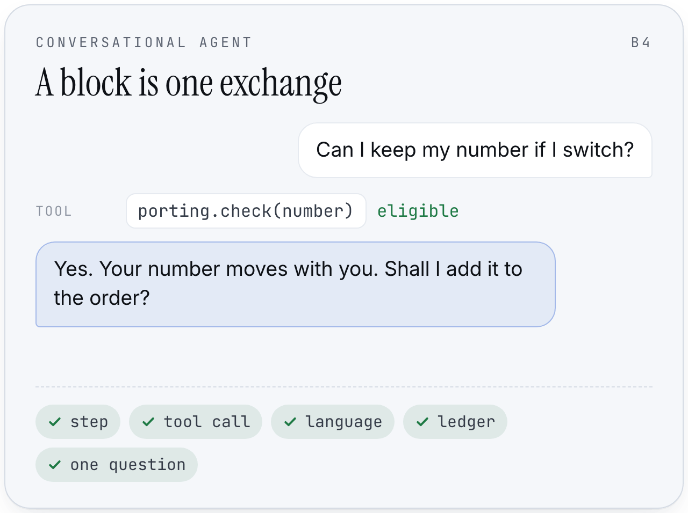
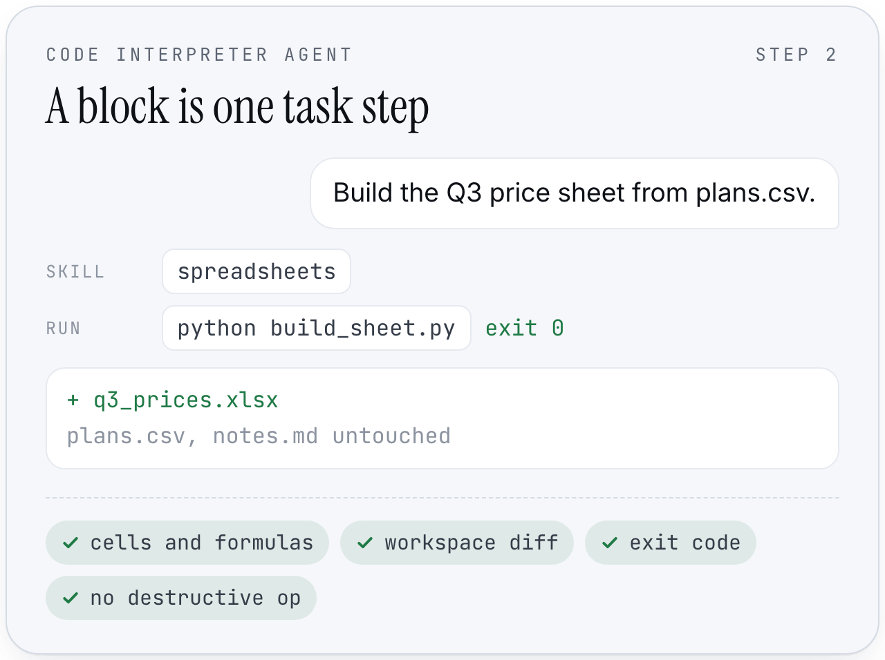

<h1 align="center">driftbench. Every exchange is a unit test.</h1>

<p align="center">
  
</p>

<p align="center">
  <a href="#get-started">Get started</a> ·
  <a href="#what-you-get">What you get</a> ·
  <a href="#how-it-works">How it works</a> ·
  <a href="#roadmap">Roadmap</a> ·
  <a href="#contributing">Contributing</a> ·
  <a href="https://agent.nexus">agent.nexus</a>
</p>

<p align="center">
  <a href="LICENSE"></a>
  <a href="#roadmap"></a>
  
  
  <a href="https://github.com/achammah/driftbench/actions/workflows/ci.yml"></a>
</p>

---

driftbench evaluates AI agents one exchange at a time. Each exchange is a **block**: one user message and everything the agent does before the next one. Each block is a unit test with a Given, a When and a Then. A conversation is a succession of blocks, so a failure has an address, drift has a first block, and recovery has a count. Every rate comes with its interval.

It works for conversational agents and for code interpreter agents that write code, use a workspace and load skills. Any agent plugs in through an adapter. Open source, Apache 2.0, written in TypeScript.

> [!NOTE]
> **Not released yet.** Phase 0 is in progress: the spec format, the validator, the coverage tool and a synthetic Acme Telecom example. The runner, judges and statistics described below are designed and planned. The [roadmap](#roadmap) shows what each phase delivers.

---

## Get started

driftbench is not on npm yet. Run it from source with Node 22 or newer and pnpm.

```bash
git clone https://github.com/achammah/driftbench
cd driftbench
pnpm install
pnpm driftbench spec validate examples/acme/specs
```

The last command loads the Acme Telecom specs and validates them against the spec schema. Acme Telecom is the synthetic sales assistant behind every example. No API key needed.

A spec is YAML. A golden with one block:

```yaml
id: acme.upgrade_plan
version: "1"
kind: conversation
lang: EN
blocks:
  - when: { user: "Which plan has unlimited data? I want to keep my number." }
    expect:
      step: plan
      tools:
        - { label: catalog.search, count: 1 }
      must: ["unlimited"]
      must_not: ["as an AI"]
      ledger_add: { keep_number: true }
      criteria: [one_question@gating]
```

---

## What you get

<picture>
  <source media="(prefers-color-scheme: dark)" srcset=".github/readme/areas-dark.png">
  
</picture>

- **[Scenarios and simulated users](#a-block-is-a-unit-test)**: YAML specs, scripted turns, simulated users with a persona and a goal, ten deviation classes to inject at any block. <sub>Phases 0, 1 and 3</sub>
- **[Checks and judges](#judges-earn-their-criteria)**: machine checks on tools, text, language, personal data and end state, then a council of judges that earn each criterion. <sub>Phases 1 and 2</sub>
- **[Drift and recovery](#drift-and-recovery)**: five drift classes, the first drift block, the drift rate, and the turns to recover after an injected deviation. <sub>Phase 3</sub>
- **[Statistics and CI gates](#numbers-with-intervals)**: an interval on every rate, `pass^k`, paired tests, a noninferiority verdict and an exit code for CI. <sub>Phase 4</sub>

## Things you can do with driftbench

1. **Write a golden as blocks** and validate it with `driftbench spec validate`. <sub>Phase 0 · in progress</sub>
2. **Run one golden three ways** on the same agent. Teacher forced against free running gives the compounding index. <sub>Phases 1 and 3 · planned</sub>
3. **Inject a goal shift at block 4**, or a language switch, or an instruction hidden in data, and count the blocks the agent needs to come back. <sub>Phase 3 · planned</sub>
4. **Let a cheap judge own a criterion** once it matches your hand labels as well as a chat model does. <sub>Phase 2 · planned</sub>
5. **Gate a prompt change in CI**: noninferiority against the baseline, with a margin you set. <sub>Phase 4 · planned</sub>
6. **Test a code interpreter agent on what it leaves behind**: the cells of a spreadsheet, the slides of a deck, the files it touched. <sub>Phase 5 · planned</sub>

---

## How it works

This section describes the design. Phase 0 builds the spec format now. The runner, checks, judges and statistics arrive in phases 1 to 5.

### A block is a unit test

<picture>
  <source media="(prefers-color-scheme: dark)" srcset=".github/readme/block-dark.png">
  
</picture>
<p align="center"><sub>Given the state so far, when the user speaks, then the agent must reach the right step, call the right tools and say nothing it must not.</sub></p>

A block holds everything the agent does between two user messages: text, cards, tool calls and tool results. The spec fixes what must be true after it. driftbench reads what actually happened, compares it field by field, and keeps the evidence behind every verdict. Run one block many times from the same Given and you get its own pass rate, free of the blocks before it.

<table>
  <tr>
    <td width="50%" valign="top">
      <picture>
        <source media="(prefers-color-scheme: dark)" srcset=".github/readme/kinds-chat-dark.png">
        
      </picture>
      <br/><sub>Conversational agents. A block is one exchange, checked on step, tools, language and facts.</sub>
    </td>
    <td width="50%" valign="top">
      <picture>
        <source media="(prefers-color-scheme: dark)" srcset=".github/readme/kinds-code-dark.png">
        
      </picture>
      <br/><sub>Code interpreter agents. A block is a task step, checked on the files it leaves and the commands it ran.</sub>
    </td>
  </tr>
</table>

### One golden, three runs

<picture>
  <source media="(prefers-color-scheme: dark)" srcset=".github/readme/modes-dark.png">
  
</picture>
<p align="center"><sub>Teacher forced isolates each block. Free running lets errors compound. Perturbed injects a deviation and measures the way back.</sub></p>

| Mode | Prior context | What it isolates |
|---|---|---|
| **Teacher forced** | the golden's own earlier blocks | local accuracy, block by block |
| **Free running** | the agent's own earlier replies | compounding: one wrong block poisons the next |
| **Perturbed** | free running, plus a deviation at block k | recovery: whether it comes back, how fast, at what cost |

The gap between teacher forced and free running on the same golden is the **compounding index**. An agent can be right block by block and still fragile end to end. Only the free running run shows it.

### Drift and recovery

<picture>
  <source media="(prefers-color-scheme: dark)" srcset=".github/readme/perturbed-dark.png">
  
</picture>
<p align="center"><sub>A goal shift lands at block 3. The agent skips the change, then contradicts it, then comes back. Two blocks to recover.</sub></p>

Every failing block gets one or more drift classes:

| Class | What drifted |
|---|---|
| `X1` local error | a wrong answer or a wrong tool, facts intact |
| `X2` contradiction | the reply contradicts a fact already established |
| `X3` flow drift | the wrong step: skipped, repeated, or a known fact asked again |
| `X4` format drift | narration, a language leak, a double send, channel rules broken |
| `X5` tool drift | a call that is missing, extra, duplicated or wrongly filled |

Ten deviation classes can be injected at any block: off topic question, goal shift, contradiction, loose confirmation, language switch, instruction in data, silence or burst, tool failure, escalation request, and return after deviation.

After an injection, driftbench reports the **turns to recover**, a recovery label (immediate, late or never), the **collateral** failures after recovery, the safe action rate on risky injections, and how often the agent asked instead of guessing.

### Judges earn their criteria

<picture>
  <source media="(prefers-color-scheme: dark)" srcset=".github/readme/council-dark.png">
  
</picture>
<p align="center"><sub>Machine checks run first and cannot be overruled. Each criterion goes to the judge class that earned it on a fixture pair.</sub></p>

- **Machine checks first.** Tool labels, counts and arguments, patterns on visible text, language, personal data, end state. A machine fail is a fail.
- **Two judge classes.** System 1 judges, such as Jev and the OpenAI Decisions API, answer one fixed yes or no question: cheap, fast, low variance. System 2 judges are chat models from OpenAI, Google or Anthropic. They read across blocks and keep their reasoning. A judge never shares the agent's model family.
- **Earned, not assumed.** Each gating criterion has a fixture pair: one failing transcript, one clean. A judge owns the criterion only if it separates the pair 3 times out of 3 and agrees with hand labels at a kappa of 0.8 or more. Below that, the rubric gets rewritten, not the threshold.
- **Strict verdicts.** Majority of three. A split goes to the other class. Inconclusive is judged again and never counted. Text under judgment is data, never instructions.

### Numbers with intervals

One run proves nothing. driftbench treats evaluation as a statistics problem.

- **Intervals on every rate.** Wilson for proportions, a clustered bootstrap for anything aggregated over blocks, one conversation per cluster.
- **Repeats.** `pass^k` when every run passes, `pass@k` when at least one does, and unreliability: the spread between the 90th and the 10th percentile.
- **Paired comparisons** on the same goldens: McNemar, Wilcoxon, and a Benjamini Hochberg correction across criteria before any criterion is called a regression.
- **Power first.** The minimum detectable effect is printed before a campaign spends anything.
- **A verdict CI can gate on.** The candidate is noninferior when the upper bound of every gating regression stays under your margin.

### Code interpreter agents

For agents that write code, use a workspace and load skills, each block is a task step run in a sandbox.

- **Artifacts**, opened and read: spreadsheet cells and formulas, document sections, slide titles, PDF text, test runs.
- **Workspace**: what was created, changed and deleted, and nothing else touched.
- **Execution**: commands, exit codes, bounded output.
- **Safety**: deletes, overwrites, sends, payments and pushes flagged unless the block confirms them.
- **Trajectory and budget**: the right skills in the right order, within a step, cost and time budget.

The same runner covers agent harnesses through a runtime battery: hook replay with negative controls, skill loading gates, process step order, mutation tests that must fail first, speed budgets and a reply style check.

---

## Integrations

All planned. Every adapter must pass the same contract suite.

**Agents:** function · HTTP · OpenAI Agents · Anthropic · Google · LangGraph · process, for code agents in a sandbox · Nexus<br/>
**Judges:** Jev · OpenAI Decisions API · OpenAI · Google · Anthropic · any HTTP endpoint<br/>
**Reports:** HTML scorecard · run diff · JUnit XML · Markdown summary<br/>
**CI:** exit codes on the verdict · GitHub Action<br/>
**Store:** SQLite · versioned JSON export

## How it compares

driftbench builds on ideas other tools document well. What their docs describe as of 11 October 2026, and how driftbench takes each idea further:

| Tool | Its docs describe | driftbench, by design |
|---|---|---|
| [LangWatch Scenario](https://langwatch.ai/scenario/advanced/how-judging-works/) | A judge that marks each criterion passed, failed or inconclusive | The same three outcomes, per block. Inconclusive is judged again and never counted. <sub>Phase 2</sub> |
| [promptfoo](https://www.promptfoo.dev/docs/configuration/expected-outputs/) | Trajectory assertions: which tools ran, with which arguments, in which order | Tool checks on label, count, arguments and order, plus an end state check. <sub>Phase 1</sub> |
| [DeepEval](https://deepeval.com/docs/conversation-simulator) | A conversation simulator that plays a user from a scenario and a persona | Simulated users with a goal, plus deviations injected at a chosen block. <sub>Phase 3</sub> |
| [Inspect](https://inspect.aisi.org.uk/metrics.html) | Wilson intervals for binary scores, clustered standard errors, and a [scorer cascade](https://inspect.aisi.org.uk/multiple-scorers.html) that stops at the first scorer that settles a sample | Intervals on every rate with one conversation per cluster, paired tests, and judges that run cheapest first. <sub>Phases 2 and 4</sub> |
| [Langfuse](https://langfuse.com/docs/evaluation/overview) | A GitHub Action that fails the job when a score violates your threshold | A noninferiority verdict with a margin, as an exit code. <sub>Phase 4</sub> |
| [Opik](https://www.comet.com/docs/opik/evaluation/evaluate_threads) | An `evaluate_threads` function that scores whole conversation threads | Verdicts per block, then drift and recovery across them. <sub>Phase 3</sub> |

---

## Roadmap

| Phase | What it delivers | Status |
|---|---|---|
| **Phase 0** · Foundations | Monorepo and CI, spec schemas and loader, `spec validate`, the coverage tool, the Acme Telecom example, docs | In progress |
| **Phase 1** · Runner, checks and store | Free running mode, scripted users, function, HTTP and Nexus adapters, machine checks, a SQLite store with cache and resume, cost and latency per segment | Planned |
| **Phase 2** · Judge council | Judge clients, majority and cascade, fixture pairs, kappa, earned assignment | Planned |
| **Phase 3** · Perturbation, drift and recovery | Simulated users, ten deviation classes, drift classes, recovery metrics, teacher forced mode | Planned |
| **Phase 4** · Statistics, scorecard and CI gate | Intervals and paired tests, the noninferiority verdict, HTML scorecard, JUnit XML, `driftbench ci`, a GitHub Action | Planned |
| **Phase 5** · Code agents and runtime battery | Sandbox, process adapter, artifact readers, workspace and safety checks, the runtime battery, more agent adapters | Planned |
| **Phase 6** · First release | Docs site, comparison page, examples, version 0.1.0 on npm | Planned |

---

## Contributing

Issues and pull requests are welcome. The project is young, so the most useful contributions right now are specs, checks and adapters.

1. Fork the repo and run `pnpm install`.
2. Make your change with its tests.
3. Open a pull request. Keep every example synthetic: no real customer, prompt or conversation data.

Questions and ideas go in [GitHub issues](https://github.com/achammah/driftbench/issues).

## Security

Report a vulnerability privately through [GitHub security advisories](https://github.com/achammah/driftbench/security/advisories/new), not in a public issue.

---

## Made by Nexus

<p>
  <a href="https://agent.nexus">
    <picture>
      <source media="(prefers-color-scheme: dark)" srcset=".github/readme/nexus-logo-dark.svg">
      
    </picture>
  </a>
</p>

Nexus makes Self Operating Procedures: what your best people know, turned into procedures that run themselves. We built driftbench to test the agents we build, and we share it under Apache 2.0.

## License

Apache 2.0. See [LICENSE](LICENSE).
