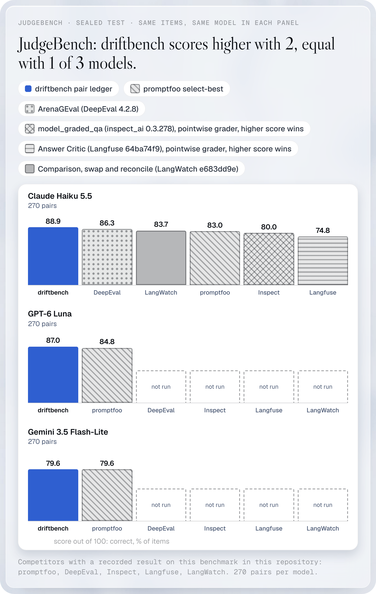
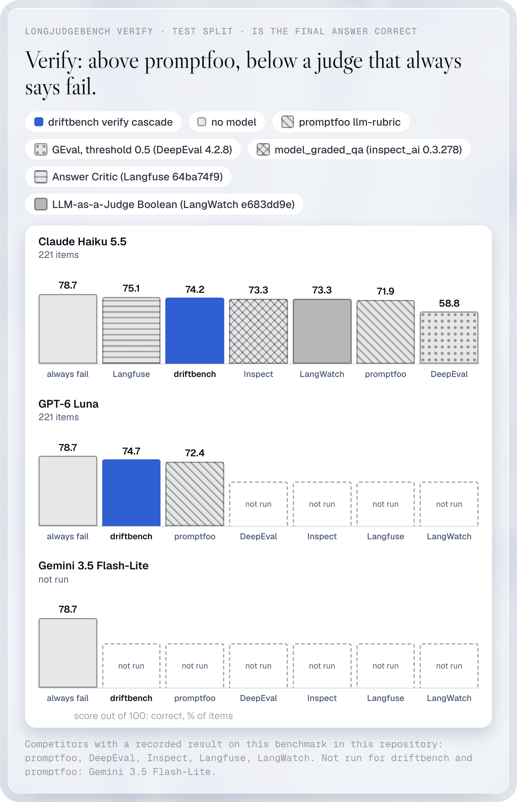
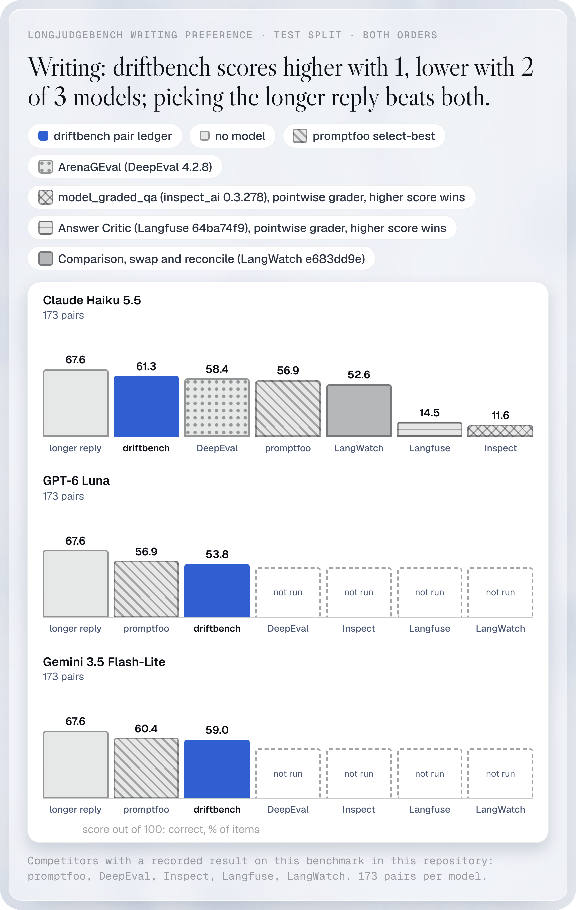
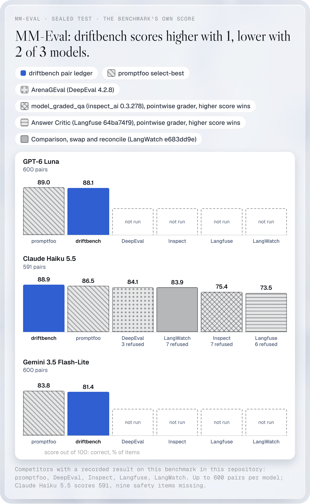
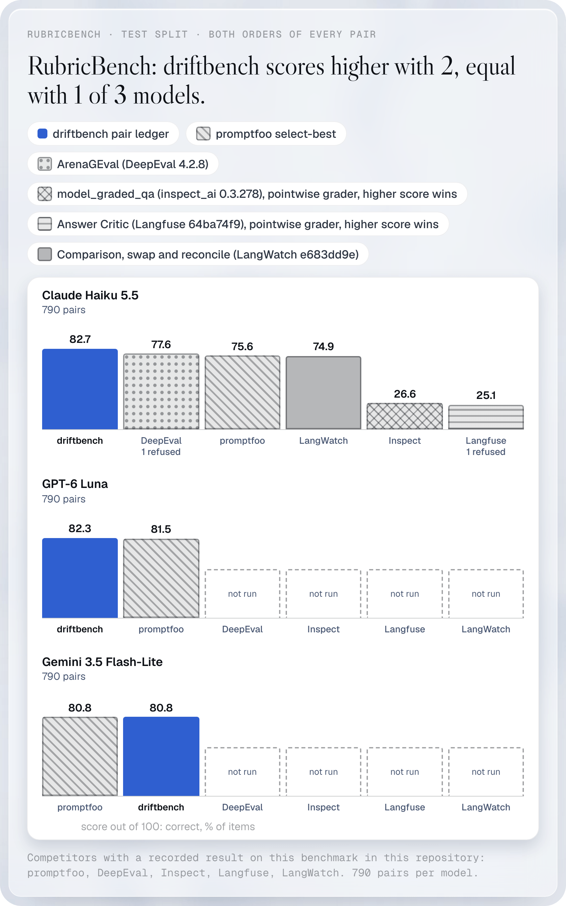

# Public judge benchmarks

The README shows one chart per benchmark: driftbench beside every competitor on one model. This page holds the rest: one chart and one table per benchmark with every model that was run, and a "not run" where a contestant was not. Bars run from the highest score to the lowest, on one scale of 0 to 100. A refused item counts as wrong, and the table says how many. The sets, the rules and the limits of each result are in [how the README numbers were measured](../methods.md#public-benchmarks-against-promptfoo). A correction across the whole family of cells is pending, so no cell is called a win or a loss.

DeepEval, Inspect, Langfuse and LangWatch were run on Claude Haiku 5.5 only. promptfoo and driftbench were also run on GPT-6 Luna and Gemini 3.5 Flash-Lite. Paired tests, wins, losses and spend per benchmark are in the [all-competitors tables](judgebench-all-peers.md).

## JudgeBench

Three models, 270 sealed pairs each.

| Model | Set | driftbench | promptfoo | DeepEval | Inspect | Langfuse | LangWatch |
|---|---|---:|---:|---:|---:|---:|---:|
| Claude Haiku 5.5 | 270 pairs | 88.9 | 83.0 | 86.3 | 80.0 | 74.8 | 83.7 |
| GPT-6 Luna | 270 pairs | 87.0 | 84.8 | not run | not run | not run | not run |
| Gemini 3.5 Flash-Lite | 270 pairs | 79.6 | 79.6 | not run | not run | not run | not run |

## LongJudgeBench

Verify is run on GPT-6 Luna for promptfoo and driftbench, and on Claude Haiku 5.5 for all contestants. Writing preference has 173 pairs per model, and a rule that picks the longer reply is drawn as a baseline.

| Model | Set | driftbench | promptfoo | DeepEval | Inspect | Langfuse | LangWatch | always fail |
|---|---|---:|---:|---:|---:|---:|---:|---:|
| Claude Haiku 5.5 | 221 items | 74.2 | 71.9 | 58.8 | 73.3 | 75.1 | 73.3 | 78.7 |
| GPT-6 Luna | 221 items | 74.7 | 72.4 | not run | not run | not run | not run | 78.7 |
| Gemini 3.5 Flash-Lite | not run | not run | not run | not run | not run | not run | not run | 78.7 |

| Model | Set | driftbench | promptfoo | DeepEval | Inspect | Langfuse | LangWatch | longer reply |
|---|---|---:|---:|---:|---:|---:|---:|---:|
| Claude Haiku 5.5 | 173 pairs | 61.3 | 56.9 | 58.4 | 11.6 | 14.5 | 52.6 | 67.6 |
| GPT-6 Luna | 173 pairs | 53.8 | 56.9 | not run | not run | not run | not run | 67.6 |
| Gemini 3.5 Flash-Lite | 173 pairs | 59.0 | 60.4 | not run | not run | not run | not run | 67.6 |

## MM-Eval

Up to 600 sealed pairs per model. Claude Haiku 5.5 scores 591 pairs; the nine missing are safety items.

| Model | Set | driftbench | promptfoo | DeepEval | Inspect | Langfuse | LangWatch |
|---|---|---:|---:|---:|---:|---:|---:|
| GPT-6 Luna | 600 pairs | 88.1 | 89.0 | not run | not run | not run | not run |
| Claude Haiku 5.5 | 591 pairs | 88.9 | 86.5 | 84.1 (3 refused) | 75.4 (7 refused) | 73.5 (6 refused) | 83.9 (7 refused) |
| Gemini 3.5 Flash-Lite | 600 pairs | 81.4 | 83.8 | not run | not run | not run | not run |

## RubricBench

Three models, 790 pairs each.

| Model | Set | driftbench | promptfoo | DeepEval | Inspect | Langfuse | LangWatch |
|---|---|---:|---:|---:|---:|---:|---:|
| Claude Haiku 5.5 | 790 pairs | 82.7 | 75.6 | 77.6 (1 refused) | 26.6 | 25.1 (1 refused) | 74.9 |
| GPT-6 Luna | 790 pairs | 82.3 | 81.5 | not run | not run | not run | not run |
| Gemini 3.5 Flash-Lite | 790 pairs | 80.8 | 80.8 | not run | not run | not run | not run |

## RubricEval

Data not public. No chart is planned.
