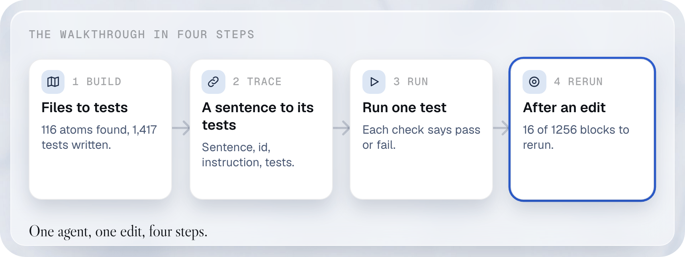

# A walkthrough on your own agent

This is a hands-on guide. It takes one small made-up agent, the Northwind ops assistant, from its files to a list of tests. Each test is one file, called a **spec**. The guide runs a test, then changes one rule. It reruns only the tests that rule can affect. Do the same on your own agent by swapping in your folder. Every command below is run by a test on GitHub, and every excerpt is real output. Nothing calls a model and nothing is paid for.

<a href="../../.github/readme/walkthrough-light.png">
  <picture>
    <source media="(prefers-color-scheme: dark)" srcset="../../.github/readme/walkthrough-dark.png">
    
  </picture>
</a>

## Before you start

**Why you do this.** driftbench reads your agent's files, so they must sit in one folder that you can point it at. This part sets that up and installs the tool.


**What you need.**

- Node 22.13 or newer, and driftbench installed from a clone, as the [guide index](index.md#install) shows. That gives you the command `driftbench`. Run this page from the root of the clone, because it reads `examples/estates/fixture`.
- A terminal open in the folder that holds your agent folder. Run every command of this page from there. In the example that folder is `walk`. For your own agent it is the folder that holds `my-agent`.
- Your agent as one folder that holds every file defining it. driftbench calls that folder the **estate**. It must follow the layout of Claude Code, Anthropic's coding agent, which is the only layout the `estate` commands read today. Anything else (a function, an HTTP endpoint, a script) uses the [quickstart](quickstart.md) instead.

| File | What goes in it |
|---|---|
| `CLAUDE.md` | Your system prompt: the rules the agent follows. |
| `.claude/skills/<name>/SKILL.md` | One folder per skill. A short header, then the instructions of the skill. |
| `.claude/agents/<name>.md` | One file per helper agent. |
| `.claude/settings.json` | The model, the permissions and the guards. |

**Two ways to run tests, and which to use.** `campaign run` runs test files you wrote. Its target can be a function, an HTTP endpoint or a command. The [quickstart](quickstart.md) uses it. `estate run` runs tests that driftbench generated from an agent folder, against Claude Code in a copy of that folder. This walkthrough uses it.

Your files can be small. This is the start of the example agent's `CLAUDE.md`:

```markdown
# Northwind ops assistant

## Rules

- **R1.** Always answer in the language of the user's latest message.
- **R7.** When a shipment is late by more than two days, tell the user and propose a supplier email.
```

And the start of one of its skills, `.claude/skills/weekly-report/SKILL.md`:

```markdown
---
name: weekly-report
description: Prepare the weekly operations report from the ledger and the shipment log.
---
Count only what the ledger and the shipment log show for the last seven days.
```

**Relevant commands.**

- `mkdir -p walk && cp -R examples/estates/fixture walk/northwind`: makes a working folder `walk` and copies the example agent into it as `northwind`, so the repository stays as it is · `-p` makes the folder if it is missing, `-R` copies a whole folder · it produces `walk/northwind`. With your own agent, copy or point at your own folder instead.
- `rm -rf walk/northwind/generated`: deletes the tests that come with the example, because step 1 writes them again · `-rf` removes a folder and what it holds without asking · it produces nothing.
- `cd walk`: goes into the working folder · no options · every later command runs from there.

```console
$ mkdir -p walk && cp -R examples/estates/fixture walk/northwind
$ rm -rf walk/northwind/generated
$ cd walk
```

**If it goes wrong.**

- `driftbench: command not found`: the install did not finish, or this terminal predates it. Run the install line again and open a new terminal.
- `cp: examples/estates/fixture: No such file or directory`: you are not at the root of the clone. Run `cd` to the clone first, then the commands again.
- Later commands say `Cannot find northwind`: you are in the wrong folder. Run `pwd`. It must print the path of `walk`.
- `rm` removed more than you meant: you ran it outside `walk`. The command names `walk/northwind/generated` only, so check your folder before you run it.

## 1. Turn the agent's files into tests

**Why you do this.** Writing hundreds of tests by hand is slow, and you would not know what you missed. This step lets code write them from your own files, and tells you what they cover.


**What you have.** The folder `northwind` with the files above.

**Two words first.** A rule is called an **atom**. An atom is one thing your files tell the agent to do or to use. It is kept with a quote of the line it came from. driftbench finds atoms in two ways. Code reads the structured parts itself: headings, lists, tables, links, the skill folders and the settings file. A model reads the prose, such as the sentences of your prompt, and says which ones are rules. A person, you, approves what the model found. The list of all atoms is the **map**.

**Three more words for the next command.** The **pointer reader** is the way driftbench reads prose. It cuts the prose into sentences and asks a labeler about each one. A **labeler** is a model that reads a sentence and says whether it is a rule. A labeler has a class. A `system1` labeler is quick and cheap, and answers yes or no. A `system2` labeler is a larger model that reads with more care. The **ledger** is the file `build/ledger.json`. It gives every sentence an id that stays the same when you edit the sentence. A **cassette** is a file of recorded answers from the labeler. Replaying a cassette costs nothing.

**Relevant commands.**

- `estate build`: reads your agent's files and lists what they tell the agent to do. It makes a **plan** (the list of situations to test) and writes the tests. It asks you twice before it goes on · `northwind` is your agent's folder. `--out build` is the folder where every file goes. `--pointer` gives each sentence of your prompt an id that survives edits, which step 4 needs. It keeps the ids in `build/ledger.json`. Your own files, `CLAUDE.md` included, are never changed. `--cassette northwind/cassette.jsonl` replays recorded answers of the model that labels the sentences, so no model is called in this example. `--states northwind/live/states/library.json` is the state library. It says how to put the agent in each session state, as step 3 explains. With it, the tests that need a state are written complete; `--yes` answers yes to both questions · it writes the map `build/map.yaml`, the approved map `build/approved.yaml`, the plan `build/plan.yaml` and the tests in `build/generated`.

**On your own agent** a model has to read your prose, so you need an Anthropic API key. The labeler is this model. Create one in your Anthropic account (console.anthropic.com, under API keys). Then set it, and name the model that reads your prose, and swap the `--cassette` option:

```bash
export ANTHROPIC_API_KEY=<your key>
export ANTHROPIC_LABELER_MODEL=claude-haiku-5-5
driftbench estate build my-agent --out build --pointer --labeler system2:anthropic --cassette my-agent.cassette.jsonl --record
```

`ANTHROPIC_LABELER_MODEL` is read by the `anthropic` labeler. It names the model that labels your sentences. Without it the labeler uses `claude-haiku-5-5`, so the line is optional. `--labeler system2:anthropic` picks the labeler: `system2` is the careful kind, a large model that reads each sentence. A `system1` labeler is a quick, cheap one that answers yes or no. `anthropic` is who runs it. `--cassette my-agent.cassette.jsonl` is where its answers are kept, and `--record` writes them there, so the next run is free.

**What it costs.** The cassette of the example, `examples/estates/fixture/cassette.jsonl`, holds the answers of such a live run with `claude-haiku-5-5`. It has 100 requests of the careful labeler, one for each chunk of prose. They hold 334,600 input tokens and 18,716 output tokens. The command `estate build --pointer --cassette northwind/cassette.jsonl --prices prices.yaml` prints these numbers once the next release is out. The repository records a price for this labeler: 0.10 USD per million input tokens and 0.50 USD per million output tokens ([source](../estate-pointer-reader.md)). At that price the 100 requests cost 0.0428 USD. The cassette also holds 21 requests of the quick labeler, which has no price in that source, so the figure leaves them out. A live run we made by hand on 2026-10-22 made 100 requests too, with 18,017 output tokens, which costs 0.0425 USD. A live model answers differently each time, so your numbers will differ.

**Why you do this.** The example replays recorded answers, so it needs no key. Your own prose has no recording yet, so a model must read it once, and the cassette keeps what it said.

**If it goes wrong.** A message that names `ANTHROPIC_API_KEY` as missing: export the key in the same terminal, then run again. Any other error from the model: the scan stops and keeps what it has, and running again continues without repeating the answers already recorded.

  What `estate build` runs for you, in this order:

  - `estate scan northwind --out build/map.yaml --pointer --cassette ...`: reads your files into a **map**, a list of **atoms** · the folder, `--pointer` and `--cassette` as above. An atom is one thing the files tell the agent to do or to use, with a quote of where it says so · it produces `build/map.yaml` and `build/ledger.json`, the ids of your sentences.
  - `estate approve build/map.yaml --all --to build/approved.yaml`: **first question.** You approve the atoms that a model split out of your prose, so the tests are built on them · `--all` approves every atom, `--to` names the approved copy · it produces `build/approved.yaml`. If you say no, nothing is approved and the command stops, with the files so far kept.
  - `estate map build/approved.yaml --to build/space.yaml`: lists the situations a test can vary, such as the kind of ask or the state of the session · `--to` names the file · it produces `build/space.yaml`.
  - `estate plan build/approved.yaml --space build/space.yaml --out build/plan.yaml`: chooses which situations to test, so that every pair of situations is covered at least once · `--space` is the file above, `--out` the plan · it produces `build/plan.yaml`, with one row per test.
  - `estate plan approve build/plan.yaml --all`: **second question.** You approve the planned tests · `--all` approves every row · it updates `build/plan.yaml`. If you say no, no test is written and the command stops.
  - `estate generate --map build/approved.yaml --plan build/plan.yaml --out build/generated`: writes one test file per planned test · the three paths are the inputs and the output folder · it produces `build/generated`, with the tests and a report of what each incomplete test still needs.

**Why it runs in these steps.** Each step needs the file the step before it wrote. The two questions stop the chain before it spends effort on atoms or tests you do not want.

**If a step fails.** `estate build` stops at that step and keeps the files of the steps before it. Read the message, fix the cause, and run the same command again. A step whose input did not change is skipped, so nothing is repeated. To run one step by hand, use the single command shown in the list above.

**Look at and decide.** Run it without `--yes`. In a terminal it asks. Here there is no terminal, so it stops at the first question and tells you what to type:

```console
$ driftbench estate build northwind --out build --pointer --cassette northwind/cassette.jsonl --states northwind/live/states/library.json   # exit 1
driftbench estate build northwind, into build
1. Read the estate: 116 atoms, 69 of them split from prose by a model and waiting for approval. Wrote build/map.yaml.
   The scan reported some refused labels or failed chunks; run with --verbose to read them.
Stopped before the first approval: 69 atoms were split from prose by a model and wait for your approval. Approve all 69?
Run again with --yes to approve them all, or approve some first with driftbench estate approve build/map.yaml --kind <kind> and run estate build again.
```

The question counts the atoms that wait. To read them before you answer, list them:

```console
$ driftbench estate approve build/map.yaml
build/map.yaml: 69 of 116 atoms wait for approval.
  instruction: 31
    instruction.inbox-triager.you-sort-messages-into-three-folders  .claude/agents/inbox-triager.md:8  "You sort messages into three folders: invoices, shipments..."
    instruction.inbox-triager.a-message-that-fits-none-goes  .claude/agents/inbox-triager.md:8  "A message that fits none goes to "other"."
Approve a kind with --kind <kind>, an atom with --atom <id>, or every atom with --all.
```

A good answer is yes when each atom restates a sentence of your files that you want tested. If some are wrong, approve only the good ones with `estate approve build/map.yaml --kind <kind>` or `--atom <id>`, and run `estate build` again. When you are happy, run it with `--yes`. The scan is not repeated, because its inputs did not change:

```console
$ driftbench estate build northwind --out build --pointer --cassette northwind/cassette.jsonl --states northwind/live/states/library.json --yes   # exit 1
driftbench estate build northwind, into build
1. Read the estate: unchanged since the last run, map.yaml kept.
2. Approve the atoms: approved all, as --yes says. Wrote build/approved.yaml.
3. Map and plan: the plan holds 1424 tests, chosen so that every pair of situations is covered at least once. Wrote build/space.yaml and build/plan.yaml.
4. Approve the plan: approved all 1424 tests, as --yes says.
5. Write the tests: 1424 tests written. 1283 are complete and 141 still wait for something (the report lists what).
```

**What you get.** The folder `build`, and a count of tests:

```text
1. Read the estate: 116 atoms, 69 of them split from prose by a model and waiting for approval. Wrote build/map.yaml.
3. Map and plan: the plan holds 1424 tests, chosen so that every pair of situations is covered at least once. Wrote build/space.yaml and build/plan.yaml.
5. Write the tests: 1424 tests written. 1283 are complete and 141 still wait for something (the report lists what).
```

Read it like this: the map holds 116 atoms. The **plan** is the list of situations to test. It is chosen so that every pair of situations meets at least once. A pair is a kind of question with a kind of session, say. The plan holds 1424 tests. 1283 are complete. The other 141 still wait for something, such as an answer to give or a recorded session. The report in `build/generated` says what each one needs. The command exits 1 while tests wait. That is expected.

**If it goes wrong.**

- `Cannot find northwind.` (exit 2): the folder name is wrong, or you are not in the folder that holds it. Check with `ls`, then give the right path.
- `Stopped before the first approval` or `Stopped before the second approval` (exit 1): this is not a failure. The command found nothing to ask in a terminal and stopped on purpose. Run it with `--yes`, or approve first as the message says.
- `The scan reported some refused labels or failed chunks` (the command exits 1): the map is written and the build went on. Some sentences were not turned into atoms. Run again with `--verbose` to read which ones, and reword those sentences if you want them tested.
- A message that names `ANTHROPIC_API_KEY` as missing (your own agent): export the key as shown above, and run again. The scan will not repeat what did not change.
- `5. Write the tests` says that many tests still wait: that is normal. The report in `build/generated` lists what each one needs, such as an answer to give.

## 2. See which tests cover one sentence

**Why you do this.** Before you trust the link between a sentence and its tests, look at one chain with your own eyes. Step 4 relies on it.


**What you have.** One sentence of the weekly report skill, on line 12 of its `SKILL.md`:

```console
$ grep -n "Count only" northwind/.claude/skills/weekly-report/SKILL.md
12:Count only what the ledger and the shipment log show for the last seven days. Read
```

**Relevant commands.**

- `grep -A8 "^  links:" <test file>`: shows the **links** of one test, which say what the test is about · `-A8` prints the 8 lines after the match. `"^  links:"` is the line to find. `<test file>` is the test to read, here the obligation test of the sentence · it prints the links.

```console
$ grep -A8 "^  links:" build/generated/specs/live/obligation/estate.obligation.instruction.weekly-report.count-only-what-the-ledger-and.yaml
```

**You get and how to read it.**

```text
        kind: rule
        rule: instruction.weekly-report.count-only-what-the-ledger-and
        ledger: wrl4c7wlvb
      relation: verifies
      status: declared
```

Step 1 gave the sentence an id, `wrl4c7wlvb`, that stays the same when the sentence is edited. It also made the sentence the atom `instruction.weekly-report.count-only-what-the-ledger-and`. This test says it `verifies` that atom. Read the lines of the link like this. `kind: rule` says the test points at a rule. `rule` is the id of the atom. `ledger` is the id of the sentence. `relation: verifies` says the test checks that rule. `status: declared` says a generator wrote the link and nothing has checked it yet. The `status: live` that you see in `build/ledger.json` is a different thing: it says the sentence is still in your files. To check a link, `estate mutate` deletes the line of the rule from a copy of the estate. The tests then run again on the copy, and `estate prove` marks the link `verified` when its test now fails. The [rule links walkthrough](../rule-links.md) runs that check. The file is called `obligation`. That is one of three kinds of test written for each rule. An **obligation** test checks that the agent does what the rule says. An **outside_trigger** test is a control that checks the agent does not apply the rule where it should not. A **twin** test asks for the same thing in other words. In all, 17 tests name this sentence; step 4 lists them. When you edit the sentence, driftbench follows this chain to find them.

<details><summary>Look at the id, the atom and the test itself</summary>

The id and the text of the sentence, in the file `build/ledger.json`:

```console
$ node -e 'const l=JSON.parse(require("fs").readFileSync("build/ledger.json","utf8"));const e=l.entries.find((x)=>x.id==="wrl4c7wlvb");console.log(JSON.stringify({id:e.id,fp:e.fp,path:e.path,status:e.status,quote:e.quote},null,2))'
{
  "id": "wrl4c7wlvb",
  "fp": "731c59e8e7713e95",
  "path": ".claude/skills/weekly-report/SKILL.md",
  "status": "live",
  "quote": "Count only what the ledger and the shipment log show for the last seven days."
}
```

To find the id of your own sentence, search the ledger for words of it:

```console
$ node -e 'const l=JSON.parse(require("fs").readFileSync("build/ledger.json","utf8"));console.log(l.entries.filter((x)=>x.quote.includes(process.argv[1])).map((x)=>x.id+" "+x.path).join("\n"))' "Count only"
wrl4c7wlvb .claude/skills/weekly-report/SKILL.md
```

The atom in the map, with its quote and where it sits:

```console
$ grep -B1 -A9 "id: instruction.weekly-report.count-only-what-the-ledger-and" build/map.yaml
  - id: instruction.weekly-report.count-only-what-the-ledger-and
    kind: instruction
    title: Count only what the ledger and the shipment log show for the last seven days.
    provenance:
      file: .claude/skills/weekly-report/SKILL.md
      startLine: 12
      endLine: 12
      quote: Count only what the ledger and the shipment log show for the last seven days.
      hash: 6fed6d234ad61539420fe7e424ee64104bd3d2065701ad8f40896728bc69158c
    producedBy: model
```

`producedBy: model` says that a model, not code, found this atom in prose, so you approved it in step 1. An atom that code read from a heading, a list or a settings file says `producedBy: code`, and needs no approval. `quote` and `hash` let driftbench check later that the sentence in your file is still the one the atom quotes.

The first three of the tests that name it. The files named `pairwise` are tests of the plan. They cross this rule with other situations, such as a kind of ask with a kind of session:

```console
$ grep -rl -- "- instruction.weekly-report.count-only-what-the-ledger-and$" build/generated/specs/live | sort | head -3
build/generated/specs/live/obligation/estate.obligation.instruction.weekly-report.count-only-what-the-ledger-and.yaml
build/generated/specs/live/obligation/estate.pairwise.0107.yaml
build/generated/specs/live/obligation/estate.pairwise.0177.yaml
```

The part of the first test that says what to do and what to expect. A **block** is one message from the user and what must be true after it:

```console
$ sed -n '/^blocks:/,/^metadata:/p' build/generated/specs/live/obligation/estate.obligation.instruction.weekly-report.count-only-what-the-ledger-and.yaml
blocks:
  - id: ask
    when:
      user: Please prepare the weekly report.
    expect:
      skills:
        - name: weekly-report
          count:
            min: 1
      workspace:
        deleted: []
      criteria:
        - instruction.weekly-report.count-only-what-the-ledger-and
metadata:
```

Read the block like this. `when.user` is the message the test sends. `expect` lists what must be true after the reply. `skills` says the agent must load the skill `weekly-report` at least once. `workspace.deleted: []` says the agent may delete no file. `criteria` names the rules that a judge reads. See the [glossary](index.md#words-used-in-the-guide) for **expect**, **skill** and **criterion**.

</details>

**If it goes wrong.**

- The `grep -A8` prints nothing: the test file is not there, or the sentence became no atom. Check that `build/generated` exists, then read the atoms of your sentence with `grep -n "Count only" build/map.yaml`. No match means the model did not call it a rule. Write the sentence as a plain instruction, such as "Count only what the ledger shows", and run `estate build` again.
- You are on your own agent: the id `wrl4c7wlvb` belongs to the example sentence. Your sentences have their own ids. Search `build/ledger.json` for words of your sentence, with the command in the fold above.

## 3. Connect your agent and run a test

**Why you do this.** A test only means something when it runs against an agent. This step shows what you must give driftbench to run your agent, and what a verdict looks like.


**What you have.** The test file from step 2. It starts a fresh session and says: "Please prepare the weekly report."
The agent must load the `weekly-report` skill, delete no file, and obey the rule.

**What you must provide.** A command that runs your agent **headless**, which means once, from the command line, with no window. It takes the question as input, does its work, and exits. You have three choices:

- A **stand-in**: a script that plays recorded answers in place of the agent. It calls no model and costs nothing. The example folder has one, and this walkthrough uses it.
- Your real agent: the command `claude`, which is Claude Code. Only the labeler of step 1 calls the Anthropic API directly and needs `ANTHROPIC_API_KEY`. The agent run and the judge of this step go through your `claude` command. They use its login, or the key you pass. With only the Claude Code login, you can run everything in this step and in step 4: the agent and the judge use the login. You need no API key for them. Install it with `npm install --global @anthropic-ai/claude-code`, run `claude` once in your terminal and log in as it asks ([Claude Code setup](https://docs.claude.com/en/docs/claude-code/overview)). These install lines are not run by our tests, because they install third-party software. To check the install, run `claude --version`. It prints a line such as `2.1.306 (Claude Code)`. We ran that line by hand. It calls a model and costs money, so you add `--allow-billed` to say you accept that, and `--max-budget-usd` to cap what one test may spend. This is the whole command, with a real model name:

  ```bash
  driftbench estate run build/generated/specs/live/obligation/estate.obligation.instruction.weekly-report.count-only-what-the-ledger-and.yaml --estate my-agent --runtime claude-code --command claude --allow-billed --model claude-haiku-5-5 --judge claude:claude-haiku-5-5 --judge-budget 1 --max-budget-usd 1 --store runs.db
  ```

  `--model claude-haiku-5-5` is the model your agent runs on. `--judge claude:claude-haiku-5-5` is the model that reads the answers that code cannot check. It runs through the same `claude` command, so it uses the same login as the agent. `claude-haiku-5-5` is the full name of a model. `claude:haiku` is a short alias that your `claude` command resolves to its current Haiku model. This page uses the full name everywhere. `--judge-budget 1` caps what all judge calls of this command may spend together, in dollars. The command refuses to start without it. `--max-budget-usd 1` caps what each test may spend. Both the agent run and the judge use the login of `claude`. To use an API key in place of the login, run `export ANTHROPIC_API_KEY=<your key>` and add `--pass-env ANTHROPIC_API_KEY`. `--store runs.db` is the file where the run is kept. This is the real output of that command. We ran it once by hand on 2026-10-22, with an API key. It ran on the example agent: the folder `northwind` replaces `my-agent`. It is not run by the tests, because it is billed:

  ```txt
  note: the estate copy is not pinned to a map hash; pass --map to pin it
  ✓ estate.obligation.instruction.weekly-report.count-only-what-the-ledger-and  (0.0085 USD)
      judged instruction.weekly-report.count-only-what-the-ledger-and: pass
  1 spec run live: 1 pass, 0 fail. Cost 0.0085 USD over 1 run that report one, judge claude:claude-haiku-5-5 0.0017 USD of it. Campaign estate-run-d0c1fe2d38a8.
  ```

  The real agent passes where the stand-in failed. The run cost 0.0085 US dollars, of which 0.0017 was the judge. A live model answers differently each time, so your numbers and verdicts will differ. The `note` line is only a reminder that `--map` was left out. A **map hash** is the short fingerprint of the approved map. `--map` pins the run to it, so the run refuses a folder that changed after you approved it. You do not need `--map` or `--states`. `--map` is only a safety check that the folder is the one you approved. `--states` is only for tests that start from a resumed session or another prepared state. The example needs it only because its stand-in plays those.
- Not a Claude Code agent: use the [quickstart](quickstart.md), which connects a command, a function or an HTTP endpoint.

**Find a test file for your agent.** `estate run` takes the path of one test file. **Why you do this.** `estate run` needs the path of one file. The build wrote more than a thousand. This command lists a few, so you can pick one.

**Relevant commands.**

- `find build/generated/specs/live -name '*.yaml' | LC_ALL=C sort | head -5`: lists test files · `-name '*.yaml'` keeps only test files. `sort` puts them in a fixed order. `head -5` keeps the first five · it prints one path per line.

```console
$ find build/generated/specs/live -name '*.yaml' | LC_ALL=C sort | head -5
build/generated/specs/live/dispatch/estate.dispatch.subagent.inbox-triager.helper-inbox-triager.yaml
build/generated/specs/live/dispatch/estate.dispatch.subagent.ledger-auditor.helper-ledger-auditor.yaml
build/generated/specs/live/dispatch/estate.dispatch.subagent.route-planner.helper-route-planner.yaml
build/generated/specs/live/dispatch/estate.pairwise.0019.yaml
build/generated/specs/live/dispatch/estate.pairwise.0083.yaml
```

The folders under `live` group the tests by kind. The folder `obligation` holds the tests of one rule each, named after the rule. Pick one and give its path to `estate run`.

**If it goes wrong.** The command prints nothing: the build did not write tests. Check that `build/generated/specs/live` exists, then run step 1 again.

**Relevant commands.**

- `estate run`: starts the agent in a throw-away copy of your folder, sends the test's message and checks what the agent did · `<test file>` is the test to run. `--estate northwind` is your agent's folder, copied for the run. `--runtime claude-code` is the only runtime today. `--command northwind/live/fake/claude.mjs` is the program that stands in for the agent. For your agent it is `claude`. `--set-env "FAKE_MANIFEST=$PWD/northwind/live/fake/manifest.json"` hands the stand-in the file of its recorded answers. `--store original.db` is the file where the run is kept. `--map build/approved.yaml` checks that the copy is the folder you approved. `--states northwind/live/states/library.json` is a file of session states the stand-in plays. A **session state** is where the conversation stands when a test starts, such as `resumed`. The file is a **state library** · it prints one line per test and writes the run to `original.db`.

```console
$ driftbench estate run build/generated/specs/live/obligation/estate.obligation.instruction.weekly-report.count-only-what-the-ledger-and.yaml --estate northwind --runtime claude-code --command northwind/live/fake/claude.mjs --set-env "FAKE_MANIFEST=$PWD/northwind/live/fake/manifest.json" --store original.db --map build/approved.yaml --states northwind/live/states/library.json   # exit 1
```

**You get and how to read it.**

```text
✗ estate.obligation.instruction.weekly-report.count-only-what-the-ledger-and  (0.0000 USD)
    failing: block 0: skills.weekly-report, block 0: judge.instruction.weekly-report.count-only-what-the-ledger-and (inconclusive)
```

A ✗ means the test failed. The `failing:` line names each check that failed. Here the stand-in has no recorded answer for this question, so the agent never loaded the weekly report skill. No judge was set to read its answer. That check is **inconclusive**, which means it has no verdict. That is why this example fails. Nothing was spent, because the stand-in is a script. With your real agent you would use `--command claude --allow-billed --judge claude:<model>`.

**If it goes wrong.**

- `claude: command not found`: Claude Code is not installed, or not on your path. Run the install line above, open a new terminal, and check `claude --version`.
- `claude` asks you to log in, or answers with an authentication error. Run `claude` by hand once and finish the login, then run the test again.
- `claude is not a stand-in: a live run of the real runtime is billed. Size it first, then pass --allow-billed.` (exit 2): you asked for a real agent. Add `--allow-billed` once you accept the cost, or use a stand-in. To size the run, count the tests you plan to run, and multiply by the cost of one test. The example test cost 0.0085 USD.
- `a judge on a command that is not a stand-in is billed: pass --judge-budget <usd>` (exit 2): add `--judge-budget` with a number of dollars, such as `--judge-budget 1`.
- Every test says `?` or `inconclusive`: no judge was set, so the checks that need one have no verdict. Add `--judge claude:claude-haiku-5-5` and `--judge-budget 1`.
- A `✗` with `skills.weekly-report` in the `failing:` line: the agent did not load that skill. Read the skill's `description` in its `SKILL.md`: it must say when the skill applies.
- The run is slow or expensive: add `--max-budget-usd` to cap each test, and run one test first, as here.

## 4. Change a rule, and rerun only what it can affect

**Why you do this.** After an edit you want to know whether you broke something. Rerunning every test is slow and costs money. Rerunning only the tests the edit can reach is fast, and the saving is measured.


**A baseline first.** To know whether an edit broke something, you need the results from before the edit. A **baseline** is a run of the tests on the unedited folder, kept in a store. In a real project the baseline is the whole suite (`build/generated/run-order.txt` lists it). With a real agent it is billed. Size it first. Count the tests and multiply by the cost of one test (0.0085 USD for the example test). Here, to stay short, the baseline is 25 tests: the 17 tests that name the sentence of step 2, and 8 others. The stand-in runs them free.

- `grep -rl ... > rerun.txt`: lists the tests that name the sentence, as in step 2 · `-r` searches the folder, `-l` prints file names · it writes the 17 names to `rerun.txt`.
- `find ... | grep -v ... | head -8 > others.txt`: picks 8 tests that do not name it · `grep -v -x -F -f rerun.txt` drops the 17 · it writes `others.txt`.
- `driftbench estate run --order base.txt ... --agent-version v1`: runs the 25 tests and keeps the results · `--order` is the file of names. `--store before.db` is the store. `--agent-version v1` labels this version of your agent. The next steps use the label to carry results · it prints one line per test, and a last line that counts them.

```console
$ grep -rl -- "- instruction.weekly-report.count-only-what-the-ledger-and$" build/generated/specs/live | LC_ALL=C sort > rerun.txt
$ find build/generated/specs/live -name '*.yaml' | LC_ALL=C sort | grep -v -x -F -f rerun.txt | head -8 > others.txt
$ cat rerun.txt others.txt | LC_ALL=C sort > base.txt
$ grep -c "" base.txt
25
$ driftbench estate run --order base.txt --estate northwind --runtime claude-code --command northwind/live/fake/claude.mjs --set-env "FAKE_MANIFEST=$PWD/northwind/live/fake/manifest.json" --store before.db --agent-version v1 --states northwind/live/states/library.json   # exit 1
25 specs run live on a stand-in: 0 pass, 25 fail (1 undecided: only inconclusive checks). Cost 0.0000 USD over 25 runs that report one, judge none 0.0000 USD of it. Campaign estate-run-<id>.
```

`estate run` has no flag to repeat each test. To repeat a run, run the same command again with a new `--store`, such as `before-2.db`.

**If the baseline goes wrong.** `base.txt` is empty: the build wrote no tests, so run step 1 again. The run asks for `--allow-billed`: you used a real agent, so read the cost note in step 3 first. The run takes long: start with the tests of your sentence, as here.

**What you have.** You edit one sentence of your prompt, from seven days to fourteen days. You do not run `estate build` again for this. `radius ledger` reads your edited files and compares them with the ledger of step 1. Run `estate build` again only when you want new tests.

**Why you edit by hand here.** The edit is the change you want to test. Use `sed` as shown, or open the file in your editor and change the sentence.

```console
$ sed -i.bak 's/for the last seven days/for the last fourteen days/' northwind/.claude/skills/weekly-report/SKILL.md
$ grep -n "Count only" northwind/.claude/skills/weekly-report/SKILL.md
12:Count only what the ledger and the shipment log show for the last fourteen days. Read
```

**Relevant commands.**

- `radius ledger`: finds what you changed by the ids of step 1 and writes a **change file** · `build/map.yaml` is the map from step 1. `--ledger build/ledger.json` is the file of sentence ids. `--from-version v1` and `--to-version v2` name the two versions of your agent, as the baseline did. `--out change.yaml` is where the change file goes · it prints how many sentences changed and writes `change.yaml`.
- `radius`: reads the change file and the links of every test, and lists the tests the change can reach. That list is the **blast radius** · `build/generated/specs/live` is the folder of tests to look through; `--change change.yaml` is the change file · it prints the count and the list, and runs nothing.

```console
$ driftbench radius ledger build/map.yaml --ledger build/ledger.json --from-version v1 --to-version v2 --out change.yaml
$ driftbench radius build/generated/specs/live --change change.yaml
```

**Why two commands.** The first turns your edit into a change file. The second reads the links of the tests and lists those the change can reach.

**If these fail.** `Cannot find build/map.yaml`: you are not in the folder that holds `build`. `Units: ... 0 changed`: the file you edited is not under the estate folder, or it was not saved. An empty list: the edited sentence holds no atom, so reword it as an instruction and build again.

**You get and how to read it.** The output uses four words. A **block** is one test message with its checks. A **cell** is one test file run once. **Mode F** means the agent runs the whole conversation on its own replies. The **manifest** is a short id of the change file. First the count, then the list:

```text
Blast radius of v1 to v2 (manifest 6c3bc0d86690): prompt:instruction.weekly-report.count-only-what-the-ledger-and.
1248 specs, 1251 blocks.
Mode F, free-running: 17 of 1251 blocks in the radius (17 direct, 0 forward), 1234 out. 17 of 1248 cells.
  A cell reruns whole: 17 of 1251 blocks sent, 98.6% saved; 1231 of 1248 cells left to carry.
```

Of 1251 blocks, 17 can be reached by that sentence. The other 1234 are not run, which saves 98.6%. The 1248 specs are the live tests that `estate run` sends to an agent. The step 1 count of 1424 tests also holds 35 static and unit tests that need no agent. It holds 141 incomplete tests that wait for something. Most live test files hold one block: 1248 files hold 1251 blocks in all. The 17 files in the radius hold one block each, so 17 blocks are 17 test files. The change file is the small file `change.yaml` that names what you changed. The list:

```text
In the radius, mode F:
  spec                                                                             blocks in  from  why
  estate.obligation.instruction.weekly-report.count-only-what-the-ledger-and       1 of 1     ask   prompt:instruction.weekly-report.count-only-what-the-ledger-and
  estate.outside_trigger.instruction.weekly-report.count-only-what-the-ledger-and  1 of 1     ask   prompt:instruction.weekly-report.count-only-what-the-ledger-and
  estate.twin.instruction.weekly-report.count-only-what-the-ledger-and             1 of 1     ask   prompt:instruction.weekly-report.count-only-what-the-ledger-and
  estate.pairwise.0107                                                             1 of 1     ask   prompt:instruction.weekly-report.count-only-what-the-ledger-and
  estate.pairwise.0177                                                             1 of 1     ask   prompt:instruction.weekly-report.count-only-what-the-ledger-and
```

Read each row as one test file: its name, how many of its blocks are in the radius, and why. The `why` is the same for all of them: they name the sentence you changed. Three are named after the rule, the obligation, outside_trigger and twin tests of step 2. The other 13 are called `pairwise`: they are tests of the plan that cross this sentence with other situations. The last one is the `ordered_pair` test of the gate `gate.weekly-report.read-templates-report-md-before-writing`. That gate and this sentence are in one section of the skill file. So the plan puts them in one row. So the 17 blocks are 17 files, 3 named for the rule, 13 from the plan and 1 for the gate of the same section.

**Which id to grep for.** The first line of the radius output ends with `prompt:` and the id of the atom you changed. Here it is `instruction.weekly-report.count-only-what-the-ledger-and`. On your own agent it is the text after `prompt:`, without the final full stop. The tests that name an atom hold a line `- <atom id>` in their links, so a `grep` for that line finds them.

**Rerun, and carry the rest.** Run the same 25 names again with the edited folder. Add `--from before.db`, `--change change.yaml` and `--agent-version v2`. The tests in the radius run fresh. A test outside it keeps its stored result from the baseline, and is marked `(carried)`. `--map` is left out because the files changed since the map was written. The shown lines leave out the per-test notes, and the campaign id changes at every run, so the page shows it as `<id>`:

- `--from before.db`: the store of the baseline. It is never written · it is where carried results come from.
- `--change change.yaml`: the change file, so the command knows which tests the edit can reach.
- `--agent-version v2`: the label of this version, which must match the `--to-version` of the change file.

```console
$ driftbench estate run --order base.txt --estate northwind --runtime claude-code --command northwind/live/fake/claude.mjs --set-env "FAKE_MANIFEST=$PWD/northwind/live/fake/manifest.json" --store edited.db --agent-version v2 --from before.db --change change.yaml --states northwind/live/states/library.json   # exit 1
Blast radius of v1 to v2 (manifest 6c3bc0d86690): prompt:instruction.weekly-report.count-only-what-the-ledger-and.
17 of 25 cells in the radius. 17 cells run fresh, 8 carried from estate-run-<id> in before.db.
✗ estate.dispatch.subagent.inbox-triager.helper-inbox-triager  (carried)
    failing: block 0: subagents.inbox-triager
✗ estate.obligation.instruction.weekly-report.count-only-what-the-ledger-and  (0.0000 USD)
    failing: block 0: skills.weekly-report, block 0: judge.instruction.weekly-report.count-only-what-the-ledger-and (inconclusive)
17 specs run live on a stand-in and 8 carried: 0 pass, 25 fail (1 undecided: only inconclusive checks). Cost 0.0000 USD over 17 runs that report one, judge none 0.0000 USD of it. Campaign estate-run-<id>.
```

Read it like this. The line "17 of 25 cells in the radius" counts the tests the edit can reach. Those 17 ran, and 8 were carried. A `✗` is a test that failed on a check, as in step 3. A `?` is a test that could not be decided, because it needs a judge and none was set. The last line counts the fresh and the carried tests, and gives the cost. The stand-in has no judge, so all 25 tests show as failed here. With the real agent and a judge, they get a verdict. A **campaign** is one run of a set of tests, kept in the store under its id. In a real project the baseline is the whole suite, so one edit reruns 17 of 1248 tests and carries the other 1231.

**If the carry goes wrong.**

- `Nothing is carried, every cell runs`: the version label of this run is not the `--to-version` of the change file, or the old store holds no campaign of the `--from-version`. Use the same labels in the baseline, in `radius ledger` and in this run.
- `--from` is refused: it needs `--change` and `--agent-version` too.
- A carried result looks old: `--max-age` (7 days) and `--max-carry` (5 campaigns in a row) limit how long a result is carried. Past the limit the test runs fresh.

**Rerun them on a real agent.** Use the real agent and a judge, as in step 3, on the 17 tests of the sentence. The recorded run below was made earlier, on 16 tests, before the plan grouped the atoms of one section. It is billed, so the caps stay. `--max-budget-usd 0.05` caps each test. `--judge-budget 0.2` caps all the judge calls. So the whole run cannot pass 1 USD. A real agent also needs the **state library**. A **session state** is where the conversation stands when a test starts, such as `resumed` or `after_compaction`. A **state library** is a file that tells driftbench how to put the agent in each state. Without it, a test that needs a state stops with an error. The example's library is `northwind/live/states/library.json`. On your own agent, `estate build` writes a library of its own to `build/generated/states/library.json`. It holds the states that need no file of yours (`long`, `after_compaction`, `after_restart`) and the events that change the runtime. The tests that need a state of your own wait as incomplete until you add an operation for it to the library.

```bash
driftbench estate run --order rerun.txt --estate my-agent --runtime claude-code --command claude --allow-billed --model claude-haiku-5-5 --judge claude:claude-haiku-5-5 --judge-budget 0.2 --max-budget-usd 0.05 --states build/generated/states/library.json --store edited.db
```

This is the real output of that command. We ran it once by hand on 2026-10-22, with an API key. It ran on the example agent: the folder `northwind` replaces `my-agent`, with its own state library. It is not run by the tests, because it is billed. The campaign id changes at every run:

```txt
note: the estate copy is not pinned to a map hash; pass --map to pin it
✗ estate.obligation.instruction.weekly-report.count-only-what-the-ledger-and  (0.0055 USD)
    failing: block 0: judge.instruction.weekly-report.count-only-what-the-ledger-and
    judged instruction.weekly-report.count-only-what-the-ledger-and: fail
✓ estate.pairwise.0107  (0.0026 USD)
    judged instruction.weekly-report.count-only-what-the-ledger-and: pass
✓ estate.pairwise.0177  (0.0024 USD)
    judged instruction.weekly-report.count-only-what-the-ledger-and: pass
✓ estate.pairwise.0244  (0.0044 USD)
    judged instruction.weekly-report.count-only-what-the-ledger-and: pass
✓ estate.pairwise.0315  (0.0028 USD)
    judged instruction.weekly-report.count-only-what-the-ledger-and: pass
✓ estate.pairwise.0380  (0.0026 USD)
    judged instruction.weekly-report.count-only-what-the-ledger-and: pass
✓ estate.pairwise.0449  (0.0026 USD)
    judged instruction.weekly-report.count-only-what-the-ledger-and: pass
✓ estate.pairwise.0520  (0.0028 USD)
    judged instruction.weekly-report.count-only-what-the-ledger-and: pass
✓ estate.pairwise.0638  (0.0026 USD)
    judged instruction.weekly-report.count-only-what-the-ledger-and: pass
✗ estate.pairwise.0697  (0.0048 USD)
    failing: block 0: judge.instruction.weekly-report.count-only-what-the-ledger-and
    judged instruction.weekly-report.count-only-what-the-ledger-and: fail
✓ estate.pairwise.0734  (0.0031 USD)
    judged instruction.weekly-report.count-only-what-the-ledger-and: pass
✓ estate.pairwise.0792  (0.0025 USD)
    judged instruction.weekly-report.count-only-what-the-ledger-and: pass
✗ estate.pairwise.1016  (0.0050 USD)
    failing: block 0: judge.instruction.weekly-report.count-only-what-the-ledger-and
    judged instruction.weekly-report.count-only-what-the-ledger-and: fail
✓ estate.pairwise.1048  (0.0054 USD)
    judged instruction.weekly-report.count-only-what-the-ledger-and: pass
✓ estate.outside_trigger.instruction.weekly-report.count-only-what-the-ledger-and  (0.0023 USD)
    judged instruction.weekly-report.count-only-what-the-ledger-and.control: pass
✓ estate.twin.instruction.weekly-report.count-only-what-the-ledger-and  (0.0030 USD)
    judged instruction.weekly-report.count-only-what-the-ledger-and: pass
16 specs run live: 13 pass, 3 fail. Cost 0.0544 USD over 16 runs that report one, judge claude:claude-haiku-5-5 0.0147 USD of it. Campaign estate-run-2512856d0930.
```

The recorded run cost 0.0544 US dollars, of which 0.0147 was the judge, for 16 tests. It was made before the plan grouped the atoms of one section, so the 17th test is not in it. Three tests failed on the judge: the obligation test and two pairwise tests. A live model answers differently each time, so run a test more than once before you trust one verdict. The [read the numbers](read-the-numbers.md) part shows how to repeat runs and read the spread.

**Why you do this.** A rerun without `--judge` leaves every judged check undecided (`?`), so the edit would look unproven. `--allow-billed` and `--judge-budget` are required for a real agent, as in step 3.

**If it goes wrong.**

- `wc -l rerun.txt` prints `0`: the `grep` found no test. The id is mistyped, or you are not in the folder that holds `build`. Copy the id from the first line of the radius output, without the final full stop.
- The real-agent rerun costs more than you expect: run a few tests first, lower `--max-budget-usd`, and keep `--judge-budget` small. Cost is printed on the last line of the output.
- Every line of the rerun shows `?` or `inconclusive`: you left `--judge claude:claude-haiku-5-5 --judge-budget 1` out. Add both and run again.
- A line starts with `!` and says `the session state resumed has no operation in the state library`: you ran without `--states`, or the library has no operation for that state. Pass `--states <library>`, or add the operation to the library.
- A refusal that names `--allow-billed` or `--judge-budget` (exit 2): add the one it names.
- `Units: ... 0 changed`: the edit did not change any sentence that the ledger knows. Check that you edited a file under the estate folder and saved it.
- `The radius is the whole suite` and `unit selection is advisory`: your edit hit a sentence that holds no atom, so driftbench cannot tell which tests it affects and keeps the whole suite. Nothing is skipped. Reword the sentence as an instruction so that it becomes an atom, then run `estate build` and `radius` again.
- The count in `rerun.txt` is not the count in the radius: the radius is the authority. Use the names of its list, and check that you ran the `grep` from the folder that holds `build`.
- Your own agent has no ledger: you left `--pointer` out of `estate build`. Run it again with `--pointer`, since step 4 needs the ids.
