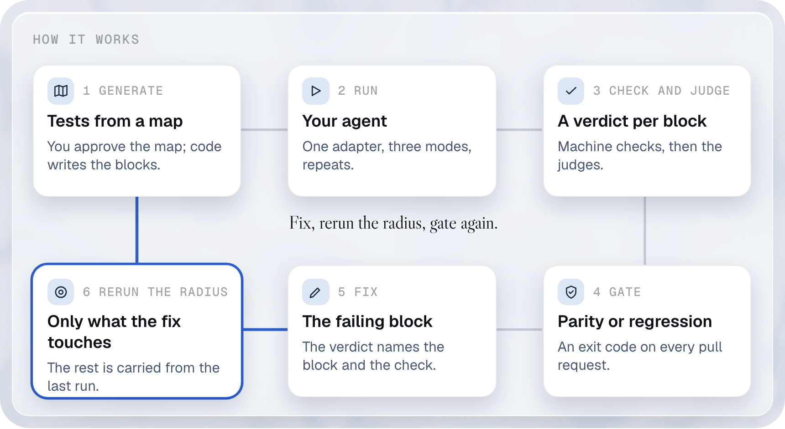
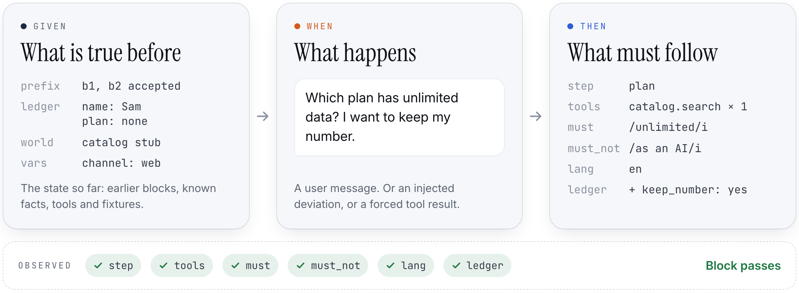
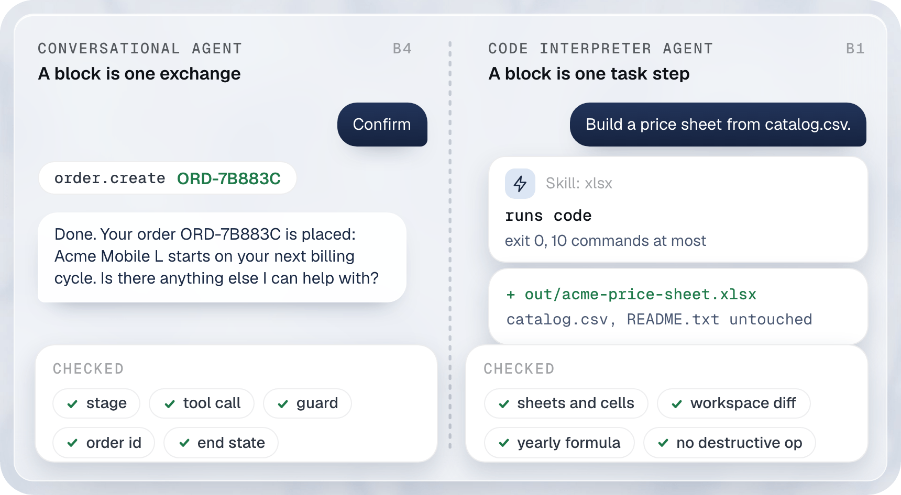
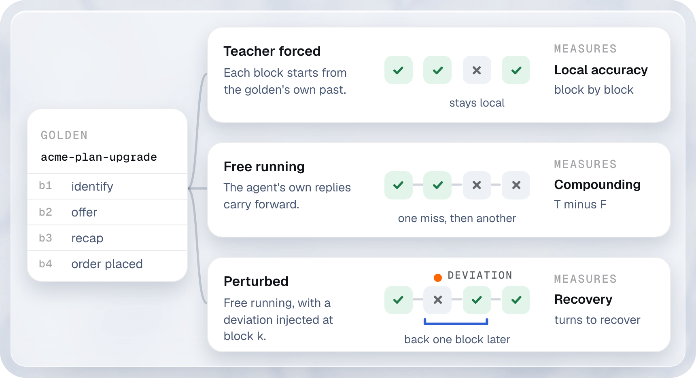
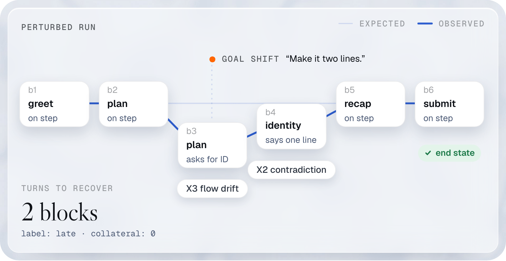

# How it works

The loop a team runs, with its commands and what they print. The [README](../README.md#what-driftbench-does) tells the same story in plain words.

<a href="../.github/readme/loop-light.png">
  <picture>
    <source media="(prefers-color-scheme: dark)" srcset="../.github/readme/loop-dark.png">
    
  </picture>
</a>

Six steps, numbered as in the figure, then the loop again. You can start at step 2 with specs you write by hand, as in the quickstart.

## Generating tests

You approve a map of what the agent can face, and code writes the blocks from it. A validity gate keeps only tests a planted fault fails.

<details>
<summary>Generate the tests of the example agent</summary>

driftbench writes tests from a map of the situations an agent can face. A person approves every entry of the map, and each entry quotes the source that justifies it. Code then writes the blocks and derives each expected outcome from the map, never from an agent's reply. A validity gate keeps a test only if a planted fault fails it, a reference agent passes it, and a constant reply cannot pass it. Then `select` picks the fewest conversations that cover the map. On the Acme example the gated suite covers 592 of the 708 allowed pairs of values and every required cell.

Generate the Acme suite from its approved map, from a clone. No model is called:

```bash
pnpm driftbench generate --map examples/acme/map/approved.yaml --out generated --t 2
```

The table of test writers, the coverage line and the last line:

```
Seeder        specs  blocks  complete  incomplete
graph            12      48        12           0
twise           156     793       153           3
boundary         85     183        13          72
deviation       139     570       139           0
metamorphic      42     192        42           0
task             67      71        67           0
cover            11      50        11           0

Coverage on the axis map at t = 2: complete specs 708 of 708 (100.0%), all specs 708 (100.0%).
Wrote 711 files to generated.
```

Complete specs go to `specs/`. A spec with no approved phrase or no machine-checkable outcome goes to `incomplete/`, and the command then exits 1: the map has a gap to fill, and the output names it.

**On a budget.** `driftbench generate --budget N` writes the N tests that cover the most pairs of settings. → [budget study](../comparisons/budget/full-study.md)

</details>

## Running your agent

<a href="../.github/readme/block-light.png">
  <picture>
    <source media="(prefers-color-scheme: dark)" srcset="../.github/readme/block-dark.png">
    
  </picture>
</a>
<p align="center"><sub>Before the step, what the user says, and what must be true after it.</sub></p>

A block holds everything the agent does between two user messages: text, cards, tool calls and tool results. The spec fixes what must be true after it. driftbench reads what happened, compares it field by field, and keeps the evidence behind every verdict. Because a block starts from its own Given, it can be run many times on its own and gets its own pass rate.

A Given can hold the conversation before the block, tool calls included. A past lookup goes in as a recorded call with its result, never as a sentence of the assistant: an agent that finds an earlier result only in its own prose tends to call the tool again ([why](concepts/given-when-then.md#tool-history-records-not-prose)).

```yaml
- user: What is my callback reference?
  given:
    origin: recorded              # copied from a real run
    prefix:
      - { role: user, content: Can someone call me back about fiber? }
      - role: assistant
        content: Done, an advisor will call you today.
        tool_calls:
          - { id: call-1, label: notify_sales, input: { topic: fiber }, output: { ref: LD-4471 } }
  expect:
    must: [LD-4471]
    tools: [{ label: notify_sales, count: 0 }]   # it must not file the request twice
```

<details><summary>See it in TypeScript</summary>

A block whose Given the target cannot apply is `not_run`, never a fail. A `prefix` needs an adapter that declares `seedPrefix`.
Here the same Acme spec runs on a function agent, then on a copy of it that declares it cannot start from a history.
Save both files together and run `npx tsx not-run.ts`.

```yaml
# file: callback.spec.yaml
id: acme-callback-reference
target: { adapter: function, agent: acme-sales } # The demo agent
blocks:
  - id: reference
    given:
      origin: recorded # Copied from a real run
      prefix:
        - { role: user, content: Can someone from Acme call me back about fiber? }
        - role: assistant
          content: Done, an Acme advisor will call you today.
          tool_calls: # The earlier call, with the result the tool returned
            - { id: call-1, label: notify_sales, input: { topic: fiber }, output: { ref: LD-4471 } }
    when: { user: What is my callback reference? }
    expect:
      must: [LD-4471] # Read from the recorded result
      tools:
        - { label: notify_sales, count: 0 } # Do not file the request twice
```

```ts
// file: not-run.ts
import { fileURLToPath } from 'node:url';
import { functionAdapter } from '@agent-nexus/driftbench-adapters';
import { defaultChecks } from '@agent-nexus/driftbench-checks';
import { blockStatus, loadSpecFile, runOutcome, runSpec, skipReason } from '@agent-nexus/driftbench-core';
import { createScriptedDriver } from '@agent-nexus/driftbench-users';

// A stand-in Acme agent that reads the reference from its history.
const text = 'Your Acme callback reference is LD-4471.';
const seeds = functionAdapter({
  respond: () => ({ segments: [{ type: 'text', text }], text, toolCalls: [], cost: { usd: 0 }, latencyMs: 0 }),
});
// The same agent behind a target that cannot start from a written history.
const noSeed = { ...seeds, capabilities: () => ({ ...seeds.capabilities(), seedPrefix: false }) };

const loaded = await loadSpecFile(fileURLToPath(new URL('callback.spec.yaml', import.meta.url)));
if (!loaded.ok) throw new Error('the spec is invalid');
for (const adapter of [seeds, noSeed]) {
  const run = await runSpec(loaded.spec, {
    adapter,
    driver: createScriptedDriver(),
    checks: defaultChecks(),
    mode: 'F',
    repeat: 0,
  });
  const [block] = run.blocks;
  if (!block) throw new Error('the run has no block');
  console.log(`seedPrefix ${adapter.capabilities().seedPrefix}: block ${blockStatus(block)}, run ${runOutcome(run)}`);
  const reason = skipReason(block);
  if (reason) console.log(`  ${reason}`);
}
```

```
seedPrefix true: block pass, run pass
seedPrefix false: block not_run, run not_run
  not run (unsupported, check capability): expected the adapter applies a prefix (seedPrefix); got function declares seedPrefix false: the agent would never see it
```

</details>

<a href="../.github/readme/kinds-light.png">
  <picture>
    <source media="(prefers-color-scheme: dark)" srcset="../.github/readme/kinds-dark.png">
    
  </picture>
</a>
<p align="center"><sub>One step model for a chat agent and for an agent that writes files.</sub></p>

The same block model covers a chat agent and an agent that writes code and files. For a code agent, a block is one task step in a sandbox, and the checks read what it left behind: workbook cells and formulas, the workspace diff, the commands run, the skills loaded.

<details>
<summary>A chat block and a code-agent block, side by side</summary>

<br/>

A chat block from the bundled Acme example, [`plan-upgrade.yaml`](../examples/acme/specs/conversations/plan-upgrade.yaml):

```yaml
- user: It's sam.rivera@example.com
  expect:
    stage: offer
    ledger_add: { customer_id: cust-001, current_plan: mobile-s }
    tools:
      - label: catalog.search
        count: 1
        input:
          category: mobile
          customer_email: sam.rivera@example.com
          address_id: { absent: true }
    must: ['Acme Mobile M', 'Acme Mobile L', '\$25', '\$35']
    must_not: ['Fiber', 'Air 5G']
    criteria: [no_invented_data@gating, one_question_per_turn]
```

A task block for a code agent, the whole of [`price-sheet-build.yaml`](../examples/estates/sessions/specs/price-sheet-build.yaml). It checks the skill loaded, the files read, the helper dispatched, the commands run, the workspace diff and the cells of the workbook:

```yaml
id: replay-price-sheet-build
kind: task
title: Build the Acme price sheet, reviewed by a helper
target: { adapter: claude-code }
workspace_seed: examples/estates/sessions/price-sheet-build/before
stages: [plan, build_sheet, report]
metadata:
  replay:
    session: price-sheet-build
    before: price-sheet-build/before
    after: price-sheet-build/after
operations: { Read: read, Skill: read, Agent: read, Edit: modify }
rules:
  forbidden_tools: [WebFetch]
  custom:
    ordered:
      pairs:
        - { before: Read, after: Edit, key: file_path, reset: compaction }
blocks:
  - id: build
    user: >
      Build a price sheet from catalog.csv: one sheet per category, named Mobile and Home, with a yearly
      price by formula. Save it as out/acme-price-sheet.xlsx and have the sheet reviewer check it.
    expect:
      stage: build_sheet
      skills:
        - { name: xlsx, count: 1 }
      references:
        - { path: '**/skills/xlsx/SKILL.md', count: 1 }
        - { path: '**/skills/xlsx/reference/*.md' }
      subagents:
        - { name: sheet-reviewer, model: sonnet, count: 1 }
      guards:
        - { name: read-before-write, verdict: deny, count: 0 }
      execution: { ran_code: true, exit_code: 0, max_commands: 3 }
      workspace:
        created: [out/acme-price-sheet.xlsx]
        changed: [build_sheet.py]
        deleted: []
        others_untouched: true
      artifacts:
        - path: out/acme-price-sheet.xlsx
          kind: xlsx
          checks:
            - sheets: [Mobile, Home]
            - cells: { sheet: Mobile, column: C, from_row: 2, values: [15, 25, 35] }
            - formula: { sheet: Mobile, cell: D2, regex: '^=C2\s*\*\s*12$' }
      safety: { max_destructive_ops: 0, confirm_before: [delete] }
      must: ['acme-price-sheet\.xlsx']
```

</details>

<a href="../.github/readme/modes-light.png">
  <picture>
    <source media="(prefers-color-scheme: dark)" srcset="../.github/readme/modes-dark.png">
    
  </picture>
</a>
<p align="center"><sub>Replay to test each step alone, let it run to see errors pile up, or throw in a surprise to see it recover.</sub></p>

An agent can pass every step on its own and still fail the whole conversation. Replaying the real conversation tests each step alone; letting the agent run shows the errors that pile up. The gap between the two is the **compounding index**. → [run modes](concepts/run-modes.md)

## Checking and judging every block

<a href="../.github/readme/council-light.png">
  <picture>
    <source media="(prefers-color-scheme: dark)" srcset="../.github/readme/council-dark.png">
    
  </picture>
</a>
<p align="center"><sub>Rules first, then fast or expert judges, each one tested to earn its place.</sub></p>

- **Machine checks first.** Code checks everything code can check. A machine fail is final.
- **Earned on evidence.** A judge must separate a failing transcript from a clean one in every repeat, 3 by default. It must also agree with hand labels at a kappa of 0.8 or more.
- **Strict verdicts.** Three seats by default, with configurable size and weights. A split tries the other class in hybrid mode, then a larger budget. An unresolved result is inconclusive. A judge never shares the agent's model family.
- **Rules you can inspect.** Every verdict names its deciding rule. You can change that rule in a file and score the stored run again.

<sub>Rule files and verdict stamps ship: see [Rule files](innovations.md#rule-files-change-the-rule-and-score-the-run-again).</sub>

→ [judges](concepts/judges.md)

## Measuring, and gating the pull request

One run proves little. Every rate comes with its interval, comparisons are paired on the same conversations, and a difference smaller than the run-to-run spread is reported as noise. Before a campaign spends anything, driftbench prints the smallest effect it can detect. → [statistics](concepts/statistics.md)

<details><summary>See it in TypeScript</summary>

Honest intervals ship.
Repeats of one conversation move together, so they are not independent runs.
`wilsonEffective` gives the interval of a pooled rate over clustered runs, and `hierarchicalBetaBinomial` the suite headline. Here on six Acme goldens (one spec, one target, one mode each).
Run `npx tsx headline.ts`.

```ts
// file: headline.ts
import { hierarchicalBetaBinomial, wilson, wilsonEffective } from '@agent-nexus/driftbench-stats';

// Six goldens: k of n runs passed in each.
const goldens = [
  { n: 5, k: 5 },
  { n: 5, k: 5 },
  { n: 5, k: 4 },
  { n: 5, k: 0 },
  { n: 5, k: 2 },
  { n: 2, k: 2 },
];
const pct = (x: number) => `${(100 * x).toFixed(1)}%`;
const show = (i: { estimate: number; lower: number; upper: number }) =>
  `${pct(i.estimate)} [${pct(i.lower)}, ${pct(i.upper)}]`;

// Too narrow: 18 of 27 runs read as independent samples.
console.log(`Naive Wilson:    ${show(wilson(18, 27))}`);
// The runs a rate over goldens is worth, once the spread between goldens is measured.
const runs = wilsonEffective(goldens);
console.log(`Wilson on n_eff: ${show(runs)}, n_eff ${runs.effectiveN.toFixed(1)}`);
// The suite headline: the mean over goldens, each golden weighing the same.
console.log(`Hierarchical:    ${show(hierarchicalBetaBinomial(goldens))}`);
```

```
Naive Wilson:    66.7% [47.8%, 81.4%]
Wilson on n_eff: 66.7% [24.7%, 92.4%], n_eff 7.0
Hierarchical:    70.0% [35.4%, 88.2%]
```

</details>

<a href="../.github/readme/perturbed-light.png">
  <picture>
    <source media="(prefers-color-scheme: dark)" srcset="../.github/readme/perturbed-dark.png">
    
  </picture>
</a>
<p align="center"><sub>An illustration with a faulty agent: the user changes course at step 3, and the agent goes off track, then comes back two steps later.</sub></p>

Every failing block gets a drift class: a local error, a contradiction, flow drift, format drift or tool drift. Twelve kinds of deviation can be injected at any block. After an injection, driftbench reports the blocks to recover, the failures after recovery, and whether the agent's actions stayed safe.

On the correct Acme sales agent, a goal shift at block 2 is handled at once:

```bash
pnpm driftbench perturb examples/acme/specs/conversations/plan-upgrade.yaml --class D2_goal_shift --at 2
```

```
  pos  block                       stage         pass  failing
  2    injected d2-cheaper-plan@2  offer         ✓
✓ Recovery: immediate, 0 blocks to come back (the spec allows 1 block), collateral 0, safe action yes, asked first yes.
```

→ [drift](concepts/drift.md), [recovery](concepts/recovery.md)

The gate turns all of this into an exit code: parity, regression, or not enough evidence. See [gate a pull request](recipes.md#gate-a-pull-request).

## Fixing the block that failed

The verdict names the block, the stage and the check, with the evidence. The fault finder reads that evidence and names who is at fault and where the fix belongs. A failed tool call can point to the tool description; a missing order recap can point to the prompt. The diagnosis never changes a failed check into a pass.

<sub>The fault finder ships as rule files and a runner: five diagnostics (`code-agent-liability`, `fix-plan`, `flaky-block`, `liability-confirm`, `value-mismatch`) and the blame and placement rules they read ([reference](reference/blame.md)), and a scorecard that shows two scores and a ranked fix list. `driftbench report` and `driftbench view` list the fixes of a campaign from its stored diagnoses. A spec asks for a diagnostic with `uses.diagnostics`; see [the Northwind campaign](northwind-campaign.md) and [diagnostics](../packages/cli/help/running-diagnostics.md).</sub>

## Rerunning the blast radius

The fix maps to the blocks it can affect through their declared dependencies. driftbench reruns affected blocks and any steps that inherit their state. It carries the other results from the last run. When it cannot tell what the change touches, it reruns everything. The gate decides again, and the nightly run still covers everything. Source links advise which blocks to run; they do not skip tests. See [blast radius](innovations.md#blast-radius-rerun-only-what-a-change-touches).

<sub>Block links to prompt sections and advisory selection by them ship.</sub>

Concepts in the docs: [block](concepts/block.md) · [Given, When, Then](concepts/given-when-then.md) · [run modes](concepts/run-modes.md) · [judges](concepts/judges.md) · [statistics](concepts/statistics.md)
