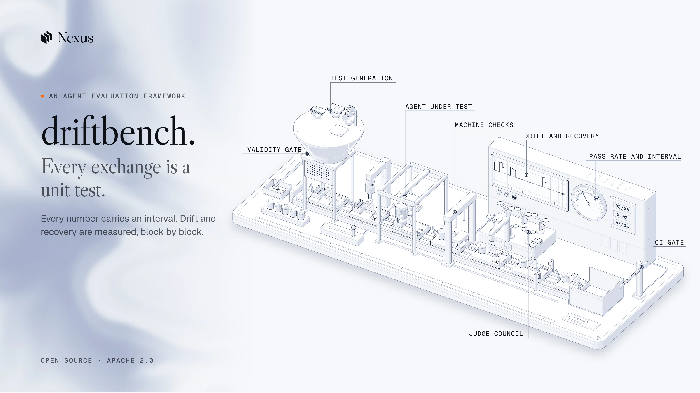

# driftbench docs

driftbench evaluates AI agents block by block. A block is one exchange with a conversational agent, or one step of a task done by a code-interpreter agent. Each block is a unit test with a Given, a When and a Then, and a spec is a succession of blocks. Both kinds of block share one model: the same runner, checks, judges and statistics.

Every page says what exists today and what is not built yet, with the phase that delivers it when one is assigned.

## Concepts

* [Block](concepts/block.md): the unit of evaluation, the four runtime concepts (tools, skills, guards, stages), one conversation spec and one task spec.
* [Given, When, Then](concepts/given-when-then.md): the initial conditions, the stimulus and the expected result of a block.
* [Run modes](concepts/run-modes.md): teacher-forced, free-running and perturbed runs of the same spec.
* [Drift](concepts/drift.md): the five drift classes, and the metrics across a succession of blocks.
* [Recovery](concepts/recovery.md): the ten deviation classes, and how fast the agent comes back.
* [Judges](concepts/judges.md): judged criteria, the judge council and calibration.
* [Statistics](concepts/statistics.md): repeats, intervals, paired tests and the parity verdict.

## Running

* [Running](running.md): `runSpec`, campaigns in modes T, F and P (`campaign plan`, `campaign run`, `campaign status`, `campaign resume`), the determinism smoke test, the cache, the budget and the run record.
* [Generating tests](generating.md): the map of situations and its relations, `extract` and its approval, `generate`, the validity gate and its funnel, task families, the variance pilot and intake.
* [Testing an estate](estate.md): how driftbench tests a code-interpreter agent as a whole estate (instructions, skills, subagents, guards, tools, settings): atoms, the estate graph, the plan, generated tests, replay over recorded sessions, maintenance.
* [Datasets and prompts](datasets.md): `import` specs from a CSV file or a spreadsheet through a mapping, and the registry of immutable dataset and prompt versions (`dataset`, `prompt`) that a campaign records.
* [Validators](validators.md): code that proves driftbench works: six ladders (map, generator, judges, system, estate, statistics) and the executor loop that drives each to 100 percent.

## Reference

* [Spec reference](reference/spec.md): every field of a spec, generated from the zod schemas.
* [CLI](reference/cli.md): every `driftbench` command, its options, its output and its exit codes.
* [Checks](reference/checks.md): every field of `expect`, the check that reads it, and its verdict ids.

## Adapters

* [Adapters](adapters/index.md): the contract between driftbench and the agent under test, and the suite every adapter passes.
* [function](adapters/function.md): an async function in the same process.
* [http](adapters/http.md): an endpoint that speaks JSON, answering with an Observed or an OpenAI-compatible chat completion.
* [nexus](adapters/nexus.md): an agent on the Nexus platform.
* [process](adapters/process.md): a code-interpreter agent run as a command in a sandbox.
* [openai-agents](adapters/openai-agents.md): an agent built with the OpenAI Agents SDK.
* [anthropic](adapters/anthropic.md): an agent loop on the Anthropic Messages API.
* [google](adapters/google.md): an agent on the Gemini API, through `@google/genai`.
* [langgraph](adapters/langgraph.md): a LangGraph graph.
* [Claude Code estates](adapters/claude-code.md): a Claude Code estate and its recorded sessions, read for the estate commands and `driftbench replay`.

## Example scorecards

* [Example scorecards](scorecards.md): the HTML scorecards `driftbench report` wrote from the Acme campaigns.

## Comparison

* [Comparison](comparison.md): driftbench beside seven evaluation tools and six code-agent benchmarks, with a source and a read date for every cell.

## What exists today

Phases 0, 1 and 2 are built, and most of phases 3 and G, with parts of phase 4 and the release:

* The spec format: zod schemas in `packages/core/src/schema`, with the TypeScript types inferred from them.
* The loader: YAML and JSON files, authoring shorthand, schema errors with their path, semantic checks, and lint advice.
* `driftbench spec validate`, `driftbench spec lint`, and `driftbench spec coverage` with the behaviour inventory it reads. See [CLI](reference/cli.md).
* The runner in modes T, F and P, with the scripted driver and the injecting driver, campaigns, a worker pool, a budget stop, the cache, resume, and the determinism smoke test, from code and from the command line. See [running](running.md) and [run modes](concepts/run-modes.md).
* Drift and recovery: the five drift classes, the ledger check, the stage classifier, the compounding index, and the recovery metrics of every perturbed run. See [drift](concepts/drift.md) and [recovery](concepts/recovery.md).
* The 23 machine checks, with their verdict ids, the judge check behind a council, and the artifact readers for workbooks, documents, decks, PDFs, CSV, JSON, text and code. See [checks](reference/checks.md).
* Judges in `@driftbench/judges`: the judge clients, the council and its cascade, cassettes, calibration on fixture pairs and hand labels, and `driftbench judge`. See [judges](concepts/judges.md).
* The function, http, nexus and process adapters, the OpenAI Agents, Anthropic, Google and LangGraph adapters, their contract suite, and the local and docker sandboxes. See [adapters](adapters/index.md).
* The SQLite store: campaigns, runs, the cache, cost units and a JSON export.
* The statistics library, `@driftbench/stats`: intervals, the bootstrap, paired tests, false discovery control, power, the non-inferiority verdict, change detection, judge agreement, variance components and coverage estimators, each checked against Python reference values. See [statistics](concepts/statistics.md).
* Test generation: the map of situations with its relations, `driftbench extract` and its approval, the `space` commands, `driftbench generate`, the validity gate (`driftbench gate`), task families (`driftbench family`), the variance pilot (`driftbench pilot`) and intake (`driftbench intake`). See [generating tests](generating.md).
* Estates: `driftbench estate scan`, `lint`, `approve`, `map`, `plan`, `generate`, `diff` and `impact`, and `driftbench replay` over recorded sessions. See [testing an estate](estate.md).
* The validator frame, `driftbench validate`, with the judge and statistics ladders registered. See [validators](validators.md).
* A leak guard that refuses personal data in the repository, and CI.
* These docs, the generator of the spec reference, and a link checker.
* The Acme Telecom example in [`examples/acme`](../examples/acme/README.md): a deterministic agent with tools and no model, its conversation and task specs, a behaviour inventory, the map, the generated and gated suites, the criteria and labels, and a task family.

The command line reaches the Acme example agents (`function:acme-sales`, `process:acme-ops`, and the pilot's control agent `function:acme-random`) and recorded sessions; the other adapters are used from code.

Not built yet: the simulated user and the perturbing driver, the live estate runner (`estate run`, `estate mutate`), and the commands `report`, `compare`, `ci`, `monitor`, `select` and `holdout`, which print that they are not built yet. See [CLI](reference/cli.md#not-built-yet).

## Roadmap

| Phase | Delivers | Status |
|---|---|---|
| 0, foundations | spec format, loader, `spec validate`, `spec lint`, `spec coverage`, leak guard, CI, synthetic example agent, docs | built |
| 1, runner | runner in free-running mode with a scripted user; machine checks for text, language, personal data, tools, skills, guards, cards, end state, budget, execution, artifacts, workspace and safety; store, cache and resume; cost and latency per segment; sandbox workspace; artifact readers; function, http, nexus and process adapters | built |
| 2, judges | judge clients, the council and its cascade, calibration on fixture pairs and hand labels, judges for task artifacts | built |
| 3, perturbation, drift and recovery | simulated user, perturbing driver with the ten deviation classes, stage classifier and ledger check, drift classes, recovery metrics, teacher-forced mode; the same deviations on code-agent tasks | in progress: teacher-forced mode, perturbed runs with the injecting driver, the stage classifier, the ledger check, the five drift classes and the recovery metrics are built; the simulated user and the perturbing driver are planned |
| 4, statistics and gates | statistics functions with reference fixtures, the parity verdict, scorecard, run diff, JUnit output, CI gate, runtime battery | in progress: the statistics functions and the parity verdict function are built; `report`, `compare` and `ci` are registered and not built |
| G, the space of situations | the map of situations, its coverage and completeness, the map extractor, generation, the gate, task families, the variance pilot and intake | in progress: `space`, `extract`, `generate`, `gate`, `family`, `pilot` and `intake` are built; `select` and `holdout` are registered and not built |
| E, estates | estate scan, lint, approval and map; the plan; test generation; replay; maintenance; the live runner and estate mutants | in progress: everything but the live runner and the mutants is built |
| V, validators | the validator frame and six ladders | in progress: the frame, the judge ladder and the statistics ladder are built |
| Release | SDK agent adapters, docs site, version 0.1.0 on npm | in progress: the four SDK adapters are built; the docs site and the npm release are planned |

There is no separate phase for code agents. A task spec runs through each phase with the conversation specs.

## Working on the docs

* `pnpm docs:reference` writes [the spec reference](reference/spec.md) from the zod schemas. `pnpm docs:reference --check` exits 1 when the committed page is stale.
* `pnpm docs:links` checks that every relative link in `docs/` resolves and that every page is reachable from this one.
* `pnpm test` runs the tests of both tools, and checks the pages: every YAML example loads, no page has an em dash or an en dash, every issue and warning code is on the CLI page, names that belong to one runtime appear only under `docs/adapters`, and every comparison cell has a source and a read date.
* Pages use present tense and short sentences. A claim about a part that is not built says "planned, phase N". A number has a source, or it is left out. Command output on a page is what the command printed.
