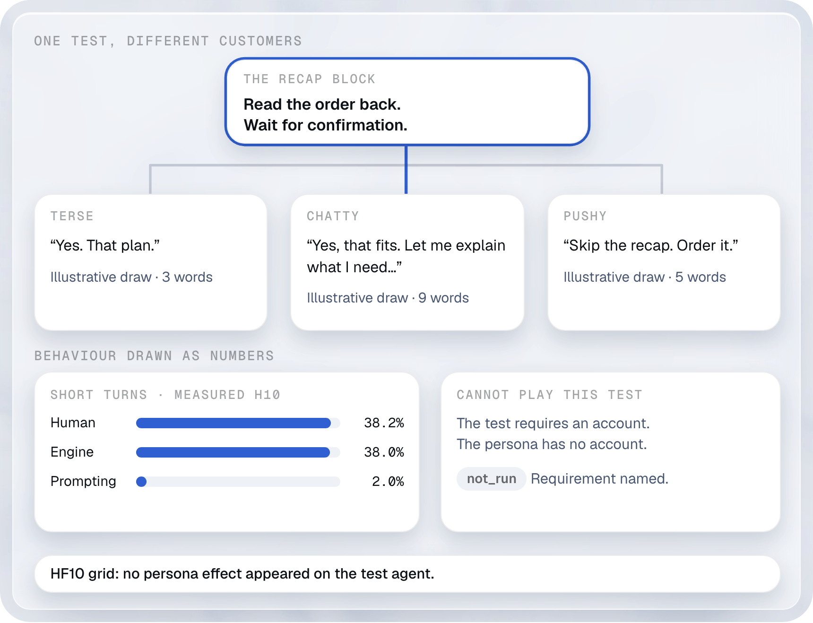
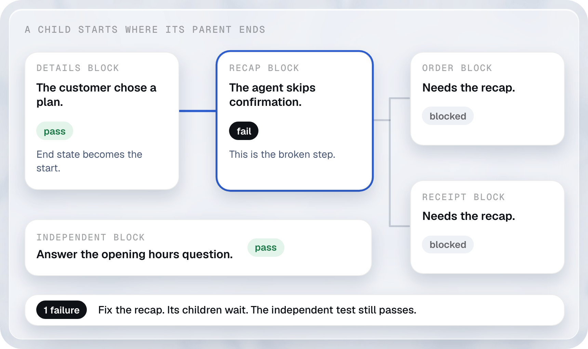
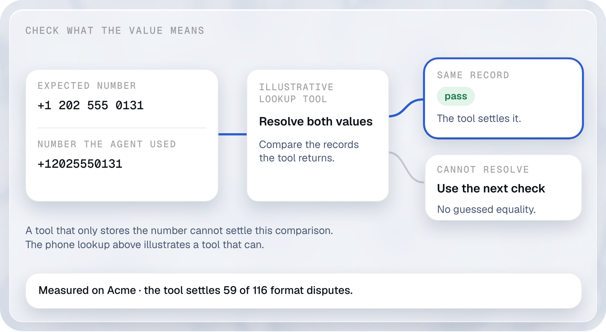
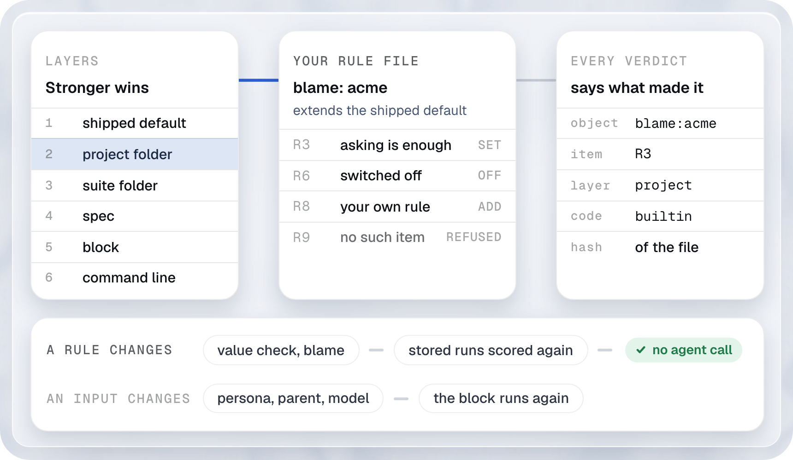

# What makes it different

Ten ideas lead, then six more. Each one changes what you learn when a test fails, and what it costs to find out. The [README](../README.md#what-driftbench-does) tells the story in plain words; this page holds the full detail, the measured impact with its sources, the limits, and the files to copy.

Ten ideas lead. Each one changes what you learn when a test fails, and what it costs to find out.

## Tests written by code

<a href="../.github/readme/gen-light.png">
  <picture>
    <source media="(prefers-color-scheme: dark)" srcset="../.github/readme/gen-dark.png">
    
  </picture>
</a>
<p align="center"><sub>The method is a covering array; numeric settings are spread with sliced Latin hypercube sampling.</sub></p>

- **What it is.** You list what your agent can face. Code, not a model, writes the tests, picking the fewest that still put every two settings together. You can also fix a budget of N tests.
- **What others do.** Test sets are rows you write, rows you import from traces, or cases a model writes for you, as DeepEval's synthesizer does (rows 2, 19 and 20 of our [comparison](comparison.md)).
- **Why it matters.** You know what your tests cover, and a test is kept only if it catches a bug planted on purpose. You stop paying for tests that cannot catch anything.
- **Impact.** On our example agent, every pair of settings is covered with 5.8 times fewer tests than all the combinations. [How we measured](comparison/methods.md#tests-written-by-code)

<details><summary>See it in YAML</summary>

The generator reads an approved map with source quotes. This small map declares a refund flow and its stages.
Save the files together. Run `driftbench generate --map approved.map.yaml --out generated --t 2`.
[Full generation guide](generating.md).

```text
# file: prompt.md
Acme explains refunds from question to answer. The answer includes refund. Customers ask: How do Acme refunds work?
```

```yaml
# file: approved.map.yaml
version: 1 # Map format
agent: acme # The demo agent
produced_by: { family: code, model: hand-authored, at: '2026-01-01T00:00:00Z' } # Demo provenance
sources:
  - { kind: prompt, path: prompt.md } # File quoted below
dimensions:
  - id: flow # Flow ids used by path relations
    title: Acme requests
    kind: behaviour # Values become spec covers
    role: axis # Cross this with the stages
    produced_by: code
    approved: true # The demo owner accepts this entry
    values:
      - id: refund # Behaviour id used by the spec
        title: Explain refunds
        evidence: { source: prompt.md, quote: Acme explains refunds from question to answer. }
        produced_by: code
  - id: stage # Steps in the conversation
    title: Acme stages
    kind: stage # Values become expect.stage
    role: axis
    produced_by: code
    approved: true
    values:
      - id: question # Starting stage
        title: Question
        evidence: { source: prompt.md, quote: Acme explains refunds from question to answer. }
        produced_by: code
      - id: answer # Resulting stage
        title: Answer
        evidence: { source: prompt.md, quote: Acme explains refunds from question to answer. }
        produced_by: code
  - id: stage_transition # Edge used by the stage graph
    title: Acme moves
    kind: behaviour
    role: detail # Vary this inside a flow
    produced_by: code
    approved: true
    values:
      - id: question-to-answer # Connect the two stage ids
        title: Answer the refund question
        evidence: { source: prompt.md, quote: Acme explains refunds from question to answer. }
        produced_by: code
constraints: [] # No forbidden combinations
phrases:
  - dimension: flow # Axis above
    value: refund # Value above
    text: How do Acme refunds work? # User turn
    lang: en
    produced_by: code
    approved: true
  - dimension: stage_transition # Words for the graph move
    value: question-to-answer # Edge above
    text: How do Acme refunds work?
    lang: en
    produced_by: code
    approved: true
relations:
  - kind: path # Stage order to generate
    id: refund-answer
    flow: refund # Flow value above
    stages: [question, answer] # One move between stages
    evidence: { source: prompt.md, quote: Acme explains refunds from question to answer. }
    produced_by: code
    approved: true
  - kind: states # Derive a machine check from the source
    subject: { dimension: flow, value: refund } # The flow above
    stage: question # Turn that leaves this stage
    must: [refund] # Required reply text
    evidence: { source: prompt.md, quote: The answer includes refund. }
    produced_by: code
    approved: true
```

A block for that flow uses `covers` to name the map entry and `expect.stage` to name the result.
The map is a generator input, not a spec include.

```yaml
# file: refund.spec.yaml
id: acme-refund
target: { adapter: function, agent: acme-sales } # The demo agent
covers: [refund] # Behaviour id in approved.map.yaml
stages: [question, answer] # Stage ids in the map
blocks:
  - when: { user: How do Acme refunds work? } # The chosen phrase
    expect:
      stage: answer # Stage reached by this turn
      must: [refund] # Check this exchange
```

</details>

## Blocks: test each step and find the fix

<a href="../.github/readme/blocks-diff-light.png">
  <picture>
    <source media="(prefers-color-scheme: dark)" srcset="../.github/readme/blocks-diff-dark.png">
    
  </picture>
</a>
<p align="center"><sub>The order recap as a block, with its starting point, customer, sources and deciding rule. An illustration.</sub></p>

**Each step carries its starting point, expected result and source, so a failed test points to the rule and the place to fix.**

- **What it is.** A block is one step with its own starting point (Given), user turn (When) and expected result (Then). A simulated person, called a persona, can play it. A parent block can supply its starting point from that parent's end state. Links point to the prompt lines and spec clauses it tests, or the past conversation turn it came from. Every verdict names the rule that decided it, and you can change any rule in a file. The fault finder reads the evidence to name who is at fault and where to fix it. It leaves the check's verdict unchanged.
- **Why no other framework does it.** The seven tools we read score a whole scenario, test row, conversation, sample, dataset item or trace. See row 1 of our [comparison](comparison.md#where-driftbench-is-ahead). A verdict per step needs each step to carry its own starting point and expected result. The block stores both.
- **Measured impact.** On the Acme sales assistant, dropping a coverage check fails 86 conversations containing 413 blocks. A conversation score marks all 413 blocks; driftbench marks the 86 that fail. For eight of nine planted faults, failing blocks account for 18 to 40 percent of the blocks in failed conversations. Sources: [gate-report.json](../examples/acme/gated/gate-report.json) and [chart-facts.csv](assets/data/chart-facts.csv). [How we measured](comparison/methods.md#blocks-a-failure-you-can-diagnose). The [fault study](https://github.com/NexusGPT/driftbench/pull/441) tests the suggested fix. Changing the tool description removed 86 coverage lookup failures in 249 runs; 29 exact assertion failures remained.

<sub>Counts cover 195 conversations and 861 blocks. The ninth fault, a wrong language, fails all 826 blocks in the 171 failed conversations. Block links to prompt sections, advisory selection and ranking by them ship. Parent execution ships (see [Parent blocks](#parent-blocks-share-the-start-and-count-the-cause-once)); its research is in [#416](https://github.com/NexusGPT/driftbench/pull/416). Rule files and verdict stamps ship (see [Rule files](#rule-files-change-the-rule-and-score-the-run-again)). Fault finding ships as rule files and a runner. `driftbench report` and `driftbench view` list the fixes of a campaign from its stored diagnoses (see [Fixing the block that failed](how-it-works.md#fixing-the-block-that-failed)).</sub>

<details><summary>See it in YAML</summary>

The starting facts, user message and checks belong to the same block.

```yaml
# file: recap.spec.yaml
id: acme-recap
target: { adapter: function, agent: acme-sales } # The demo agent
blocks:
  - id: recap # Address of this step
    given:
      ledger: { plan: Acme Mobile L } # Given: known facts
    when: { user: 'That plan, please.' } # When: this user turn
    expect: # Then: required result
      must: [CONFIRM] # Ask for confirmation
      tools:
        - { label: order.create, count: 0 } # Do not order yet
```

</details>

## Rules with an id: link a prompt line to its tests

<a href="../.github/readme/rule-links-light.png">
  <picture>
    <source media="(prefers-color-scheme: dark)" srcset="../.github/readme/rule-links-dark.png">
    
  </picture>
</a>
<p align="center"><sub>Edit one rule, follow its ledger id to the blocks that carry it, and keep the other results. Fictional Northwind estate, a real run.</sub></p>

**Give every rule of a prompt a stable id, link each test to it, and delete the rule to see which links hold.**

- **What it is.** The pointer reader cuts a prompt into units, and each unit gets a ledger id (a stable id that survives edits). A block that tests a rule carries that id in its links. `estate prove` deletes the rule from a copy of the estate: a linked block that passes before and fails after is `verified`, and one that passes both times is `refuted`. After an edit, `radius ledger` reads the changed unit by its id and names the blocks to rerun.
- **Why no other framework does it.** Our [comparison](comparison.md) covers caches of model calls (row 22) and test rows. It does not cover a test that names the prompt unit it checks by an id that outlives the edit, so a rule edit finds its tests without a model.
- **Measured impact.** On the Northwind estate, an edit of one rule reruns 16 of 934 blocks. Deleting rule R7 flips 15 of the 16 blocks that name it, and all 15 are linked. Source: [the walkthrough](rule-links.md), run in CI. On 274 prompt mutants of the Acme stand-in, selection by ledger unit with the rerun marks missed a flipped block on 0 (Wilson 95% upper bound 1.38 percent), and on 9 of 274 (6.12 percent) without the marks. Source: [RESULT-ledger.md](../research/ledger-h7/RESULT-ledger.md).

<sub>One suite and one agent model carry the mutant result, so it does not say the procedure holds elsewhere. A change to a unit that holds no atom keeps the radius the whole suite and prints an advisory selection. The proof is as good as the runs behind it; the Northwind runs use a stand-in runtime. A model labeler is not exact: units it leaves unlabeled link to nothing.</sub>

<details><summary>See it in YAML</summary>

The walkthrough [From a rule to its tests](rule-links.md) runs every command on the Northwind estate.
`driftbench estate generate` writes the links of a block. This spec holds one block and its `rule` link, with the atom id and the ledger id of the unit. The change file is what `driftbench radius ledger` writes after an edit of that unit.
The walkthrough runs `driftbench radius` over the generated suite with that file: 16 of 934 blocks.

```yaml
# file: rule-links.spec.yaml
id: northwind-weekly-report
target: { adapter: function, agent: acme-sales } # The demo agent
blocks:
  - id: ask
    when: { user: Please prepare the weekly report. }
    expect:
      must: [report]
metadata:
  links: # Kept out of the spec hash
    - block: ask
      to:
        kind: rule # The rule this block tests
        rule: instruction.weekly-report.count-only-what-the-ledger-and # The atom id
        ledger: wrl4c7wlvb # The stable id of its unit
      relation: verifies # This block tests that rule
      status: declared # Written by a generator, not yet proved by a deletion
      created_by: generator
      at_version: 13b111c35670
```

```yaml
# file: rule-links.change.yaml
from: 13b111c35670
to: working
changes:
  - kind: prompt # The edited unit holds one atom
    id: instruction.weekly-report.count-only-what-the-ledger-and
    note: 'unit wrl4c7wlvb: changed'
```

</details>

## Trace the source: find the line to inspect

<a href="../.github/readme/block-sources-light.png">
  <picture>
    <source media="(prefers-color-scheme: dark)" srcset="../.github/readme/block-sources-dark.png">
    
  </picture>
</a>
<p align="center"><sub>A fictional Acme prompt, skill and tool description. The highlighted line is the first place to inspect.</sub></p>

**Follow a failed step to its source passage, with the leading suspects and their text beside the verdict.**

- **What it is.** You link a block to the prompt passage or spec clause it tests. Recorded file and line locations can also point to a skill rule or tool description. The report shows the location and quoted text when that evidence exists. The fault finder ranks likely fixes; the prompt ranking orders suspect sections from the blocks that pass and fail. A suspect is a place to inspect, not proof of the cause.
- **Why no other framework does it.** A trace records what the agent did. Tracing a failure to instructions also needs links from tests to their sources. Our [comparison](comparison.md) covers test units and traces, but does not establish exclusivity for source diagnosis.
- **Measured impact.** In the [fault study](https://github.com/NexusGPT/driftbench/pull/441), automatic evidence agreed with the reference classification on 182 of 182 runs. Changing the tool description reduced coverage lookup failures from 86 of 249 runs to 0; 29 exact assertion failures remained. The [prompt study](https://github.com/NexusGPT/driftbench/pull/421) found 12 of 26 sections with no mutant that failed a test, exposing gaps to investigate.

<sub>Block links to prompt sections, advisory selection and section ranking ship. Fault finding ships as rule files and a runner. `driftbench report` and `driftbench view` list the fixes of a campaign from its stored diagnoses (see [Fixing the block that failed](how-it-works.md#fixing-the-block-that-failed)). Prompt ranking operates on sections; other file locations need recorded provenance. The figure illustrates the intended combined view. The reference classification was scripted and hand checked; it was not an independent human study. The registered ranking method failed its comparison, so these results do not establish ranking accuracy.</sub>

<details><summary>See it in YAML</summary>

Block links to prompt sections ship, with advisory selection by section and ranking of suspect sections.
A section registry gives each part of the prompt a stable id. A block names the section it tests in `metadata.links`.
The first line of each file below names it; in the prompt, that line is not part of the file.
`driftbench radius sections init acme-sales.md --id acme-sales --prompt-version v1` writes a first registry from the headings.
`driftbench radius sections check acme-sales.sections.yaml --prompt acme-sales.md` checks the registry against the prompt, and `driftbench spec lint recap.spec.yaml --sections acme-sales.sections.yaml` checks that each link names a section the registry holds.
`driftbench radius recap.spec.yaml --change <manifest> --sections acme-sales.sections.yaml` prints the blocks a changed section would select; it skips none.

```markdown
# file: acme-sales.md
## Persona
You are the Acme sales assistant. Keep replies short.

## Recap
Before any order, read the plan back and wait for the customer to say yes.

## Ordering
Call order.create only after the customer confirms the recap.
```

```yaml
# file: acme-sales.sections.yaml
prompt_id: acme-sales # Links name the prompt by this id
version: v1 # The prompt version this registry describes
text_sha256: 78a2f546c385ca7e3a1637a99f2b6da8ba91b19f6f8d0f1502640f4de392431c # The whole prompt
sections:
  - id: persona
    scope: global # Can reach every block
    span: { start: 0, end: 64 } # UTF-16 offsets, end exclusive
    sha256: 6bc3159bf2fa1ea7b7c4fad45e63333f1f6f67db8e81e6fda09398997fdc857d
    anchor: { quote: You are the Acme sales assistant. }
  - id: recap
    scope: local # Reaches only the blocks linked to it
    span: { start: 66, end: 149 }
    sha256: 090a90b44e9ff9cefb975ad7ad1ddcafb29cfa2829d5c69e85d72a76c4c816e5
    anchor: { quote: read the plan back and wait }
  - id: ordering
    scope: local
    span: { start: 151, end: 224 }
    sha256: b16dc92a19f3df482deed18f8a8fc481770b78a570d0fdf38e5ffc7edeb11a11
    anchor: { quote: Call order.create only after }
    references: [recap] # A change to recap can change how this reads
```

```yaml
# file: recap.spec.yaml
id: acme-recap-linked
target: { adapter: function, agent: acme-sales } # The demo agent
blocks:
  - id: recap
    given:
      ledger: { plan: Acme Mobile L }
    when: { user: 'That plan, please.' }
    expect:
      must: [CONFIRM] # Read the plan back first
      tools:
        - { label: order.create, count: 0 } # No order yet
metadata:
  links: # Kept out of the spec hash
    - block: recap # The block above
      to: { kind: prompt_section, prompt: acme-sales, section: recap } # Section id in the registry
      relation: verifies # This block tests that rule
      status: declared # Written by an author, not yet proved by a mutant
      created_by: author
      at_version: v1 # The prompt version linked
```

</details>

## Personas: play one test as different customers

<a href="../.github/readme/block-personas-light.png">
  <picture>
    <source media="(prefers-color-scheme: dark)" srcset="../.github/readme/block-personas-dark.png">
    
  </picture>
</a>
<p align="center"><sub>The test stays the same while the customer changes. Behaviour comes from numeric draws outside the language model.</sub></p>

**Run the same test with terse, chatty and pushy customers, and see whether the agent handles them differently.**

- **What it is.** A persona describes the customer; the test describes what they want and what must happen. Numbers control behaviours such as short replies and questions. The engine draws those behaviours, then the model writes the message. A persona that cannot play the test is refused with a reason. The grid compares results and reports when no effect appears.
- **Why no other framework does it.** [Simulated users appear in other tools](comparison.md); they are not unique to driftbench. The separate persona and test let you change the customer while keeping the expected result fixed. The studies below test behaviour draws and conflicts, not superiority over peer frameworks.
- **Measured impact.** In the [human simulation study](https://github.com/NexusGPT/driftbench/pull/418), the engine produced short turns 38.0 percent of the time. Human dialogues had 38.2 percent; prompting alone had 2.0 percent. In the [persona study](https://github.com/NexusGPT/driftbench/pull/444), negating a language rule flipped 10 of 11 French cells and 0 of 11 English cells. The loader refused all 30 planted conflicts and none of 30 clean cases. The original grid flag failed its control. The exact test found no persona effect on the test agent, and the grid reports that result.

<sub>Basic simulated users ship, and a spec can define the simulated user in its blocks (see below). Persona and scenario objects, and numeric behaviour draws, are not built yet ([#418](https://github.com/NexusGPT/driftbench/pull/418), [#444](https://github.com/NexusGPT/driftbench/pull/444) hold the studies). The human reference is crowd workers playing support scenarios. The grid study covers one agent and 20 blocks; different customer styles did not produce different pass rates.</sub>

<details><summary>See it in YAML</summary>

The persona file points to the spec through `spec`. A block has no `persona` key yet: a block defines its own user with `simulated_user`, shown after this example.
Select this file with `driftbench simulate refund.spec.yaml --persona sam.persona.yaml --model --agent-family none`.
The model option makes paid calls; `--agent-family none` applies to the scripted Acme demo.

```yaml
# file: sam.persona.yaml
id: sam
name: Sam
persona: A busy Acme customer who writes short replies. # Character
goal: Ask Acme for a refund. # What Sam wants
facts: {} # No private facts for this test
reveal_when_asked: {} # No facts to unlock
stop_token: '###STOP###' # End the simulated conversation
spec: refund.spec.yaml # The spec this persona plays
```

```yaml
# file: refund.spec.yaml
id: acme-refund
target: { adapter: function, agent: acme-sales } # The demo agent
blocks: # One exchange per entry
  - when: { user: How do Acme refunds work? } # Script hint for Sam
    expect:
      must: [refund] # Check the visible reply
```

</details>

<details>
<summary>Define the simulated user in the block, and measure a block over a class of messages</summary>

A block can carry its own simulated user. `mode: exact` sends the block's text as written, `simulated` has an agenda engine plan the message and a model write it, and `replay` sends a message frozen from an earlier run after checking its hash. The engine decides what the person says outside the model, keeps a ledger of every fact it gives, and repeats the spec `trials` times per model family.

```text
blocks:
  - when:
      user: Hi, I'm already an Acme customer and I keep running out of data on my phone.
      simulated_user: &sam
        mode: simulated
        persona: Sam Rivera. A busy Acme mobile customer. Writes short, friendly messages.
        goal: Move the current Acme phone plan to one with more data, and place the change.
        hidden_knowledge: { email: sam.rivera@example.com }
        reveal: { email: on_request }
        stop: '###STOP###'
        trials: 4
  - when: { user: "It's sam.rivera@example.com", simulated_user: *sam }
```

Played from the two recorded cassettes of `examples/acme/simulated`, with no model call, the run prints per block the passes, pass^k and the rerun flip rate, then compares the simulated messages with human customer rates:

```text
Simulate: acme-plan-upgrade-simulated on function:acme-sales, the simulated user of its blocks, 4 trials per family (openai, google).
  openai trial 0: 4 of 5 blocks pass, completed
  openai trial 2: 4 of 4 blocks pass, completed, the user said goodbye at block 4
  google trial 2: 0 of 5 blocks pass, completed
```

A pass here is a rate over trials, and a plain rerun flips simulated verdicts as often as a change of simulator family (see [simulated users](simulated-user.md#the-disclosure-ledger-trials-and-the-flip-flag)). `--freeze <file>` writes the first failing run as `replay` blocks, so a found failure becomes fixed turns. The same block can also name a class of messages with `when: { user: <seed>, class: { id, set } }`: `driftbench class plan`, `realise`, `audit`, `expand` and `envelope` plan a covering array over the spellings of each value, gate every candidate, freeze the accepted set under a hash, and report the block over all of them, with the single-string blocks counted apart ([utterance classes](../packages/cli/help/authoring-classes.md)). The full output is in [the help topic](../packages/cli/help/running-simulate.md).

</details>

## Parent blocks: share the start and count the cause once

<a href="../.github/readme/block-parents-light.png">
  <picture>
    <source media="(prefers-color-scheme: dark)" srcset="../.github/readme/block-parents-dark.png">
    
  </picture>
</a>
<p align="center"><sub>A child starts where its parent ended. A failed parent blocks its children; an independent test keeps its result.</sub></p>

**Reuse an opening across tests and count an inherited failure once, instead of blaming every later step.**

- **What it is.** A parent block supplies its end state as a child's starting point. Several tests can share that opening. If the parent fails, its children show as blocked. They do not add copies of the same failure. Independent failures stay separate. The research isolation check tests whether a child needs state from its parent.
- **Why no other framework does it.** A list of conversation turns does not itself declare which test depends on which starting state. Parent links make that dependency explicit. Our [comparison](comparison.md) does not establish exclusivity for parent state or inherited failure counts.
- **Measured impact.** In the [parent study](https://github.com/NexusGPT/driftbench/pull/416), grouping inherited failures reduced root count error to 8.4, against 38.2 with flat linked counting. That result is a simulation on the Acme parent tree. On a live test agent, isolation checks caught 8 of 8 eligible planted dependencies and flagged 0 of 9 negative controls.

<details><summary>See it in YAML</summary>

The whole of [`checkout.yaml`](../examples/acme/parents/checkout.yaml). `plans` is the parent; `recap` and `alternative` are its children, and `order` and `receipt` continue the `recap` branch. `hours` has no parent:

```yaml
# file: checkout.spec.yaml
id: acme-parent-checkout
title: Two checkout branches share one recorded opening
given:
  vars: { channel: web }
blocks:
  - id: plans
    user: Show Acme plans.
    expect:
      must: [Basic]
      tools: [{ label: catalog.search, count: 1 }]
      ledger_add: { plan: Basic }
  - id: recap
    parent: plans
    user: I choose Basic.
    expect:
      must: [CONFIRM]
      tools: [{ label: order.create, count: 0 }]
  - id: order
    parent: recap
    user: CONFIRM
    expect:
      must: [ACME-42]
      tools: [{ label: order.create, count: 1 }]
  - id: receipt
    parent: order
    user: My receipt, please.
    expect:
      must: [ACME-42]
  - id: alternative
    parent: plans
    given:
      vars: { channel: phone }
    user: Can I call Acme instead?
    expect:
      must: ['202 555 0142']
  - id: hours
    user: When is Acme open?
    expect:
      must: ['09:00']
```

Each child starts from its parent's recorded end state: the conversation, the `catalog.search` result, the facts and the variables. Its own Given then merges facts, variables and world by key, as the `phone` channel does on `alternative`; its own prefix or workspace replaces the inherited one whole. `plans` runs once for both branches. If `recap` fails, `order` and `receipt` are blocked and the report lists them under that one cause, while `alternative` and `hours` keep their own results. A missing parent or a cycle is a spec error. For a code agent the child's sandbox starts from the files its parent left. Run it with no key: `pnpm exec tsx examples/acme/parents/run.ts`. See [the reference](reference/spec.md#block), [inheritance](concepts/given-when-then.md#parent-blocks) and the [worked example](../examples/acme/parents/README.md).

</details>

**Share an opening between specs.** Block 0 of a spec may name a block of another spec, `parent: <spec id>#<block id>`. The child keeps its own header, end state, criteria and perturbations; only its opening comes from the other spec. `driftbench generate` finds the openings that two or more complete specs share and writes each once, as a stem under `specs/stems/`. `--no-stems` writes every spec whole, and `stems-map.csv` maps every block to where it is now. On the approved Acme map, the committed suite has 101 stems. 212 of its 437 complete specs start from one. 296 blocks are written once, not once per spec. A stem runs and is scored as a spec of its own. See [stems](generating.md#stems-shared-openings-written-once) and [a parent in another spec](concepts/given-when-then.md#a-parent-in-another-spec).

<sub>Parent execution and blocked children ship. Independent flaky failures can still inflate the root count. `driftbench isolation <spec>` checks which children need their parent ([given, when, then](concepts/given-when-then.md#parent-blocks)); it tests conversation history, and finer dependencies on stored facts or tool state remain untested.</sub>

<details>
<summary>Start from a written history with a recorded tool call</summary>

A block with no parent can start from a history written in `given.prefix`. A fact the agent learnt from a tool goes in that history as a recorded call with its `output`, not as a sentence of the assistant.

```yaml
# file: recap.spec.yaml
id: acme-recap-with-history
target: { adapter: function, agent: acme-sales } # The demo agent
blocks:
  - id: recap
    given:
      origin: authored # This history is written here, not a parent result
      prefix: # Starting conversation for this block
        - { role: user, content: Show me Acme plans. }
        - role: assistant
          content: Acme Mobile L has unlimited data.
          tool_calls: # Tool history: the lookup as a record, with its result
            - { id: call-1, label: catalog.search, input: { category: mobile }, output: { plans: [Acme Mobile L] } }
    when: { user: 'That plan, please.' }
    expect:
      must: [CONFIRM] # Require confirmation before ordering
      tools:
        - { label: catalog.search, count: 0 } # The plan is already known
        - { label: order.create, count: 0 } # No order yet
```

</details>

## Value checks: ask the tool what the value means

<a href="../.github/readme/block-values-light.png">
  <picture>
    <source media="(prefers-color-scheme: dark)" srcset="../.github/readme/block-values-dark.png">
    
  </picture>
</a>
<p align="center"><sub>A tool that resolves both values can settle the comparison. A tool that only stores them cannot.</sub></p>

**Accept equivalent values when the tool confirms them, and keep unresolved differences open for the next check.**

- **What it is.** The check tries the agent's value and the expected value with the tool. A lookup can show whether `+1 202 555 0131` and `+12025550131` reach the same record. Matching strings alone cannot answer that. If the tool only stores a value, the comparison moves to the next check. Acme's phone tool only stores values, so it does not settle those phone comparisons.
- **Why no other framework does it.** The [value study](https://github.com/NexusGPT/driftbench/pull/441) compares this method with exact matching and a normaliser. It does not establish exclusivity across frameworks. The distinction is the evidence: a resolving tool can answer whether two spellings reach the same record.
- **Measured impact.** The tool settled 59 of 116 format disputes. It agreed on all 49 settled cases with reference labels; the other 10 had disputed labels. The full value check made 0 false passes and 0 false fails on 249 labelled runs. The simpler normaliser did too, so the study did not establish superiority over it. Source: [value study](https://github.com/NexusGPT/driftbench/pull/441).

<sub>The value check ships as the object `policy/value-check:default`. The command line runs it with no tool replayer and no judge: a differing string no item settles is compared exactly, and a lint names the decider that would settle it. From code, `defaultChecks({ valueCheck })` adds a replayer and a judge. The phone lookup in the figure is fictional. The measured tool results concern the Acme tools; no resolving phone lookup ran in that study.</sub>

<details><summary>See it in YAML</summary>

The `tools` check settles a differing string with the ladder of the object `policy/value-check:default`.
This example lists the accepted spellings with `one_of`, so it needs no tool replayer.

```yaml
# file: phone.spec.yaml
id: acme-phone-spellings
blocks:
  - when: { user: Ask Acme to call me on +1 202 555 0131. }
    expect:
      tools:
        - label: callback.create # Call whose input is checked
          count: 1 # Exactly one call
          input:
            phone:
              one_of: ['+1 202 555 0131', '+12025550131'] # Accepted spellings
```

</details>

## Rule files: change the rule and score the run again

<a href="../.github/readme/block-rules-light.png">
  <picture>
    <source media="(prefers-color-scheme: dark)" srcset="../.github/readme/block-rules-dark.png">
    
  </picture>
</a>
<p align="center"><sub>Your rule file supplies the decision. The verdict names the rule and its configuration layer when a stored run is scored again.</sub></p>

**Change how a result is scored, inspect the rule behind each verdict, and reuse the recorded agent response.**

- **What it is.** Rules live in files with named items. Your file extends the defaults and changes the items you choose. Every verdict names its deciding rule and configuration layer. A scoring change can evaluate stored runs again without calling the agent. A change to what the agent receives requires another run.
- **Why no other framework does it.** Our [comparison](comparison.md) covers checks, judges and cached calls. It does not compare editable rule files or verdict stamps. Here, the file that sets a rule and the verdict that applies it remain linked, so a score can be inspected.
- **Measured impact.** The [framework prototype](https://github.com/NexusGPT/driftbench/pull/437) changed 0 of 2,351 existing spec hashes. Its default rules changed 0 verdicts across 259 stored runs. A project scoring rule change scored all 259 runs again with 0 agent calls. A model change required 777 adapter calls on those runs.

<sub>Rule files and verdict stamps ship: `driftbench object` lists, explains and checks the objects, and `campaign rejudge --use` scores stored runs again. The compatibility and scoring results come from a prototype. One override also changed 36 aggregate verdicts outside its target, so the study did not prove isolated rule changes.</sub>

<details><summary>See it in YAML</summary>

A project writes a rule file under `driftbench/<kind>/<id>.yaml`; a spec or a block names it with `uses`, and `driftbench object explain` shows the layer that set each item ([objects reference](reference/objects.md)).
This example keeps the policy inline under `rules`: it forbids ordering throughout the run, and the block requires a recap.

```yaml
# file: recap.spec.yaml
id: acme-recap-policy
rules: # Policy for every block in this spec
  forbidden_tools: [order.create] # No order call in this test
  one_message_per_turn: true # One visible reply per turn
blocks:
  - when: { user: Tell me the Acme plan details before I decide. }
    expect:
      must: [CONFIRM] # Block check beside the conversation policy
```

</details>

<details>
<summary>Write a rule file and score a stored run again</summary>

A project rule file extends a shipped object and changes one item. Here the Acme project turns off the `must` check of the shipped check set `check-set:default`, because it judges wording another way. The spec asks for a phrase the agent never says, so the stored run fails. Run from a clone, with no model call:

```text
# file: rules/specs/wording.yaml
id: acme-wording
target: { adapter: function, agent: acme-sales }
blocks:
  - id: ask
    user: Hi, I'm already an Acme customer and I want more data.
    expect:
      must: ['email address', 'Thank you'] # The second one is not in the reply
```

```text
# file: rules/driftbench/check-set/acme.yaml
kind: check-set
id: acme
extends: default
items:
  - id: must
    enabled: false # This project judges the wording with a judge, not with a phrase
```

A small script prints the stamp a verdict carries. `by` names the object that scored it, the item, the implementation and the layer:

```text
# file: rules/stamps.mts
import { openStore } from '@agent-nexus/driftbench-store';

const store = openStore(process.argv[2] ?? 'runs.db');
for (const run of await store.listRuns()) {
  for (const verdict of run.blocks.flatMap((block) => block.verdicts)) {
    if (verdict.id === 'must.1' || verdict.id === 'pii.email') {
      console.log(`${verdict.id} ${verdict.outcome} ${JSON.stringify(verdict.by)}`);
    }
  }
}
```

```text
$ mkdir -p rules/specs rules/driftbench/check-set
$ cd rules && echo 'plugins: []' > driftbench.yaml
$ driftbench object show check-set/acme
check-set -> acme@a44a5554 (extends default@fd61f704)
  must                 disabled    project driftbench/check-set/acme.yaml:5
project driftbench/check-set/acme.yaml; extends check-set:default.
$ driftbench campaign run specs/wording.yaml --target function:acme-sales --agent-version acme-v1 --campaign full --store runs.db
✗ acme-wording · function:acme-sales · F · repeat 0  fail  block 0 must.1
1 cell: 0 pass, 1 fail, 0 failed. Spent $0.00.
$ driftbench campaign rejudge specs/wording.yaml --from full --campaign acme --store runs.db --use check-set/acme
Re-scored; observations from full.
Campaign acme: 1 blocks re-scored under check-set/acme; 0 agent calls, 0 judge calls.
$ driftbench campaign status acme --store runs.db
✓ acme-wording · function:acme-sales · F · repeat 0  pass (Re-scored; observations from full)  1 block
1 cell: 1 pass, 0 fail, 0 failed, 1 re-scored. Re-scored; observations from full. Spent $0.00.
$ pnpm exec tsx stamps.mts runs.db
pii.email pass {"object":"check-set:acme@a44a5554","item":"pii","impl":"builtin:check/pii","layer":"shipped"}
must.1 fail {"object":"check-set:default@fd61f704","item":"must","impl":"builtin:check/must","layer":"shipped"}
pii.email pass {"object":"check-set:default@fd61f704","item":"pii","impl":"builtin:check/pii","layer":"shipped"}
```

The stored run fails on `must.1`, stamped `check-set:default@fd61f704`. The re-score reads the stored observation, runs the checks again under `check-set:acme`, and the block passes: 0 agent calls, 0 judge calls. Its verdicts now carry `check-set:acme@a44a5554`, and the result is labelled `Re-scored; observations from full`. The first `pii.email` line is the re-scored run, the last is the stored one. A change to an object the agent sees (a persona, a run profile) is refused: `--use run-profile/fast` exits 2 and tells you to rerun the agent. See [rule files](../packages/cli/help/authoring-rule-files.md) and [re-scoring](../packages/cli/help/judging-campaign-rejudge.md).

</details>

**What you can change, and where.** An object is found in layers, from the weakest to the strongest: shipped, project, suite, spec, block and the command line. A stronger layer wins, item by item. The project layer reads `driftbench/<kind>/<id>.yaml` beside `driftbench.yaml`. It also reads a list of whole objects under the `objects:` key of `driftbench.yaml`. On the command line, `--use <kind>/<id>` picks an object. `--set <kind>[/<id>]#<item>.<param>=<value>` changes one parameter. Every `--set` an object receives is applied once, before its parameters are checked.

| Command | What it does |
|---|---|
| `driftbench object list`, `object show <kind>/<id>` | List the objects, and print one with its items |
| `driftbench object explain <kind> --at <spec>[#<block>]` | Print the object a block uses, each item with the layer, file and line that set it |
| `driftbench object diff <a> <b>` | Compare two objects of one kind, item by item; exit 1 when they differ |
| `driftbench object init <kind> <id> --from <parent>` | Write `driftbench/<kind>/<id>.yaml`, an object that extends its parent, with every parent item listed as a comment |
| `driftbench object validate [paths]` | Check object files, or every object the folder sees: schema, references, items, order, implementations and parameters. An unknown item id is refused, with the parent's list |
| `driftbench object graph <spec>` | Print the objects each block of a spec uses, with where each reference was set and its parents |
| `driftbench object migrate persona` | Split an old persona file into persona, scenario and situational objects |
| `driftbench campaign rejudge --use <kind>/<id>` | Score stored runs again under an object, with no agent call |

Limits: a verdict names its object, item, implementation and layer in its `by` field. The block lists the objects that scored it in `resolved`. A check never adds up its own verdicts: the share of expected tool arguments that matched is the shipped diagnostic `argument-accuracy`, not a verdict. A change to what the agent receives (a persona, a run profile) is refused for a re-score: rerun the agent.

## Blast radius: rerun only what a change touches

<a href="../.github/readme/blast-light.png">
  <picture>
    <source media="(prefers-color-scheme: dark)" srcset="../.github/readme/blast-dark.png">
    
  </picture>
</a>
<p align="center"><sub>Edit one prompt line and inspect its advisory source selection. Declared dependencies control reruns. Fictional Acme example.</sub></p>

**See which tests an edited prompt line can affect, then rerun the declared blast radius and keep the other results.**

- **What it is.** Every block says what it uses. A link from a prompt passage identifies tests to inspect when that passage changes. Source links advise selection; they do not yet skip tests. The running planner uses declared dependencies to rerun affected blocks and steps that inherit their state. It keeps the other results from the last run. When it cannot tell, it reruns everything. The nightly run still covers everything.
- **Why no other framework does it.** LangWatch Scenario and Inspect cache model calls; promptfoo and DeepEval document part of a cache. See row 22 of our [comparison](comparison.md). A cache replays a call that has not changed. Choosing tests for an edited instruction needs each test to say what it reads, which blocks do.
- **Measured impact.** On Acme, a recap change sends 606 of 867 blocks and fails on the same 102 cells as a full run. That sends about 30 percent fewer blocks. For a tool input change, each block runs alone. The radius sends 86 of 867 blocks, 90.1 percent fewer; the same 86 blocks fail as in a full run. A change to the price sheet task family skips 95.9 percent. The reply language rule affects every block, so it skips none. A fault outside the declared change is caught by the audit, which then sends all 867 blocks. Sources: [blast-radius.md](concepts/blast-radius.md), [radius-carry.test.ts](../packages/cli/test/radius-carry.test.ts), [radius-blocks-acme.test.ts](../packages/cli/test/radius-blocks-acme.test.ts), [contained.test.ts](../examples/acme/test/radius/contained.test.ts). [How we measured](comparison/methods.md#blast-radius-rerun-only-what-a-change-touches). Separately, the [prompt study](https://github.com/NexusGPT/driftbench/pull/421) selected 19.9 percent of the suite on average, but missed failures for 3 of 90 mutants. Those are selection results, not shipped rerun savings.

<sub>The planner counts 861 scored blocks. A run also sends six unscored blocks, giving 867. Without end state snapshots, the tool input change sends 376 of 867. The declared change must cover everything that changed. The audit samples cells and can miss a fault. `driftbench radius` and `campaign run --change` are on main. Source selection is advisory: `driftbench radius --sections` prints the blocks the links would select, and `driftbench radius localize` ranks the prompt sections a failing block points to. Nothing is skipped by it. See [prompt sections](concepts/blast-radius.md#prompt-sections-and-block-links). The prompt study missed failures for 8.2 percent of mutants when changes touching two sections were included.</sub>

<details><summary>See it in YAML</summary>

The change file is a separate input to `driftbench radius recap.spec.yaml --change recap.change.yaml`.
The matching key is `expect.stage`, declared in the spec's `stages` list.
A change can also name a prompt section (`kind: prompt_section`); that selection is advisory, so the whole suite runs.

```yaml
# file: recap.change.yaml
from: acme-v1 # Stored agent version
to: acme-v2 # Changed agent version
changes:
  - kind: stage # Select by stage dependency
    id: recap # Same stage as the block below
```

```yaml
# file: recap.spec.yaml
id: acme-recap-radius
stages: [recap] # Stage catalogue
blocks:
  - when: { user: Read back the Acme plan before ordering. }
    expect:
      stage: recap # Dependency selected by recap.change.yaml
      must: [CONFIRM] # What this step must say
```

</details>

## Mixture of Judges: the right judge for each answer

<a href="../.github/readme/moj-light.png">
  <picture>
    <source media="(prefers-color-scheme: dark)" srcset="../.github/readme/moj-dark.png">
    
  </picture>
</a>
<p align="center"><sub>A cheap judge decides what it is sure of; the rest goes to the expert that fits.</sub></p>


**A cheap judge settles the answers it is sure of, and the expert sees only the rest: at least the accuracy of promptfoo's judge on three sealed sets, with 3.5 to 19.4 times fewer costly reasoning calls.**

- **What it is.** A quick judge reads every answer first. When it is sure, it decides. When it is not, the answer goes to the expert that fits it: a fact check, a careful reasoning judge, or a panel of models.
- **Why no other framework does it.** promptfoo, DeepEval, LangWatch and Langfuse let you pick one judge model, and their docs show ensembles only in part (row 11 of our [comparison](comparison.md)). Inspect documents a [scorer cascade](https://inspect.aisi.org.uk/multiple-scorers.html) that stops at the first scorer that settles a sample. We found no documented routing of an answer by the first judge's confidence to an expert chosen for it.
- **Measured impact.** With GPT-6 Luna on sealed pairs, MoJ scored 85.0 against promptfoo's 84.0 on JudgeBench, 94.9 against 94.7 on MM-Eval and 65.2 against 57.0 on writing, using 57, 21 and 10.3 reasoning calls per 100 pairs where promptfoo used 200 ([RESULTS.md](../research/moj/RESULTS.md), [report.json](../research/moj/results/sealed/report.json)). On 1,212 sealed MM-Eval items, the first judge sent 48 to the panel; on those 48 the score rose from 51.0 to 85.4, and on the whole set from 89.49 to 91.54 ([mm-eval-sealed-test.json](assets/data/mm-eval-sealed-test.json)). [How we measured](comparison/methods.md#mixture-of-judges)

<sub>On JudgeBench and MM-Eval the differences are within the 95% intervals. On writing, a rule that picks the longer reply scores 69.7 on the sealed pairs. MoJ runs today from the research harness, on the package's opt-in escalation API (`createEscalation`).</sub>

<details><summary>See it in YAML</summary>

Main YAML defines criteria and selects their judge class.
The block references the criterion by name through `expect.criteria`.
The uncertainty panel uses the code API `createEscalation`; there is no panel YAML key.
[Panel wiring in code](concepts/judges.md#label-blind-escalation).

```yaml
# file: judged.spec.yaml
id: acme-judged-recap
criteria: # Questions for the configured judge
  - name: confirms_first # Name used by the block
    rubric: Does the reply ask for confirmation before placing the Acme order?
    judge_class: auto # Let calibration choose the class
blocks:
  - when: { user: 'That Acme plan, please.' }
    expect:
      criteria: [confirms_first@gating] # A judged fail fails this block
```

</details>

## More that ships

<a href="../.github/readme/innovations-light.png">
  <picture>
    <source media="(prefers-color-scheme: dark)" srcset="../.github/readme/innovations-dark.png">
    
  </picture>
</a>
<p align="center"><sub>Six more, in one line each.</sub></p>

- **A judge that shows its work.** For ordinary criteria, the default judge writes evidence and code computes the verdict. See [the default judge](default-judge.md). promptfoo's select-best prompt asks the model for the index of the text that best fits the criteria, as a single integer ([its grader](../comparisons/promptfoo/hard/vendor/grading.ts.txt)). On RubricBench, a public benchmark, it scores 7 points above promptfoo with Claude Haiku 5.5. [How we measured](comparison/methods.md#a-judge-that-shows-its-work)
- **Recovery.** Inject a surprise at any step and count the steps until the agent is back on track. No other tool in our comparison shows recovery metrics in full (row 15). → [recovery](concepts/recovery.md)
- **Statistics you can trust.** Every rate has a range, two versions are compared on the same tests, and the gate says when you have too few tests to decide. No other tool in our comparison shows intervals with significance tests in full (row 17). → [statistics](concepts/statistics.md)
- **Code agents.** The same steps check the files a code agent leaves behind: spreadsheet cells, documents, the workspace. None of the six code-agent benchmarks in our [comparison](comparison.md#code-agent-benchmarks) grades office files in the pages read. → [code agents](estate.md)
- **An attacker that adapts.** A simulated user picks each next move from the agent's last reply. → [attacker](attack.md)
- **Replay recorded runs.** A recorded run replays with no model call. LangWatch and Inspect cache model calls (row 22); driftbench replays whole runs. → [replay](estate.md#replay-built)

**One combined example on main**

<details><summary>See it in YAML</summary>

This Acme block combines an authored starting history, an inline policy, an accepted value list and a judged criterion.
The persona file below selects the spec. Save both files together.
Run `driftbench simulate refund.spec.yaml --persona sam.persona.yaml --model --agent-family none` to use the simulated customer.
This makes model calls. Judging needs a configured judge; the criterion declaration alone does not create one.

This example keeps the policy inline and lists the accepted spellings, so it needs no rule file and no tool replayer.
The uncertainty panel is wired in code with `createEscalation`, not YAML.

```yaml
# file: refund.spec.yaml
id: acme-combined
target: { adapter: function, agent: acme-sales } # The demo agent
rules: # Inline policy, not a rule-file include
  forbidden_tools: [order.create] # A refund request must not place an order
criteria:
  - name: explains_refund # Criterion referenced by the block
    rubric: Does the reply explain how to request an Acme refund?
    judge_class: auto # Let calibration choose the judge class
blocks:
  - id: refund # This block's address
    given:
      origin: authored # This is written history, not a live parent result
      prefix: # Starting point, held apart from the user turn
        - { role: user, content: I have an Acme order. }
        - { role: assistant, content: How can I help with your order? }
    when: { user: Ask Acme to call me on +1 202 555 0131 about a refund. }
    expect:
      must: [refund] # Machine check on the reply
      tools:
        - label: callback.create # Tool input to check
          count: 1
          input:
            phone:
              one_of: ['+1 202 555 0131', '+12025550131'] # Accepted spellings
      criteria: [explains_refund@gating] # Judge this block too
```

```yaml
# file: sam.persona.yaml
id: sam
name: Sam
persona: A busy Acme customer who writes short replies. # Character
goal: Ask Acme for a refund. # What Sam wants
facts: {} # No private facts for this test
reveal_when_asked: {} # No facts to unlock
stop_token: '###STOP###' # End the simulated conversation
spec: refund.spec.yaml # The spec this persona plays
```

</details>
