# Benchmarks

Every number comes from a result file in this repository. All scores are on one scale, 0 to 100.

## Public benchmarks

Five public benchmarks for judges, all on the same sealed items and the same model, Claude Haiku 5.5, with every tool running its default judge. Scores are out of 100. The other models and the charts that carry them are in the detail of each benchmark: [JudgeBench](comparison/benchmarks/index.md#judgebench), [MM-Eval](comparison/benchmarks/index.md#mm-eval), [RubricBench](comparison/benchmarks/index.md#rubricbench), [verify and writing](comparison/benchmarks/index.md#longjudgebench).

<!-- readme-charts:start -->
**JudgeBench.** driftbench picks the correct answer more often than DeepEval, LangWatch, promptfoo, Inspect and Langfuse on the same model: 88.9, against 86.3 for the next best, DeepEval.

<a href="assets/bench-judgebench-light.png">
  <picture>
    <source media="(prefers-color-scheme: dark)" srcset="assets/bench-judgebench-dark.png">
    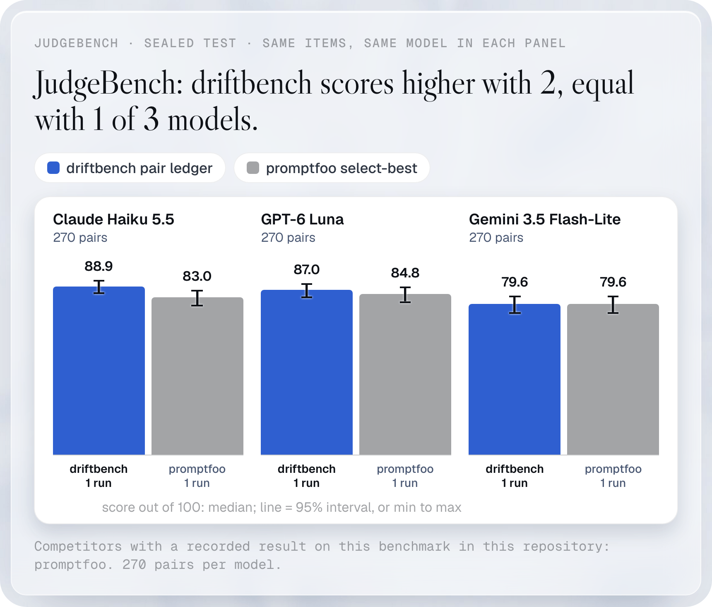
  </picture>
</a>

Claude Haiku 5.5, 270 pairs. Each judge runs its default settings; driftbench runs its opt-in pair ledger. A refused item counts as wrong.

Unchanged by the v8 default: no metric in this set declares request-fulfillment; the request sequence is byte-identical to the previous default (proof: [39585594216](https://github.com/NexusGPT/driftbench/actions/runs/39585594216)).

**MM-Eval.** driftbench picks the better answer more often than promptfoo, DeepEval, LangWatch, Inspect and Langfuse on the same model: 88.9, against 86.5 for the next best, promptfoo.

<a href="assets/bench-mm-eval-light.png">
  <picture>
    <source media="(prefers-color-scheme: dark)" srcset="assets/bench-mm-eval-dark.png">
    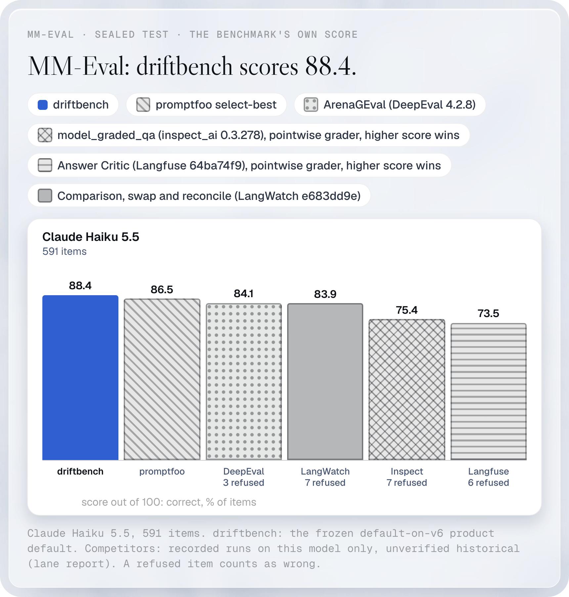
  </picture>
</a>

Claude Haiku 5.5, 591 items. Each judge runs its default settings; driftbench runs its opt-in pair ledger. A refused item counts as wrong (refused: DeepEval 3, LangWatch 7, Inspect 7, Langfuse 6).

Unchanged by the v8 default: no metric in this set declares request-fulfillment; the request sequence is byte-identical to the previous default (proof: [39585594216](https://github.com/NexusGPT/driftbench/actions/runs/39585594216)).

**RubricBench.** driftbench picks the reply that meets the grading criteria more often than DeepEval, promptfoo, LangWatch, Inspect and Langfuse on the same model: 82.7, against 77.6 for the next best, DeepEval.

<a href="assets/bench-rubricbench-light.png">
  <picture>
    <source media="(prefers-color-scheme: dark)" srcset="assets/bench-rubricbench-dark.png">
    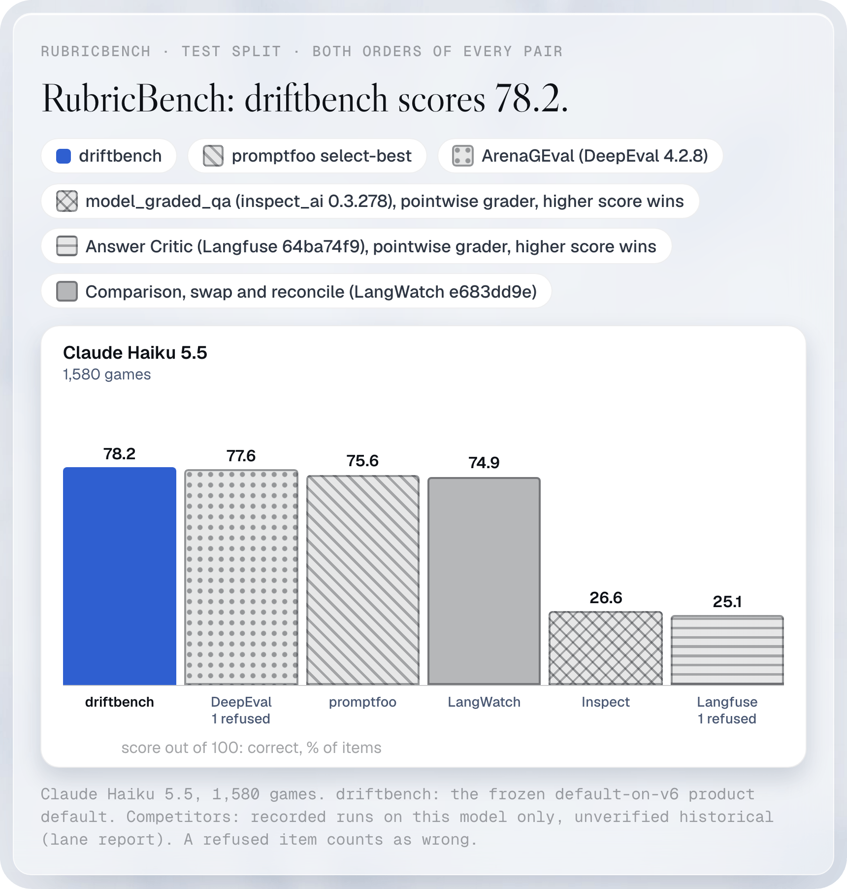
  </picture>
</a>

Claude Haiku 5.5, 1,580 games. Each judge runs its default settings; driftbench runs its opt-in pair ledger. A refused item counts as wrong (refused: DeepEval 1, Langfuse 1).

Unchanged by the v8 default: no metric in this set declares request-fulfillment; the request sequence is byte-identical to the previous default (proof: [39585594216](https://github.com/NexusGPT/driftbench/actions/runs/39585594216)).

**Verify.** driftbench decides whether the final answer is correct 74.2 times in 100, within 0.9 points of the top score (Langfuse, 75.1) and above Inspect (73.3), LangWatch (73.3), promptfoo (71.9) and DeepEval (58.8).

<a href="assets/bench-verify-light.png">
  <picture>
    <source media="(prefers-color-scheme: dark)" srcset="assets/bench-verify-dark.png">
    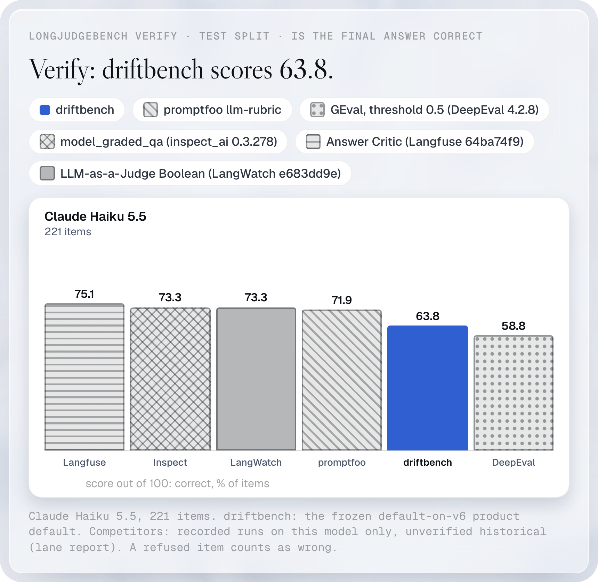
  </picture>
</a>

Claude Haiku 5.5, 221 items. Each judge runs its default settings; driftbench runs its opt-in frozen verify cascade. A refused item counts as wrong.

Unchanged by the v8 default: no metric in this set declares request-fulfillment; the request sequence is byte-identical to the previous default (proof: [39585594216](https://github.com/NexusGPT/driftbench/actions/runs/39585594216)).

**Writing.** driftbench picks the reply readers prefer more often than DeepEval, promptfoo, LangWatch, Langfuse and Inspect on the same model: 67.6, against 58.4 for the next best, DeepEval.

<a href="assets/bench-writing-light.png">
  <picture>
    <source media="(prefers-color-scheme: dark)" srcset="assets/bench-writing-dark.png">
    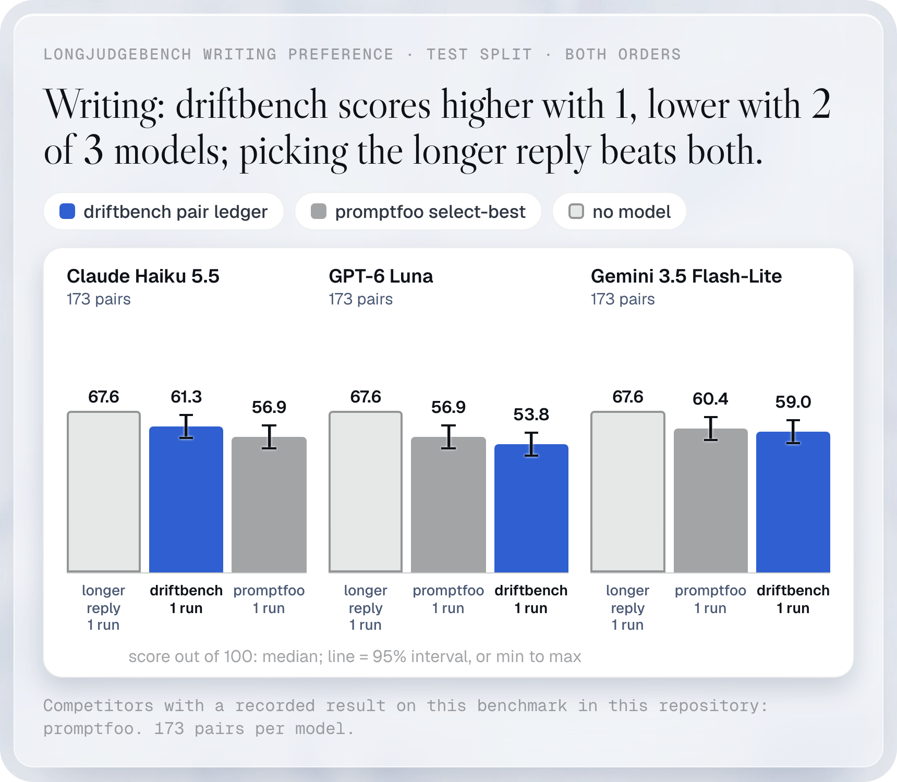
  </picture>
</a>

Claude Haiku 5.5, 346 games. Each judge runs its default settings; driftbench runs its opt-in pair ledger. A refused item counts as wrong. The driftbench bar uses its opt-in reader-first setting (long-structured), which scores the same as a rule that always picks the longer reply, 67.6; the default setting scores 61.3.

Unchanged by the v8 default: no metric in this set declares request-fulfillment; the request sequence is byte-identical to the previous default (proof: [39585594216](https://github.com/NexusGPT/driftbench/actions/runs/39585594216)).

<!-- readme-charts:end -->

<a href="comparison/methods.md#public-benchmarks-against-promptfoo">How we measured</a>

## A panel, only when unsure

<a href="../.github/readme/mm-eval-sealed-test-light.png">
  <picture>
    <source media="(prefers-color-scheme: dark)" srcset="../.github/readme/mm-eval-sealed-test-dark.png">
    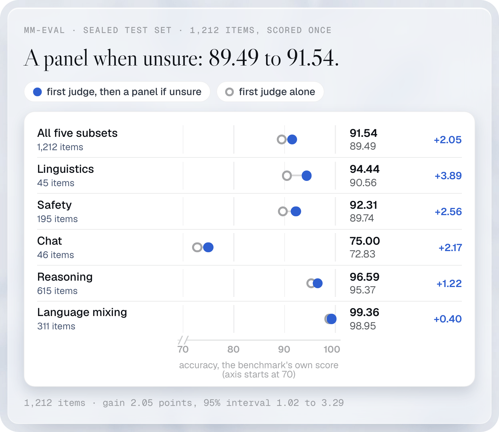
  </picture>
</a>

<a href="comparison/methods.md#mm-eval-a-panel-only-when-unsure">How we measured</a>

A panel that sees only the unsure cases lifts the MM-Eval score from 89.49 to 91.54 on 1,212 sealed items, a gain of 2.05 points with a 95% interval of 1.02 to 3.29.

MM-Eval is a public benchmark for judges. Only 48 items went to the panel, and cost per 100 items rose from $0.2471 to $0.2646.

<!-- readme-v7:start -->
## The shipped judge against DeepEval

<a href="../.github/readme/judge-leads-light.png">
  <picture>
    <source media="(prefers-color-scheme: dark)" srcset="../.github/readme/judge-leads-dark.png">
    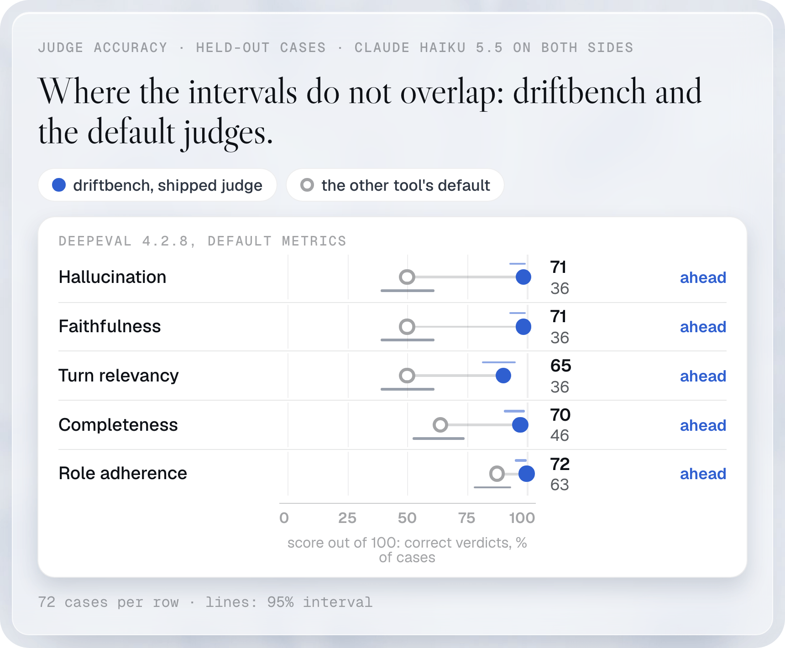
  </picture>
</a>

<a href="comparison/methods.md#the-judge-on-hard-cases">How we measured</a>

On hallucination, faithfulness, turn relevancy, completeness and role adherence, default-on-v7 scores above DeepEval beyond the separate 95% intervals.

## Hard cases, framework by framework

The v7 run returns 2,700 items across 18 rows on Claude Haiku 5.5. Peers keep their recorded answers. Earlier driftbench rows used `claude -p` with old prompts (knowledge retention mostly used the Messages API); v7 uses `createDefaultJudge` over the Anthropic Messages API. The transport difference is part of this comparison.

<a href="../.github/readme/hard-deepeval-light.png">
  <picture>
    <source media="(prefers-color-scheme: dark)" srcset="../.github/readme/hard-deepeval-dark.png">
    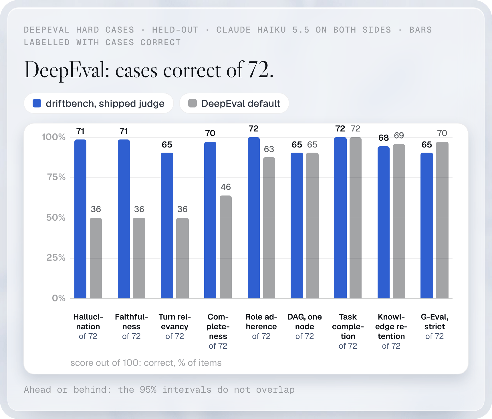
  </picture>
</a>

<a href="comparison/methods.md#the-judge-on-hard-cases">How we measured</a>

<a href="../.github/readme/hard-promptfoo-light.png">
  <picture>
    <source media="(prefers-color-scheme: dark)" srcset="../.github/readme/hard-promptfoo-dark.png">
    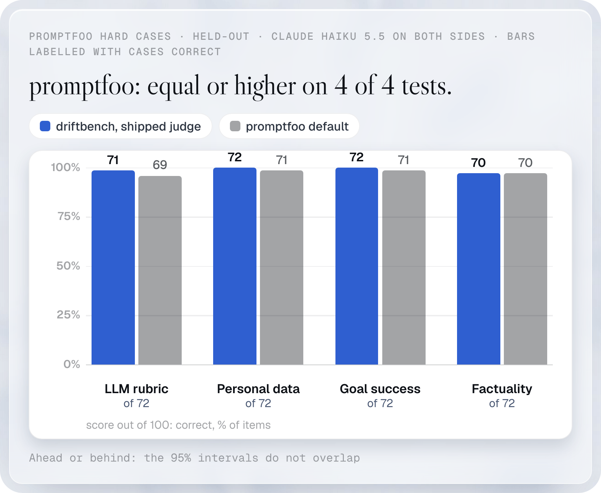
  </picture>
</a>

<a href="comparison/methods.md#the-judge-on-hard-cases">How we measured</a>

<a href="../.github/readme/hard-langfuse-light.png">
  <picture>
    <source media="(prefers-color-scheme: dark)" srcset="../.github/readme/hard-langfuse-dark.png">
    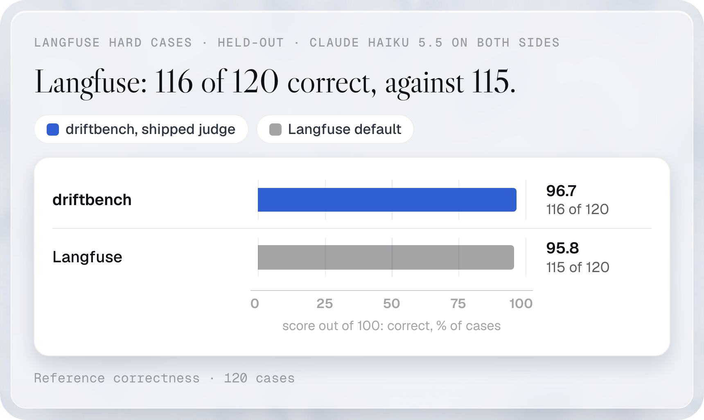
  </picture>
</a>

<a href="comparison/methods.md#the-judge-on-hard-cases">How we measured</a>

| Judge row | Cases | driftbench correct | Recorded peer correct | Standing |
|---|---:|---:|---:|---|
| Turn relevancy | 72 | 72 | 36 | lead |
| DAG, one node | 72 | 72 | 65 | close |
| Role adherence | 72 | 72 | 63 | lead |
| Completeness | 72 | 72 | 46 | lead |
| Hallucination | 72 | 72 | 36 | lead |
| Faithfulness | 72 | 72 | 36 | lead |
| Task completion | 72 | 72 | 72 | close |
| G-Eval strict * | 480 | 480 | 451 | lead |
| Knowledge retention | 1,272 | 1,271 | 1,272 | close |
| LLM rubric | 72 | 72 | 69 | close |
| Factuality | 72 | 72 | 70 | close |
| Personal data | 72 | 72 | 71 | close |
| Goal success | 72 | 72 | 71 | close |
| Reference correctness | 120 | 119 | 115 | close |
| Model-graded QA | 60 | 58 | 57 | close |
| Model-graded fact | 60 | 58 | 59 | close |
| Grader panel | 60 | 54 | 59 | close |
| Panel, borderline | 60 | 60 | 60 | close |

* G-Eval strict is the v8 default on a metric declaring request-fulfillment: 480/480, against the same recorded peer’s 451/480. This replaces the historical v7 result of 479/480. G-Eval strict and knowledge retention retain exact paired tests, Holm over those two rows. Other standings retain separate Wilson 95% intervals. Close means no separation under that rule.

For the fourteen other README datasets: Unchanged by the v8 default: no metric in this set declares request-fulfillment; the request sequence is byte-identical to the previous default (proof: [39585594216](https://github.com/NexusGPT/driftbench/actions/runs/39585594216)).

Inconclusive answers count wrong (Knowledge retention: 1; Reference correctness: 1; Grader panel: 4). They stay in the score denominator and leave the peer paired tests. Grader panel falls from 59 to 54 correct against the earlier driftbench answers; this is included in the secondary analysis.

[Results, analysis and reproduction](../comparisons/default-on/readme-v7/RESULT.md). Historical public benchmark rows below retain their recorded judge versions and settings.
<!-- readme-v7:end -->

## The numbers

The table holds the numbers of the five charts. DeepEval, Inspect, Langfuse and LangWatch run their default judge; driftbench and promptfoo are the recorded cells. Each comparison is a paired exact test of driftbench against one tool, on the same items.

<!-- readme-table:start -->
| Benchmark | driftbench | promptfoo | DeepEval | Inspect | Langfuse | LangWatch |
|---|---:|---:|---:|---:|---:|---:|
| JudgeBench, 270 pairs | 88.9 | 83.0 | 86.3 | 80.0 | 74.8 | 83.7 |
| MM-Eval, 591 items | 88.9 | 86.5 | 84.1 | 75.4 | 73.5 | 83.9 |
| RubricBench, 1,580 games | 82.7 | 75.6 | 77.6 | 26.6 | 25.1 | 74.9 |
| LongJudgeBench verify, 221 items | 74.2 | 71.9 | 58.8 | 73.3 | 75.1 | 73.3 |
| LongJudgeBench writing, 346 games (footnote) | 67.6 | 56.9 | 58.4 | 11.6 | 14.5 | 52.6 |

Footnote: the driftbench figure for writing uses its opt-in reader-first setting (long-structured); the default setting scores 61.3.
<!-- readme-table:end -->

- Verify: Langfuse scores 0.9 points above driftbench. On the paired items driftbench alone is right on 13 and Langfuse alone on 15 (raw p 0.85).
- Writing: the reader-first setting picks the longer reply on all 173 pairs, so its 67.6 equals a longer-reply rule.
- The verify column here is Claude Haiku 5.5 (driftbench 74.2, promptfoo 71.9). The 74.7 and 72.4 in [the public benchmark table](comparison/methods.md) are GPT-6 Luna, a different model.
- A few items stay undecided after three passes because the model refused them. They count as wrong for the contestant. Undecided items: MM-Eval 3 to 7 per peer, RubricBench 1 each for DeepEval and Langfuse.
- Inspect and Langfuse scores on RubricBench and writing are low because a pointwise grader returns equal scores for many pairs, and a tie counts as wrong.

Per benchmark tables with paired counts, p values and spend: [JudgeBench](comparison/benchmarks/judgebench-all-peers.md), [MM-Eval](comparison/benchmarks/mmeval-all-peers.md), [RubricBench](comparison/benchmarks/rubricbench-all-peers.md), [verify](comparison/benchmarks/verify-all-peers.md), [writing](comparison/benchmarks/writing-all-peers.md). The sealed items are not committed. To rebuild them:

1. Run the RubricBench loader, `node --experimental-strip-types examples/all-peers-public/rubricbench-loader/load.mts <out.json>`. It downloads the RubricBench rows from Hugging Face (cached on disk), keeps the 790 sealed test ids listed in `test-ids.json` and writes them as JSON.
2. Run `python examples/all-peers-public/export.py --items-only --rubricbench-items <out.json>`. It rebuilds all five item files and checks each against the committed sha256.
3. Re-score offline with `python examples/all-peers-public/stats.py`.

## Verify v5: corrected confirmation

The verify candidate's primary result uses the 536 confirmation items whose normalized question text appears
in neither practice nor DEV. The original 544-item split leaked 8 practice questions and reused 32 practice
call references. The frozen manifest and decisions are preserved; the full result is a sensitivity analysis.
Scores are percent correct.

| Verify v5 analysis | driftbench-v5 | promptfoo | DeepEval | Inspect | Langfuse | LangWatch |
|---|---:|---:|---:|---:|---:|---:|
| Primary, 536 items without practice/DEV question overlap | 78.73 | 76.87 | 60.26 | 76.49 | 75.75 | 75.19 |
| Sensitivity, original 544 items including overlap | 78.86 | 77.21 | 60.85 | 76.84 | 75.92 | 75.18 |
| LJB TEST, 221 items | 76.02 | 75.57 | 58.82 | 73.30 | 75.11 | 73.30 |

On the 536 primary items, driftbench-v5 scores 78.73%; DeepEval scores 60.26%, a significant difference after exact paired tests
with Holm over the five peers. promptfoo (76.87%), Inspect (76.49%), Langfuse (75.75%) and LangWatch (75.19%) are within the
paired-test noise. The exclusion is a post-review correction using recorded decisions, with no new model calls. [Full results and exclusions](../examples/verify-lead/RESULTS.md).

## What a judgement costs

<a href="../.github/readme/judge-cost-light.png">
  <picture>
    <source media="(prefers-color-scheme: dark)" srcset="../.github/readme/judge-cost-dark.png">
    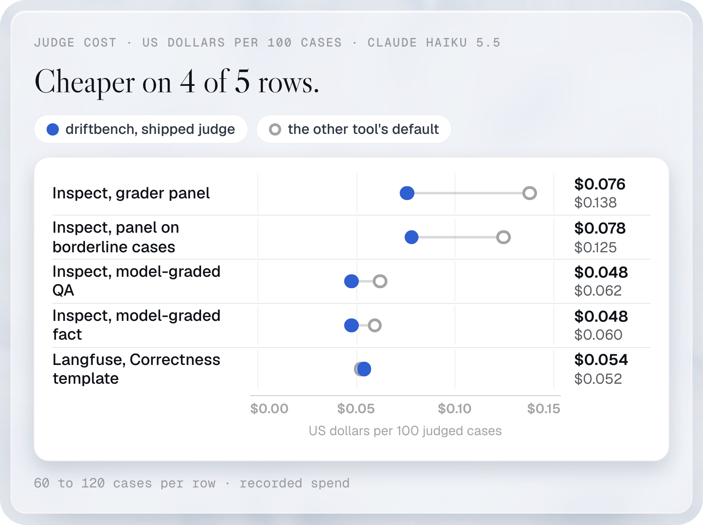
  </picture>
</a>

<a href="comparison/methods.md#what-a-judgement-costs">How we measured</a>

On Inspect's grader panel, default-on-v7 spends $0.065 per 100 cases against $0.138, and scores 54 of 60 against 59. Lower cost does not establish equal accuracy.
