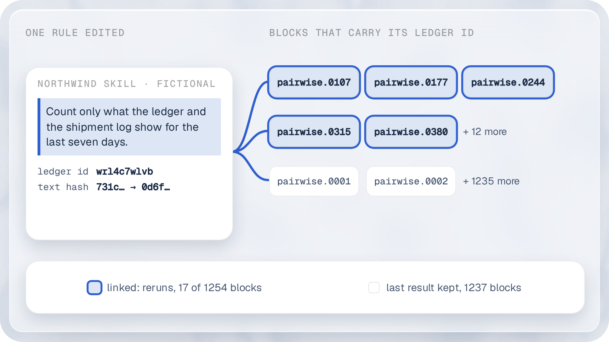

# From a rule to its tests

A rule of an agent's prompt has an id that survives an edit, the ledger id. Each test block that checks the rule carries that id. So a change to the rule finds its tests, and deleting the rule shows which of those links hold.

This page runs the whole path on the fictional Northwind estate (`examples/estates/fixture`). No step calls a model: the scan replays the recorded labeler answers, and the runs use the stand-in runtime of the fixture. The estate is a Claude Code estate; [testing an estate](estate.md) explains each command.

## The path

| Step | Command | What it writes | The id that ties it to the next step |
|---|---|---|---|
| 1. Cut | `estate scan --pointer --update` | `map.yaml`, `ledger.json` | the ledger id of each unit |
| 2. Write blocks | `estate generate` | one spec per test | `metadata.links` of each block names the rule and its ledger id |
| 3. Edit | `radius ledger` | `change.yaml` | the atom of the changed unit |
| 4. Select | `radius` | the blocks to rerun | the atom in the change and in the links |
| 5. Prove | `estate mutate --delete`, `estate prove` | `verified` or `refuted` on each link | the atom, or its ledger id |

## Set up

Work in a copy, so the repository stays as it is. The copy leaves out the committed suite, which step 2 writes again.

```
mkdir -p walk && cp -R examples/estates/fixture walk/northwind
rm -rf walk/northwind/generated
cd walk
```

The commands below run from `walk`. In a clone, put `pnpm -s` in front of `driftbench`.

## 1. Cut the prompt into units

```
driftbench estate scan northwind --out map.yaml --pointer --cassette northwind/cassette.jsonl --ledger ledger.json --update
```

The lines that matter:

```
Wrote map.yaml: 116 atoms (47 read by code and approved, 69 split from prose by the model and waiting for approval), 55 edges.
  Units: 136 in 11 files; 0 kept from the ledger, 134 labelled by this run (21 by system 1, 113 by system 2), 2 unlabeled; the runs of one labeler disagreed on 2 units; the runs drew the spans of 31 units differently, and the first run's spans stand; 69 atoms; 30 notes (spans or links) were dropped, listed below.
  Requests: 91 answered, 0 sent, 0 recorded.
```

Code cut 11 prose files into 136 units. A labeler pointed at 134 of them, and 69 became atoms. The ledger holds one entry per unit. This is the entry of the sentence that the weekly report skill states (five of its fields):

```
{
  "id": "wrl4c7wlvb",
  "fp": "731c59e8e7713e95",
  "path": ".claude/skills/weekly-report/SKILL.md",
  "status": "live",
  "quote": "Count only what the ledger and the shipment log show for the last seven days."
}
```

Two values name the unit, and they differ in what an edit does to them:

* The ledger id, `id`, is a stable id that survives edits. The ledger makes it once and keeps it as the file changes: the unit stays the same unit when its text is edited, moved, split or merged.
* The text fingerprint, `fp`, is the hash of the unit's text. It changes on every edit.

Approve the atoms and plan the tests. The plan holds one row per test, and `plan approve --all` approves them all.

```
driftbench estate approve map.yaml --all --to approved.yaml
driftbench estate map approved.yaml --to space.yaml --agent northwind
driftbench estate plan approved.yaml --space space.yaml --out plan.yaml
driftbench estate plan approve plan.yaml --all
```

## 2. Blocks that carry the rule

```
driftbench estate generate --map approved.yaml --plan plan.yaml --out generated --states northwind/live/states/library.json
```

```
Asks of the complete specs: 0 approved phrases, 1275 written by code, 0 recorded sessions, 8 with no ask.
Wrote 1455 files to generated.
```

The command exits 1 while some specs stay incomplete; its gap list names what each one needs. Every block it writes carries its links in `metadata.links`. This is the head of the spec that tests the sentence above:

```
  links:
    - block: ask
      to:
        kind: rule
        rule: instruction.weekly-report.count-only-what-the-ledger-and
        ledger: wrl4c7wlvb
      relation: verifies
      status: declared
      created_by: generator
      at_version: db9e07132a1b
```

The `rule` link names the atom and, because the pointer reader built the atom, its ledger id. `verifies` says the block tests the rule, and `declared` says an author or a generator wrote the link and nothing has proved it yet. The links stay out of the spec hash, so adding one never invalidates a recorded run. The other link kinds, `plan_row` and `source_turn`, are in the [change manifest reference](reference/change.md).

## 3. Edit a rule, and read the edit by its id

Change the sentence: seven days becomes fourteen.

```
sed -i.bak 's/for the last seven days/for the last fourteen days/' northwind/.claude/skills/weekly-report/SKILL.md
```

A new scan would ask the labeler about the changed text. `radius ledger` reads the files as they are and calls no labeler:

```
driftbench radius ledger map.yaml --ledger ledger.json --out change.yaml
```

```
Units: 133 unchanged, 2 context, 0 moved, 1 changed, 0 deleted, 0 new.
  1 unit reruns, 2 advisory only; 1 change.
Wrote change.yaml.
```

```
from: db9e07132a1b
to: working
changes:
  - kind: prompt
    id: instruction.weekly-report.count-only-what-the-ledger-and
    note: "unit wrl4c7wlvb: changed"
```

The ledger found the unit by its ledger id although its text no longer matches the old text. A small script shows the two values side by side:

```
// file: fp.mts
import { readFileSync } from 'node:fs';
import { pointer } from '@agent-nexus/driftbench-estate';

const ledger = JSON.parse(readFileSync('ledger.json', 'utf8'));
const unit = ledger.entries.find((entry: { id: string }) => entry.id === 'wrl4c7wlvb');
const edited = unit.quote.replace('seven days', 'fourteen days');
console.log(`ledger id        ${unit.id}  (kept in ledger.json)`);
console.log(`text fingerprint ${unit.fp}  before the edit`);
console.log(`text fingerprint ${pointer.fingerprint(edited)}  after the edit`);
```

```
ledger id        wrl4c7wlvb  (kept in ledger.json)
text fingerprint 731c59e8e7713e95  before the edit
text fingerprint 0d6f948324059b44  after the edit
```

The fingerprint moves and the ledger id stays. That is why the link of step 2 still reaches the unit after the edit.

## 4. Rerun only what the edit reaches

```
driftbench radius generated/specs/live --change change.yaml
```

```
Blast radius of db9e07132a1b to working (manifest 8c243c6f4bcb): prompt:instruction.weekly-report.count-only-what-the-ledger-and.
1248 specs, 1251 blocks.
Mode F, free-running: 16 of 1251 blocks in the radius (16 direct, 0 forward), 1235 out. 16 of 1248 cells.
  A cell reruns whole: 16 of 1251 blocks sent, 98.7% saved; 1232 of 1248 cells left to carry.
```

<p align="center">
  <picture>
    <source media="(prefers-color-scheme: dark)" srcset="../.github/readme/rule-links-dark.png">
    
  </picture>
</p>

Sixteen blocks rerun and 1,235 keep their last result. `campaign run --change change.yaml --from <campaign>` runs that selection and carries the rest.

## 5. Prove a link by deleting its rule

A `declared` link is a claim. `estate mutate --delete` builds a copy of the estate without the rule's line. `estate prove` reads the runs of the same specs on the original and on the copy. A block that passes on the original and fails on the copy flips; a linked block that flips proves its link.

The links of the committed Northwind suite name the atom and its ledger id. `--delete` takes an atom id or a ledger id, and `estate prove` matches either. This step uses the gate of the invoice reconcile skill, which orders a read of the matching rules before a line is matched, and the 15 specs of the committed suite that name it. It still runs from `walk`, with the fixture by its full path:

```
F=$(cd ../examples/estates/fixture && pwd)
A=gate.invoice-reconcile.read-references-matching-rules-md-before
SPECS=$(grep -rl -- "^      - $A$" $F/generated/specs/live)
driftbench estate mutate $F/approved.yaml --delete $A --to mutant
```

```
Mutant: delete gate.invoice-reconcile.read-references-matching-rules-md-before in .claude/skills/invoice-reconcile/SKILL.md.
  before: 1. Read `references/matching-rules.md` before matching any line.
  after:  (the line is gone)
  map db9e07132a1b -> fcf231475ca8
  collateral: reference.invoice-reconcile.read-references-matching-rules-md
Wrote mutant: the estate copy, map.yaml and mutant.json.
```

Run the 15 specs on the original and on the mutant, with the stand-in runtime of the fixture, and prove:

```
FAKE=$F/live/fake
driftbench estate run $SPECS --estate $F --runtime claude-code --command $FAKE/claude.mjs --set-env "FAKE_MANIFEST=$FAKE/manifest.json" --store original.db --map $F/approved.yaml --states $F/live/states/library.json
driftbench estate run $SPECS --estate mutant --runtime claude-code --command $FAKE/claude.mjs --set-env "FAKE_MANIFEST=$FAKE/manifest.json" --store mutant.db --states $F/live/states/library.json
driftbench estate prove $SPECS --mutant mutant --original original.db --mutated mutant.db
```

```
15 specs run live on a stand-in: 15 pass, 0 fail.
15 specs run live on a stand-in: 0 pass, 15 fail.
Proof of gate.invoice-reconcile.read-references-matching-rules-md-before (ledger 4wfcnk2irw) by the mutant delete fcf231475ca8: 15 blocks, 15 linked, 15 flipped.
  verified   15  linked: pass on the original, fail on the mutant
  refuted    0  linked: pass on both
  unproved   0  linked: no pass on the original, or no outcome on the mutant
  unlinked   0  flipped with no link to the rule
The blocks that flip are the linked blocks.
```

Read it row by row:

* `verified`: 15 linked blocks pass with the rule and fail without it. The links hold.
* `refuted`: a `verifies` link whose block passes on both estates. The block does not test the rule, and the link is wrong. None here.
* `unlinked`: a block that flips although no link names the rule. The links miss a test. None here.
* `exercised`: a link of a negative control, which checks that the rule does not act outside its trigger, so deleting the rule cannot flip it. None among these 15.

The command exits 0 when the blocks that flip are exactly the linked blocks, and 1 when they differ. `--write` writes `verified` and `refuted` into the spec files, in `metadata.links`, outside the spec hash.

## Limits

* The asks of the blocks written in step 2 come from code, not from approved phrases, and most of those blocks carry a judged criterion. A judged criterion has no verdict without a configured judge, so step 5 runs the 15 specs of the committed suite that name a gate, which machine checks decide.
* A model labeler is not exact. In the scan above, 2 of 136 units have no label and the runs of one labeler disagreed on 2 units. A unit without a label is not an atom, so no block links to it.
* A `unit` change, the change of a unit that holds no atom, keeps the radius the whole suite and prints an advisory selection. The edit above hit a unit with an atom, so it became a `prompt` change and selected 16 blocks.
* Measured on one suite, the Acme stand-in, with one agent model: on 274 mutants of the prompt, the selection of the ledger path with the rerun marks missed a flipped block on 0 of 274 (Wilson 95% upper bound 1.38%, mean selection ratio 0.513). Without the marks it missed 9 of 274 (6.12%). The result does not say that the procedure holds on another suite. Source: `research/ledger-h7/RESULT-ledger.md`.
* The proof is as good as the runs behind it. The stand-in follows the rules of the estate in its folder, so a flip shows that the specs test the rule, not how a real agent behaves.

## Where it lives

* [Testing an estate](estate.md#reading-the-prose-by-pointing-estate-scan---pointer): the pointer reader, the label sets and the ledger.
* [Testing an estate](estate.md#the-radius-on-the-ledger): the edit classes and their rerun sets.
* [Blast radius](concepts/blast-radius.md): changes, links and the H7 study.
* [The estate chain](estate-chain.md): every step of the estate flow, proved by one test.
* [What you can change in an estate](estate-settings.md): the settings file, the label sets, the labelers and the ledger.
